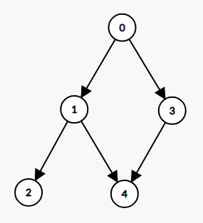
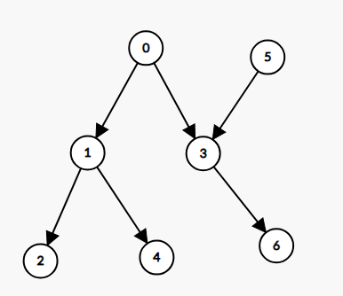
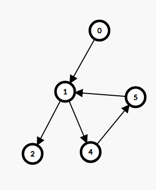
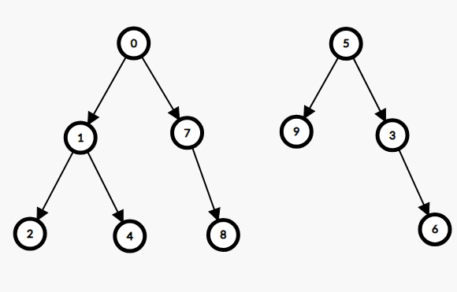
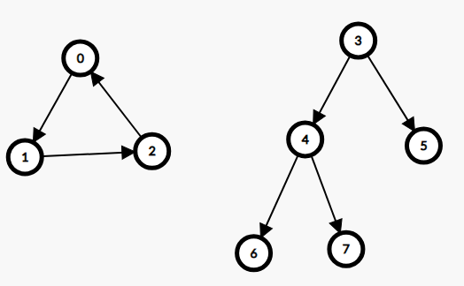

# 🚀 93.31% || BFS & DFS || Explained Intuition🚀

**Author:** MohamedMamdouh20
**Votes:** 102
**Link:** [https://leetcode.com/problems/validate-binary-tree-nodes/solutions/4176918/](https://leetcode.com/problems/validate-binary-tree-nodes/solutions/4176918/)

---

# Porblem Description

Given `n` binary tree nodes numbered from `0` to `n - 1`, represented by arrays `leftChild` and `rightChild` where each element corresponds to the `left` and `right` child of a node respectively, **determine** if the provided nodes **form** exactly one **valid** binary tree. 
A node with **no left** child is represented by `-1` in the `leftChild` array, and **similarly** for a node with **no right** child in the `rightChild` array. 
The **goal** is to verify if the given nodes, identified solely by their numbers, constitute a **valid** binary tree structure.

- **Constraints:**
    - `n == leftChild.length == rightChild.length`
    - `1 <= n <= 10e4`
    - `-1 <= leftChild[i], rightChild[i] <= n - 1`


---

# Intuition

Hi there, \uD83D\uDE03

Let's deep dive\uD83E\uDD3F in our today's Interesting problem.
The goal in our ptoblem is to **validate** if a given nodes can form a **valid Binary Tree Structure**\uD83C\uDF32.

But what is the structure of a binary tree\u2753
- Simply:
    - Each node has only **one parent** (Except for the root).
    - There is only **one root**.
    - Each node has at most **2 children** (leaf nodes have no children).
    - There is **no Cycle**.\uD83D\uDEB4\u200D\u2640\uFE0F

Seems Valid \u2714
Let's take a look at these trees\uD83C\uDF32\uD83C\uDF33.

This is **invalid** Binary Tree, Why?\uD83E\uDD14
node `4` have `2` parents which is invalid.


This is also **invalid** Binary Tree, Why?\uD83E\uDD14
There are `2` roots which are `0` and `5`.


For sure, this is not a Binary Tree\uD83D\uDE20, Why?
It has a **cycle**\uD83D\uDEB4\u200D\u2640\uFE0F, 1 -> 4 -> 5 -> 1 -> 4 .....


This is a strange tree, or two trees ?\uD83E\uDD28
This graph has **multiple components** and **multiple roots**.

**Multiple components** is when the graph has more than one piece like the last example.


This also strang \u2049\uD83E\uDD2F
This graph has **multiple components** but has only **one root**.
which means that we must check for multiple **components** and multiple **root** **seperately**.

I think we have a full picture \uD83D\uDDBC now about what will we do now.
- Since we have **two arrays** indicating `left` and `right` children for each node then:
    - We will iterate over them to see if a node has **two parents**.
    - Search for the **root** that has no parents and if there are **multiple roots** then return `false`.
    - Check for **cycles**.
    - Check for **multiple components**.

But how to check for cycles and multiple components?\uD83E\uDD14
We want to traverse the graph to check that But any known traverse algorithms?\uD83E\uDD14
YES, our today's heros\uD83E\uDDB8\u200D\u2642\uFE0F **BFS** and **DFS**.

We can use any algorithm of them and while using them we maintain `visited` array to mark nodes that were visited before and if we visited them again then we are sure there is a **cycle**.\uD83D\uDEB4\u200D\u2640\uFE0F
But how to check for multiple componenets.\uD83E\uDD28
Simply, if we started **BFS** or **DFS** from the root and the given graph is a tree with only one connected component then for sure all nodes in visited array are **true** otherwise there will  be some `true elements and false elements`.
These are the **full** steps to solve todays problem.

And this is the solution for our today'S problem I hope that you understood it\uD83D\uDE80\uD83D\uDE80


---


# Proposed Approach
## BFS or DFS
1. Create an array called `childCount` of size `n` to **track** child which nodes **have** parents.
2. **Update Child Count**:
   - Iterate through the `leftChild` array and For each left child:
       - If the left child exists (not -1), **mark** it as having a parent by setting `childCount[child]` to **true**.
   - Iterate through the `rightChild` array and For each right child:
       - If the right child exists (not -1), **mark** it as having a parent by setting `childCount[child]` to **true**.
       - If `childCount[child]` is **true**. Then there's `multiple parents for this child`.
3. **Determine Root Node**:
   - Initialize a variable `root` to -1 (indicating no root found yet).
   - Iterate through the `childCount` array and For each node:
       - If the node has no parent (childCount[node] is **false**):
         - If `root` is -1 (no root assigned yet), set `root` to the current node.
         - If `root` is not -1 (`root already assigned`):
           - Return **false**, indicating multiple roots found.
4. After that, If `root` is still -1 (`no root found`):
     - Return **false**, indicating no root found (`not a valid binary tree`).
5. **Breadth-First Search for Valid Binary Tree (isBinaryTreeValid)**:
   - Initialize a `visited` array to **track** visited nodes and `queue` for BFS traversal.
   - Mark the **root** node as **visited** and **enqueue** it.
   - While the `queue` is not empty:
     - **Dequeue** a node and mark it as the current node.
     - Check the **left** child of the current node:
       - If it exists and is already **visited**, return **false** (`cycle detected`).
       - **Enqueue** the **left** child and mark it as **visited**.
     - Check the **right** child of the current node:
       - If it exists and is already **visited**, return **false** (`cycle detected`).
       - Enqueue the right child and mark it as visited.
   - **After** BFS, check if all nodes were visited:
     - If any node is **unvisited**, return **false**, indicating there's `multiple components`.
   - Return **true**, indicating a `valid binary tree`.
5. **Depth-First Search for Valid Binary Tree (isBinaryTreeValid)**
    - It has the same steps like BFS but we will traverse through the tree recursively.


## Complexity
- **Time complexity:** $O(N)$
Since we are Check for parents in `leftChild` array with cost `N` then Check for parents in `rightChild` array with cost `N` then search for `root` with cost `N` then doing `BFS` or `DFS` and we will traverse at most all nodes with cost `N` then we check for `multiple compenets` with cost `N`.
The total cost is `5 * N` which is `O(N)`.
- **Space complexity:** $O(N)$
Since we are storing if child has parent with cost `N` and `visited` array with cost `N` and the `queue` at most can have `N` nodes with cost `N`.
The total cost is `3 * N` which is `O(N)`.


---


# Code
## 1. BFS
``` C++ []
class Solution {
public:
    // Breadth-First Search to check if the given nodes form a valid binary tree
    bool isBinaryTreeValid(int root, vector<int>& leftChild, vector<int>& rightChild) {
        vector<bool> visited(leftChild.size(), false); // Tracks visited nodes
        queue<int> nodeQueue; // Queue for BFS traversal
        nodeQueue.push(root);
        visited[root] = true;

        while (!nodeQueue.empty()) {
            int current = nodeQueue.front();
            nodeQueue.pop();

            // Check left child
            if (leftChild[current] != -1) {
                if (visited[leftChild[current]]) // Check for cycle
                    return false;

                nodeQueue.push(leftChild[current]);
                visited[leftChild[current]] = true; // Mark left child as visited
            }

            // Check right child
            if (rightChild[current] != -1) {
                if (visited[rightChild[current]]) // Check for cycle
                    return false;

                nodeQueue.push(rightChild[current]);
                visited[rightChild[current]] = true; // Mark right child as visited
            }
        }

        // Check if there is multiple components
        for(int i = 0 ; i < visited.size() ; i ++)
            if(!visited[i])
                return false ;

        return true; // All nodes form a valid binary tree
    }

    bool validateBinaryTreeNodes(int n, vector<int>& leftChild, vector<int>& rightChild) {
        vector<bool> childCount(n, false); // Tracks child count for each node

        // Update child count based on leftChild
        for (auto child : leftChild) {
            // Check if node has child
            if (child != -1)
                childCount[child] = true; // Mark left child as having a parent
        }

        // Update child count based on rightChild
        for (auto child : rightChild) {
            // Check if node has child
            if (child != -1) {
                if (childCount[child]) // Check if the right child already has a parent
                    return false;

                childCount[child] = true; // Mark right child as having a parent
            }
        }

        int root = -1; // Root node
        for (int i = 0; i < n; ++i) {
            if (!childCount[i]) {
                if (root == -1)
                    root = i; // Set root node if not assigned
                else
                    return false; // Multiple roots found, not a valid binary tree
            }
        }

        if (root == -1)
            return false; // No root found, not a valid binary tree

        return isBinaryTreeValid(root, leftChild, rightChild); // Check if the tree is valid
    }
};
```
```Java []
class Solution {
    
    // Breadth-First Search to check if the given nodes form a valid binary tree
    private boolean isBinaryTreeValid(int root, int[] leftChild, int[] rightChild) {
        boolean[] visited = new boolean[leftChild.length]; // Tracks visited nodes
        Queue<Integer> nodeQueue = new LinkedList<>(); // Queue for BFS traversal
        nodeQueue.offer(root);
        visited[root] = true;

        while (!nodeQueue.isEmpty()) {
            int current = nodeQueue.poll();

            // Check left child
            if (leftChild[current] != -1) {
                if (visited[leftChild[current]]) // Check for cycle
                    return false;

                nodeQueue.offer(leftChild[current]);
                visited[leftChild[current]] = true; // Mark left child as visited
            }

            // Check right child
            if (rightChild[current] != -1) {
                if (visited[rightChild[current]]) // Check for cycle
                    return false;

                nodeQueue.offer(rightChild[current]);
                visited[rightChild[current]] = true; // Mark right child as visited
            }
        }

        // Check if there are multiple components
        for (boolean visit : visited) {
            if (!visit)
                return false;
        }

        return true; // All nodes form a valid binary tree
    }

    public boolean validateBinaryTreeNodes(int n, int[] leftChild, int[] rightChild) {
        boolean[] childCount = new boolean[n]; // Tracks child count for each node

        // Update child count based on leftChild
        for (int child : leftChild) {
            // Check if node has child
            if (child != -1)
                childCount[child] = true; // Mark left child as having a parent
        }

        // Update child count based on rightChild
        for (int child : rightChild) {
            // Check if node has child
            if (child != -1) {
                if (childCount[child]) // Check if the right child already has a parent
                    return false;

                childCount[child] = true; // Mark right child as having a parent
            }
        }

        int root = -1; // Root node
        for (int i = 0; i < n; ++i) {
            if (!childCount[i]) {
                if (root == -1)
                    root = i; // Set root node if not assigned
                else
                    return false; // Multiple roots found, not a valid binary tree
            }
        }

        if (root == -1)
            return false; // No root found, not a valid binary tree

        return isBinaryTreeValid(root, leftChild, rightChild); // Check if the tree is valid
    }

}
```
```Python []
from queue import Queue
class Solution:
    def isBinaryTreeValid(self, root: int, leftChild: List[int], rightChild: List[int]) -> bool:
        visited = [False] * len(leftChild)  # Tracks visited nodes
        nodeQueue = Queue()  # Queue for BFS traversal
        nodeQueue.put(root)
        visited[root] = True

        while not nodeQueue.empty():
            current = nodeQueue.get()

            # Check left child
            if leftChild[current] != -1:
                if visited[leftChild[current]]:  # Check for cycle
                    return False

                nodeQueue.put(leftChild[current])
                visited[leftChild[current]] = True  # Mark left child as visited

            # Check right child
            if rightChild[current] != -1:
                if visited[rightChild[current]]:  # Check for cycle
                    return False

                nodeQueue.put(rightChild[current])
                visited[rightChild[current]] = True  # Mark right child as visited

        # Check if there are multiple components
        for visit in visited:
            if not visit:
                return False

        return True  # All nodes form a valid binary tree

    def validateBinaryTreeNodes(self, n: int, leftChild: List[int], rightChild: List[int]) -> bool:
        childCount = [False] * n  # Tracks child count for each node

        # Update child count based on leftChild
        for child in leftChild:
            # Check if node has child
            if child != -1:
                childCount[child] = True  # Mark left child as having a parent

        # Update child count based on rightChild
        for child in rightChild:
            # Check if node has child
            if child != -1:
                if childCount[child]:  # Check if the right child already has a parent
                    return False

                childCount[child] = True  # Mark right child as having a parent

        root = -1  # Root node
        for i in range(n):
            if not childCount[i]:
                if root == -1:
                    root = i  # Set root node if not assigned
                else:
                    return False  # Multiple roots found, not a valid binary tree

        if root == -1:
            return False  # No root found, not a valid binary tree

        return self.isBinaryTreeValid(root, leftChild, rightChild)  # Check if the tree is valid

```


---


## 2. DFS

```C++ []
class Solution {
public:
    // Depth-First Search to check if the given nodes form a valid binary tree
    bool isBinaryTreeValid(int current, vector<int>& leftChild, vector<int>& rightChild, vector<bool>& visited) {
        // Check left child
        if (leftChild[current] != -1) {
            if (visited[leftChild[current]]) // Check for cycle
                return false;
    
            visited[leftChild[current]] = true; // Mark left child as visited
            if(!isBinaryTreeValid(leftChild[current], leftChild, rightChild, visited))
                return false;
        }
    
        // Check right child
        if (rightChild[current] != -1) {
            if (visited[rightChild[current]]) // Check for cycle
                return false;
    
            visited[rightChild[current]] = true; // Mark right child as visited
            if(!isBinaryTreeValid(rightChild[current], leftChild, rightChild, visited))
                return false ;
        }
        return true;
    }

    bool validateBinaryTreeNodes(int n, vector<int>& leftChild, vector<int>& rightChild) {
        vector<bool> childCount(n, false); // Tracks child count for each node

        // Update child count based on leftChild
        for (auto child : leftChild) {
            // Check if node has child
            if (child != -1)
                childCount[child] = true; // Mark left child as having a parent
        }

        // Update child count based on rightChild
        for (auto child : rightChild) {
            // Check if node has child
            if (child != -1) {
                if (childCount[child]) // Check if the right child already has a parent
                    return false;

                childCount[child] = true; // Mark right child as having a parent
            }
        }

        int root = -1; // Root node
        for (int i = 0; i < n; ++i) {
            if (!childCount[i]) {
                if (root == -1)
                    root = i; // Set root node if not assigned
                else
                    return false; // Multiple roots found, not a valid binary tree
            }
        }

        if (root == -1)
            return false; // No root found, not a valid binary tree

        
        vector<bool> visited(n) ; // Tracks visited nodes
        visited[root] = true ;
        if(!isBinaryTreeValid(root, leftChild, rightChild, visited)) // Check if the tree is valid
            return false ;

        // Check if there is multiple components
        for(int i = 0 ; i < visited.size() ; i ++)
            if(!visited[i])
                return false ;

        return true; // All nodes form a valid binary tree
    }
};
```
```Java []
class Solution {
    // Depth-First Search to check if the given nodes form a valid binary tree
    private boolean isBinaryTreeValid(int current, int[] leftChild, int[] rightChild, boolean[] visited) {
        // Check left child
        if (leftChild[current] != -1) {
            if (visited[leftChild[current]]) // Check for cycle
                return false;

            visited[leftChild[current]] = true; // Mark left child as visited
            if (!isBinaryTreeValid(leftChild[current], leftChild, rightChild, visited))
                return false;
        }

        // Check right child
        if (rightChild[current] != -1) {
            if (visited[rightChild[current]]) // Check for cycle
                return false;

            visited[rightChild[current]] = true; // Mark right child as visited
            if (!isBinaryTreeValid(rightChild[current], leftChild, rightChild, visited))
                return false;
        }
        return true;
    }

    public boolean validateBinaryTreeNodes(int n, int[] leftChild, int[] rightChild) {
        boolean[] childCount = new boolean[n]; // Tracks child count for each node

        // Update child count based on leftChild
        for (int child : leftChild) {
            // Check if node has child
            if (child != -1)
                childCount[child] = true; // Mark left child as having a parent
        }

        // Update child count based on rightChild
        for (int child : rightChild) {
            // Check if node has child
            if (child != -1) {
                if (childCount[child]) // Check if the right child already has a parent
                    return false;

                childCount[child] = true; // Mark right child as having a parent
            }
        }

        int root = -1; // Root node
        for (int i = 0; i < n; ++i) {
            if (!childCount[i]) {
                if (root == -1)
                    root = i; // Set root node if not assigned
                else
                    return false; // Multiple roots found, not a valid binary tree
            }
        }

        if (root == -1)
            return false; // No root found, not a valid binary tree

        boolean[] visited = new boolean[n]; // Tracks visited nodes
        visited[root] = true;
        if (!isBinaryTreeValid(root, leftChild, rightChild, visited)) // Check if the tree is valid
            return false;

        // Check if there is multiple components
        for (boolean visit : visited)
            if (!visit)
                return false;

        return true; // All nodes form a valid binary tree
    }
}
```
```Python []
class Solution:
    def isBinaryTreeValid(self, current, leftChild, rightChild, visited):
        # Check left child
        if leftChild[current] != -1:
            if visited[leftChild[current]]:  # Check for cycle
                return False

            visited[leftChild[current]] = True  # Mark left child as visited
            if not self.isBinaryTreeValid(leftChild[current], leftChild, rightChild, visited):
                return False

        # Check right child
        if rightChild[current] != -1:
            if visited[rightChild[current]]:  # Check for cycle
                return False

            visited[rightChild[current]] = True  # Mark right child as visited
            if not self.isBinaryTreeValid(rightChild[current], leftChild, rightChild, visited):
                return False

        return True

    def validateBinaryTreeNodes(self, n, leftChild, rightChild):
        childCount = [False] * n  # Tracks child count for each node

        # Update child count based on leftChild
        for child in leftChild:
            # Check if node has child
            if child != -1:
                childCount[child] = True  # Mark left child as having a parent

        # Update child count based on rightChild
        for child in rightChild:
            # Check if node has child
            if child != -1:
                if childCount[child]:  # Check if the right child already has a parent
                    return False

                childCount[child] = True  # Mark right child as having a parent

        root = -1  # Root node
        for i in range(n):
            if not childCount[i]:
                if root == -1:
                    root = i  # Set root node if not assigned
                else:
                    return False  # Multiple roots found, not a valid binary tree

        if root == -1:
            return False  # No root found, not a valid binary tree

        visited = [False] * n  # Tracks visited nodes
        visited[root] = True
        if not self.isBinaryTreeValid(root, leftChild, rightChild, visited):  # Check if the tree is valid
            return False

        # Check if there is multiple components
        for visit in visited:
            if not visit:
                return False

        return True  # All nodes form a valid binary tree
```


