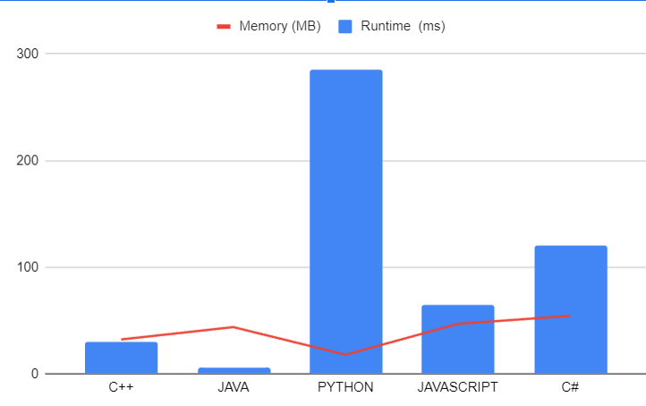

# 🔥Validating Binary Trees: Exploring Concepts through LeetCode's Challenge and Beyond || Mr. Robot

**Author:** LakshayBrejwal_1_0
**Votes:** 8
**Link:** [https://leetcode.com/problems/validate-binary-tree-nodes/solutions/4177434/](https://leetcode.com/problems/validate-binary-tree-nodes/solutions/4177434/)

---

# Validate Binary Tree Nodes 

## \u2753Problem Description\u2753

You are given `n` nodes that are labeled from `0` to `n - 1` and two integer arrays `leftChild` and `rightChild` of length `n`. The arrays represent the left and right subtrees for each node in a binary tree.

A binary tree is considered valid if for each node:

1. There is either exactly one node with a parent (the root), or no nodes with parents (an isolated node).
2. The left subtree is also a binary tree.
3. The right subtree is also a binary tree.

Return `true` if the binary tree represented by `leftChild` and `rightChild` is valid, or `false` otherwise.

## \uD83D\uDCA1Approach 1 :  BFS

# \uD83D\uDCDDDry Run

Let's consider the example with `n = 6`, `leftChild = [1, -1, -1, 4, -1, -1]`, and `rightChild = [2, -1, -1, 5, -1, -1]`.

## Dry Run Steps

1. Initialize `n = 6`.
2. Initialize `leftChild = [1, -1, -1, 4, -1, -1]` and `rightChild = [2, -1, -1, 5, -1, -1]`.
3. Create an array `parentCount` to keep track of the number of children each node has.

   ```
   parentCount = [0, 0, 0, 0, 0, 0]
   ```

4. Start iterating through the nodes.

   - For node `0`:
     - `leftChild[0] = 1` and `rightChild[0] = 2`.
     - Update `parentCount`:

       ```
       parentCount = [1, 1, 0, 0, 0, 0]
       ```

     - Edge count becomes `2`.

   - For node `1`:
     - `leftChild[1] = -1` and `rightChild[1] = -1`.
     - No updates to `parentCount`.

   - For node `2`:
     - `leftChild[2] = -1` and `rightChild[2] = -1`.
     - No updates to `parentCount`.

   - For node `3`:
     - `leftChild[3] = 4` and `rightChild[3] = 5`.
     - Update `parentCount`:

       ```
       parentCount = [1, 1, 0, 1, 1, 0]
       ```

     - Edge count becomes `4`.

   - For nodes `4` and `5`:
     - Update `parentCount` for these nodes. No duplicates, and edge count becomes `6`.

5. Edge count is `6`, which is not equal to `n - 1` (5). So, it's not a valid binary tree.

# Edge Cases

1. **Case 1: No Edges (Empty Tree)**

   - Input: `n = 0`, `leftChild = []`, `rightChild = []`
   - Output: `true` (An empty tree is considered valid).

2. **Case 2: Single Node (Root Node)**

   - Input: `n = 1`, `leftChild = [-1]`, `rightChild = [-1]`
   - Output: `true` (A single node is a valid tree).

3. **Case 3: Multiple Isolated Nodes**

   - Input: `n = 4`, `leftChild = [-1, -1, -1, -1]`, `rightChild = [-1, -1, -1, -1]`
   - Output: `true` (Multiple isolated nodes are valid).


## \uD83D\uDD78\uFE0FComplexity Analysis

- **Time Complexity**: O(n) - We perform a single pass through all nodes.
- **Space Complexity**: O(n) - We use arrays and a queue to store information related to the nodes.

## \uD83E\uDDD1\uD83C\uDFFB\u200D\uD83D\uDCBBCodes

```cpp []
class Solution {
public:
    bool validateBinaryTreeNodes(int n, vector<int>& leftChild, vector<int>& rightChild) {
    int edgeCount = 0;
    vector<int> parentCount(n, 0);

    for (int i = 0; i < n; i++) {
        if (leftChild[i] != -1) {
            parentCount[leftChild[i]]++;

            if (parentCount[leftChild[i]] > 1) return false;
            edgeCount++;
        }

        if (rightChild[i] != -1) {
            parentCount[rightChild[i]]++;

            if (parentCount[rightChild[i]] > 1) return false;
            edgeCount++;
        }
    }

    // The count of edges should be n-1.
    if (edgeCount != n - 1) return false;

    // Parent count should be exactly 1 or 0.
    int root = -1;
    for (int i = 0; i < n; i++) {
        if (parentCount[i] == 0) {
            if (root == -1) root = i;
            else return false;
        }
    }

    // Perform a breadth-first search to check the visited node count.
    queue<int> q;
    q.push(root);

    int visitedCount = 0;

    while (!q.empty()) {
        int node = q.front();
        q.pop();
        visitedCount++;

        if (leftChild[node] != -1) q.push(leftChild[node]);
        if (rightChild[node] != -1) q.push(rightChild[node]);
    }

    return visitedCount == n;
}
};
```


```java []
class Solution {
    public boolean validateBinaryTreeNodes(int n, int[] leftChild, int[] rightChild) {
    int edgeCount = 0;
    int[] parentCount = new int[n];

    for (int i = 0; i < n; i++) {
        if (leftChild[i] != -1) {
            parentCount[leftChild[i]]++;

            if (parentCount[leftChild[i]] > 1) return false;
            edgeCount++;
        }

        if (rightChild[i] != -1) {
            parentCount[rightChild[i]]++;

            if (parentCount[rightChild[i]] > 1) return false;
            edgeCount++;
        }
    }

    if (edgeCount != n - 1) return false;

    int root = -1;
    for (int i = 0; i < n; i++) {
        if (parentCount[i] == 0) {
            if (root == -1) root = i;
            else return false;
        }
    }

    Queue<Integer> q = new LinkedList<>();
    q.add(root);

    int visitedCount = 0;

    while (!q.isEmpty()) {
        int node = q.poll();
        visitedCount++;

        if (leftChild[node] != -1) q.add(leftChild[node]);
        if (rightChild[node] != -1) q.add(rightChild[node]);
    }

    return visitedCount == n;
}
}
```


```python []
from collections import deque

class Solution:
    def validateBinaryTreeNodes(self, n, leftChild, rightChild):
        edgeCount = 0
        parentCount = [0] * n

        for i in range(n):
            if leftChild[i] != -1:
                parentCount[leftChild[i]] += 1

                if parentCount[leftChild[i]] > 1:
                    return False
                edgeCount += 1

            if rightChild[i] != -1:
                parentCount[rightChild[i]] += 1

                if parentCount[rightChild[i]] > 1:
                    return False
                edgeCount += 1

        if edgeCount != n - 1:
            return False

        root = -1
        for i in range(n):
            if parentCount[i] == 0:
                if root == -1:
                    root = i
                else:
                    return False

        q = deque()
        q.append(root)

        visitedCount = 0

        while q:
            node = q.popleft()
            visitedCount += 1

            if leftChild[node] != -1:
                q.append(leftChild[node])
            if rightChild[node] != -1:
                q.append(rightChild[node])

        return visitedCount == n
```


```csharp []
public class Solution {
    public bool ValidateBinaryTreeNodes(int n, int[] leftChild, int[] rightChild) {
        int edgeCount = 0;
        int[] parentCount = new int[n];

        for (int i = 0; i < n; i++) {
            if (leftChild[i] != -1) {
                parentCount[leftChild[i]]++;

                if (parentCount[leftChild[i]] > 1) return false;
                edgeCount++;
            }

            if (rightChild[i] != -1) {
                parentCount[rightChild[i]]++;

                if (parentCount[rightChild[i]] > 1) return false;
                edgeCount++;
            }
        }

        if (edgeCount != n - 1) return false;

        int root = -1;
        for (int i = 0; i < n; i++) {
            if (parentCount[i] == 0) {
                if (root == -1) root = i;
                else return false;
            }
        }

        Queue<int> q = new Queue<int>();
        q.Enqueue(root);

        int visitedCount = 0;

        while (q.Count > 0) {
            int node =

 q.Dequeue();
            visitedCount++;

            if (leftChild[node] != -1) q.Enqueue(leftChild[node]);
            if (rightChild[node] != -1) q.Enqueue(rightChild[node]);
        }

        return visitedCount == n;
    }
}
```


```javascript []
var validateBinaryTreeNodes = function(n, leftChild, rightChild) {
    let edgeCount = 0;
    let parentCount = new Array(n).fill(0);

    for (let i = 0; i < n; i++) {
        if (leftChild[i] !== -1) {
            parentCount[leftChild[i]]++;

            if (parentCount[leftChild[i]] > 1) return false;
            edgeCount++;
        }

        if (rightChild[i] !== -1) {
            parentCount[rightChild[i]]++;

            if (parentCount[rightChild[i]] > 1) return false;
            edgeCount++;
        }
    }

    if (edgeCount !== n - 1) return false;

    let root = -1;
    for (let i = 0; i < n; i++) {
        if (parentCount[i] === 0) {
            if (root === -1) root = i;
            else return false;
        }
    }

    let q = [root];
    let visitedCount = 0;

    while (q.length > 0) {
        let node = q.shift();
        visitedCount++;

        if (leftChild[node] !== -1) q.push(leftChild[node]);
        if (rightChild[node] !== -1) q.push(rightChild[node]);
    }

    return visitedCount === n;
};
```

---

# \uD83D\uDCA1Approach 2 : DFS


### \uD83D\uDCDD Dry Run

Suppose we have the following input:

```cpp
n = 5
leftChild = [1, 0, -1, 3, 4]
rightChild = [-1, 2, 3, -1, -1]
```

1. Initialize the `parent` array: `parent = [0, 1, 2, 3, 4]`.
2. Iterate through the nodes and check their children:
   - Node 0: Left child is node 1. The DFS will explore all its descendants (1 and 2). Since there is no loop and all nodes are visited, return `true`.
   - Node 1: Right child is node 2. The DFS explores its descendants (2). Since there is no loop and all nodes are visited, return `true`.
   - Node 2: No children, no issues.
   - Node 3: Left child is node 4. The DFS explores its descendants (4). Since there is no loop and all nodes are visited, return `true`.
   - Node 4: No children, no issues.

After processing all nodes, we find that there's only one component, and it's a valid binary tree. So, return `true`.

### Edge Cases

1. Empty Tree (n = 0):
   - Input: `n = 0`, `leftChild = []`, `rightChild = []`
   - Output: `true` (An empty tree is considered a valid binary tree.)

2. Single Node Tree (n = 1):
   - Input: `n = 1`, `leftChild = [-1]`, `rightChild = [-1]`
   - Output: `true` (A single node tree with no children is a valid binary tree.)

3. Single Node with Two Children:
   - Input: `n = 1`, `leftChild = [0]`, `rightChild = [0]`
   - Output: `false` (A single node cannot have two children.)

4. Multiple Roots:
   - Input: `n = 5`, `leftChild = [1, -1, 3, -1, 4]`, `rightChild = [-1, 2, -1, 0, -1]`
   - Output: `false` (Multiple roots are not allowed in a binary tree.)

5. Loop in the Tree:
   - Input: `n = 3`, `leftChild = [1, 0, -1]`, `rightChild = [-1, 2, 1]`
   - Output: `false` (There's a loop in the tree, so it's not a valid binary tree.)

The code handles these edge cases correctly.

### \uD83D\uDD78\uFE0FComplexity Analysis

- **Time Complexity:** The time complexity for the DFS approach is O(n), where n is the number of nodes in the tree. The DFS visits each node once.

- **Space Complexity:** The space complexity is O(n) due to the additional space required for the recursive call stack and the `parent` array.


## \uD83E\uDDD1\uD83C\uDFFB\u200D\uD83D\uDCBBCodes 
```cpp []

class Solution
{
    public:
       	// Helper function for Depth-First Search (DFS)
        int dfs(vector<int> &left, vector<int> &right, int root)
        {
           	// If the current node is NULL, return 0 as there are no nodes in this subtree.
            if (root == -1)
            {
                return 0;
            }

           	// Recursively count the nodes in the left and right subtrees and add 1 for the current node.
            return 1 + dfs(left, right, left[root]) + dfs(left, right, right[root]);
        }

    bool validateBinaryTreeNodes(int n, vector<int> &leftChild, vector<int> &rightChild)
    {
       	// Create a vector to keep track of the parent count for each node.
        vector<int> parentCount(n, 0);

       	// Initialize the root node as -1 (no root yet).
        int root = -1;

       	// Iterate through the child nodes.
        for (int i = 0; i < leftChild.size(); i++)
        {
           	// Check the left child.
            if (leftChild[i] != -1)
            {
               	// If a node has more than one parent, return false.
                if (parentCount[leftChild[i]]++ == 1)
                {
                    return false;
                }
            }

           	// Check the right child.
            if (rightChild[i] != -1)
            {
               	// If a node has more than one parent, return false.
                if (parentCount[rightChild[i]]++ == 1)
                {
                    return false;
                }
            }
        }

       	// Find the root node and check for multiple roots.
        for (int i = 0; i < leftChild.size(); i++)
        {
           	// If a node has no incoming edges (in-degree is 0) and has children, it's a candidate root.
            if (parentCount[i] == 0)
            {
                if (root == -1)
                {
                   	// If there is no previous candidate root, set the current node as the root.
                    root = i;
                }
                else
                {
                   	// If we already have a candidate root, return false (multiple roots).
                    return false;
                }
            }
        }

       	// If there is no root, return false (no valid tree).
        if (root == -1)
        {
            return false;
        }

       	// Perform a depth-first search (DFS) from the root and check if all nodes are visited.
        return dfs(leftChild, rightChild, root) == n;
    }
};
```


```java []
import java.util.Arrays;

public class Solution {
    public boolean validateBinaryTreeNodes(int n, int[] leftChild, int[] rightChild) {
        int[] parentCount = new int[n];
        int root = -1;

        for (int i = 0; i < leftChild.length; i++) {
            if (leftChild[i] != -1) {
                if (parentCount[leftChild[i]]++ == 1) {
                    return false;
                }
            }

            if (rightChild[i] != -1) {
                if (parentCount[rightChild[i]]++ == 1) {
                    return false;
                }
            }
        }

        for (int i = 0; i < leftChild.length; i++) {
            if (parentCount[i] == 0) {
                if (root == -1) {
                    root = i;
                } else {
                    return false;
                }
            }
        }

        if (root == -1) {
            return false;
        }

        return dfs(leftChild, rightChild, root) == n;
    }

    private int dfs(int[] left, int[] right, int root) {
        if (root == -1) {
            return 0;
        }
        return 1 + dfs(left, right, left[root]) + dfs(left, right, right[root]);
    }
}
```

```python []
class Solution:
    def validateBinaryTreeNodes(self, n: int, leftChild: List[int], rightChild: List[int]) -> bool:
        parentCount = [0] * n
        root = -1

        for i in range(len(leftChild)):
            if leftChild[i] != -1:
                if parentCount[leftChild[i]] == 1:
                    return False
                parentCount[leftChild[i]] += 1

            if rightChild[i] != -1:
                if parentCount[rightChild[i]] == 1:
                    return False
                parentCount[rightChild[i]] += 1

        for i in range(len(leftChild)):
            if parentCount[i] == 0:
                if root == -1:
                    root = i
                else:
                    return False

        if root == -1:
            return False

        return self.dfs(leftChild, rightChild, root) == n

    def dfs(self, left: List[int], right: List[int], root: int) -> int:
        if root == -1:
            return 0
        return 1 + self.dfs(left, right, left[root]) + self.dfs(left, right, right[root])
```

```csharp []
public class Solution {
    public bool ValidateBinaryTreeNodes(int n, int[] leftChild, int[] rightChild) {
        int[] parentCount = new int[n];
        int root = -1;

        for (int i = 0; i < leftChild.Length; i++) {
            if (leftChild[i] != -1) {
                if (parentCount[leftChild[i]] == 1) {
                    return false;
                }
                parentCount[leftChild[i]]++;

            }

            if (rightChild[i] != -1) {
                if (parentCount[rightChild[i]] == 1) {
                    return false;
                }
                parentCount[rightChild[i]]++;
            }
        }

        for (int i = 0; i < leftChild.Length; i++) {
            if (parentCount[i] == 0) {
                if (root == -1) {
                    root = i;
                } else {
                    return false;
                }
            }
        }

        if (root == -1) {
            return false;
        }

        return Dfs(leftChild, rightChild, root) == n;
    }

    private int Dfs(int[] left, int[] right, int root) {
        if (root == -1) {
            return 0;
        }
        return 1 + Dfs(left, right, left[root]) + Dfs(left, right, right[root]);
    }
}
```

```javascript []
/**
 * @param {number} n
 * @param {number[]} leftChild
 * @param {number[]} rightChild
 * @return {boolean}
 */
var validateBinaryTreeNodes = function(n, leftChild, rightChild) {
    var parentCount = new Array(n).fill(0);
    var root = -1;

    for (var i = 0; i < leftChild.length; i++) {
        if (leftChild[i] !== -1) {
            if (parentCount[leftChild[i]] === 1) {
                return false;
            }
            parentCount[leftChild[i]]++;

        }

        if (rightChild[i] !== -1) {
            if (parentCount[rightChild[i]] === 1) {
                return false;
            }
            parentCount[rightChild[i]]++;
        }
    }

    for (var i = 0; i < leftChild.length; i++) {
        if (parentCount[i] === 0) {
            if (root === -1) {
                root = i;
            } else {
                return false;
            }
        }
    }

    if (root === -1) {
        return false;
    }

    return dfs(leftChild, rightChild, root) === n;
};

function dfs(left, right, root) {
    if (root === -1) {
        return 0;
    }
    return 1 + dfs(left, right, left[root]) + dfs(left, right, right[root]);
}
```
---
# \uD83D\uDCA1Approach 3 : Union Find 


### \uD83D\uDCDDDry Run

Suppose we have the following input:

```cpp
n = 5
leftChild = [1, 0, -1, 3, 4]
rightChild = [-1, 2, 3, -1, -1]
```

1. Initialize the `parent` array: `parent = [0, 1, 2, 3, 4]`
2. Iterate through the nodes and check their children:
   - Node 0: Left child is node 1, which is already a child, so it's a loop. Return `false`.
   - Node 1: Right child is node 2, which is not a child yet. Perform the union, and `parent` becomes `[0, 1, 1, 3, 4]`.
   - Node 2: No children, no issues.
   - Node 3: Left child is node 4, which is not a child yet. Perform the union, and `parent` becomes `[0, 1, 1, 3, 3]`.
   - Node 4: No children, no issues.

After processing all nodes, we find that there's only one component, and it's a valid binary tree. So, return `true`.

### Edge Cases

1. Empty Tree (n = 0):
   - Input: `n = 0`, `leftChild = []`, `rightChild = []`
   - Output: `true` (An empty tree is considered a valid binary tree.)

2. Single Node Tree (n = 1):
   - Input: `n = 1`, `leftChild = [-1]`, `rightChild = [-1]`
   - Output: `true` (A single node tree with no children is a valid binary tree.)

3. Single Node with Two Children:
   - Input: `n = 1`, `leftChild = [0]`, `rightChild = [0]`
   - Output: `false` (A single node cannot have two children.)

4. Multiple Roots:
   - Input: `n = 5`, `leftChild = [1, -1, 3, -1, 4]`, `rightChild = [-1, 2, -1, 0, -1]`
   - Output: `false` (Multiple roots are not allowed in a binary tree.)

5. Loop in the Tree:
   - Input: `n = 3`, `leftChild = [1, 0, -1]`, `rightChild = [-1, 2, 1]`
   - Output: `false` (There's a loop in the tree, so it's not a valid binary tree.)

The code handles these edge cases correctly.


### \uD83D\uDD78\uFE0FComplexity Analysis

- **Time Complexity:** The time complexity for the Union-Find approach is O(n), where n is the number of nodes in the tree. The union-find operations are performed once for each node in the tree.

- **Space Complexity:** The space complexity is O(n) due to the additional space required for the parent array.


## \uD83E\uDDD1\uD83C\uDFFB\u200D\uD83D\uDCBBCodes


```cpp []
class Solution {
public:
    int component = -1;  // Initialize a component variable to keep track of the number of connected components.
    
    int findParent(vector<int>& parent, int x) {
        while (parent[x] != x)
            x = parent[parent[x]];
        return x;
    }
    
    bool validChild(int child, int x, vector<int>& parent) {
        if (parent[child] != child)  // If the child node already has a parent set, it has two parents, return false.
            return false;
        else {
            int y = findParent(parent, child);
            if (x != y) {
                parent[y] = x;
                component--;
            } else {
                return false;  // If (x == y), both belong to the same set, and there's a loop, return false.
            }
        }
        return true;
    }
    
    bool validateBinaryTreeNodes(int n, vector<int>& leftChild, vector<int>& rightChild) {
        vector<int> parent(n);
        component = n;
        int root = -1;

        for (int i = 0; i < n; i++) {
            parent[i] = i;  // Assign each node as its parent.
        }

        for (int i = 0; i < n; i++) {
            int x = findParent(parent, i);  // Find the parent of the current root node if either of its children is present; we have to perform the union later.

            if (leftChild[i] != -1 || rightChild[i] != -1) {
                if (leftChild[i] != -1 && !validChild(leftChild[i], x, parent)) {
                    return false;
                }
                if (rightChild[i] != -1 && !validChild(rightChild[i], x, parent)) {
                    return false;
                }
            }
        }

        return component == 1;  // After all unions, there should be only one root.
    }
};
```


```java []
public class Solution {
    private int component = -1;

    public boolean validateBinaryTreeNodes(int n, int[] leftChild, int[] rightChild) {
        int[] parent = new int[n];
        component = n;
        int root = -1;

        for (int i = 0; i < n; i++) {
            parent[i] = i; // Assign each node as its parent.
        }

        for (int i = 0; i < n; i++) {
            int x = findParent(parent, i); // Find the parent of the current root node if either of its child is present; we have to perform the union later.

            if (leftChild[i] != -1 || rightChild[i] != -1) {
                if (leftChild[i] != -1 && !validChild(leftChild[i], x, parent)) {
                    return false;
                }
                if (rightChild[i] != -1 && !validChild(rightChild[i], x, parent)) {
                    return false;
                }
            }
        }

        return component == 1; // After all unions, there should be only one root.
    }

    private boolean validChild(int child, int x, int[] parent) {
        if (parent[child] != child) { // If child node has already a parent set, then it is the case with two parents, return false.
            return false;
        } else {
            int y = findParent(parent, child);
            if (x != y) {
                parent[y] = x;
                component--;
            } else {
                return false; // If (x == y), both belong to the same set, then there is a loop, return false.
            }
        }
        return true;
    }

    private int findParent(int[] parent, int x) {
        while (parent[x] != x) {
            x = parent[parent[x]];
        }
        return x;
    }
}
```


```python []
class Solution:
    def validateBinaryTreeNodes(self, n: int, leftChild: List[int], rightChild: List[int]) -> bool:
        parent = [i for i in range(n)]
        self.component = n
        root = -1

        for i in range(n):
            x = self.findParent(parent, i)

            if leftChild[i] != -1 or rightChild[i] != -1:
                if leftChild[i] != -1 and not self.validChild(leftChild[i], x, parent):
                    return False
                if rightChild[i] != -1 and not self.validChild(rightChild[i], x, parent):
                    return False

        return self.component == 1

    def validChild(self, child, x, parent):
        if parent[child] != child:
            return False
        else:
            y = self.findParent(parent, child)
            if x != y:
                parent[y] = x
                self.component -= 1
            else:
                return False
        return True

    def findParent(self, parent, x):
        while parent[x] != x:
            x = parent[parent[x]]
        return x
```


```csharp []
public class Solution {
    private int component = -1;

    public bool ValidateBinaryTreeNodes(int n, int[] leftChild, int[] rightChild) {
        int[] parent = new int[n];
        component = n;
        int root = -1;

        for (int i = 0; i < n; i++) {
            parent[i] = i; // Assign each node as its parent.
        }

        for (int i = 0; i < n; i++) {
            int x = FindParent(parent, i); // Find the parent of the current root node if either of its child is present; we have to perform the union later.

            if (leftChild[i] != -1 || rightChild[i] != -1) {
                if (leftChild[i] != -1 && !ValidChild(leftChild[i], x, parent)) {
                    return false;
                }
                if (rightChild[i] != -1 && !ValidChild(rightChild[i], x, parent)) {
                    return false;
                }
            }
        }

        return component == 1; // After all unions, there should be only one root.
    }

    private bool ValidChild(int child, int x, int[] parent) {
        if (parent[child] != child) { // If the child node already has a parent set, then it has two parents, return false.
            return false;
        } else {
            int y = FindParent(parent, child);
            if (x != y) {
                parent[y] = x;
                component--;
            } else {
                return false; // If (x == y), both belong to the same set, and there's a loop, return false.
            }
        }
        return true;
    }

    private int FindParent(int[] parent, int x) {
        while (parent[x] != x) {
            x = parent[parent[x]];
        }
        return x;
    }
}
```

```javascript []
/**
 * @param {number} n
 * @param {number[]} leftChild
 * @param {number[]} rightChild
 * @return {boolean}
 */
var validateBinaryTreeNodes = function(n, leftChild, rightChild) {
    var parent = new Array(n).fill(0);
    var root = -1;
    this.component = n;

    for (var i = 0; i < n; i++) {
        parent[i] = i; // Assign each node as its parent.
    }

    for (var i =

 0; i < n; i++) {
        var x = findParent(parent, i); // Find the parent of the current root node if either of its child is present; we have to perform the union later.

        if (leftChild[i] !== -1 || rightChild[i] !== -1) {
            if (leftChild[i] !== -1 && !validChild(leftChild[i], x, parent)) {
                return false;
            }
            if (rightChild[i] !== -1 && !validChild(rightChild[i], x, parent)) {
                return false;
            }
        }
    }

    return this.component == 1; // After all unions, there should be only one root.
};

/**
 * @param {number} child
 * @param {number} x
 * @param {number[]} parent
 * @return {boolean}
 */
var validChild = function(child, x, parent) {
    if (parent[child] != child) { // If the child node already has a parent set, then it has two parents, return false.
        return false;
    } else {
        var y = findParent(parent, child);
        if (x != y) {
            parent[y] = x;
            this.component--;
        } else {
            return false; // If (x == y), both belong to the same set, and there's a loop, return false.
        }
    }
    return true;
};

/**
 * @param {number} x
 * @param {number[]} parent
 * @return {number}
 */
var findParent = function(x, parent) {
    while (parent[x] != x) {
        x = parent[parent[x]];
    }
    return x;
};
```

---
# \uD83D\uDCCAAnalysis 



| Language   | Runtime (ms) | Memory (MB) |
|------------|--------------|-------------|
| C++        | 30           | 32.2        |
| Java       | 6            | 43.8        |
| Python     | 285          | 17.85       |
| JavaScript | 65           | 46.8        |
| C#         | 120          | 54.34       |


## Related Questions and Practice
- [Check if There is a Valid Path in a Grid](https://leetcode.com/problems/check-if-there-is-a-valid-path-in-a-grid/description/)
- [Water and Jug Problem](https://leetcode.com/problems/water-and-jug-problem/description/)

---
# Consider UPVOTING \u2B06\uFE0F


# DROP YOUR SUGGESTIONS IN THE COMMENT

## Keep Coding\uD83E\uDDD1\u200D\uD83D\uDCBB

 -- *MR.ROBOT SIGNING OFF*
