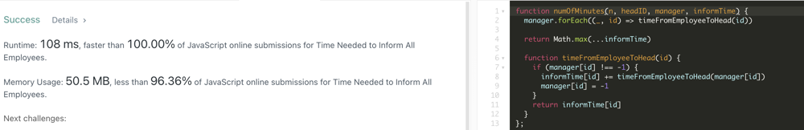

# JavaScript Super Short w/ Explanation 100% | 98%

**Author:** casmith1987
**Votes:** 19
**Link:** [https://leetcode.com/problems/time-needed-to-inform-all-employees/solutions/1106599/](https://leetcode.com/problems/time-needed-to-inform-all-employees/solutions/1106599/)

---



Basic approach is as follows - We are given a list of all employees (manager contains all employees / managers) and a list of the time to reach those employees from their direct managers.  We loop through every employee and calculate the time it takes to reach the head of the company from that employee. (Pretty straight forward, just the time from employee -> manager -> ... n manager -> owner.  No branches, straight path.)  Since managers can have many employees, but employees only have one manager - this approach is nice since we can change the 'manager' value to -1 after traversing to the owner node from there and storing the updated total calculated value in the informTime array.  This approach keeps us from calculating time from said manager to owner multiple times.  If another employee under the same manager comes up again, when we run our helper function on the manager, we'll see that his value is -1 (same as owner) and simply return the previously calculated value.  After we calculate the time for All employees, we can then return the maximum value within the informTime array as it will be the longest it takes for news to reach the entire company.  Big O(numEmployees * TreeDepth)
	
```
var numOfMinutes = function(n, headID, manager, informTime) {
    manager.forEach((_, index) => timeFromEmployeeToHead(index))
        
    return Math.max(...informTime);
    
    function timeFromEmployeeToHead(id) {
        if (manager[id] !== -1) {
            informTime[id] += timeFromEmployeeToHead(manager[id]);
            manager[id] = -1
        }
        return informTime[id];
    }
};
```