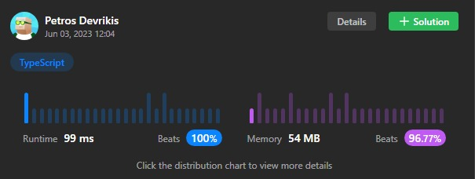

# Beats 100% | TS | Tree | Time Needed to Inform All Employees | Easy Solution with Explanation

**Author:** Petrosdevri
**Votes:** 2
**Link:** [https://leetcode.com/problems/time-needed-to-inform-all-employees/solutions/3592386/](https://leetcode.com/problems/time-needed-to-inform-all-employees/solutions/3592386/)

---



# Intuition
<!-- Describe your first thoughts on how to solve this problem. -->
My main goal was to traverse the organisation using Depth-First Search and to simplify the solution I used TypeScript as it's easier to figure out which parameters I need to use.

# Approach
<!-- Describe your approach to solving the problem. -->
- Define a helper function `timeFromEmployeeToHead` that takes an employee ID (`id`) as a parameter and calculates the time required for information to flow from that employee to the head of the organization.
    - Inside the helper function, check if the current employee has a manager (identified by `manager[id]`). 
    - If the manager exists (not equal to `-1`), it means the current employee is not the head.
    - If the employee has a manager, recursively call the `timeFromEmployeeToHead` function for the manager's ID. This step ensures that the information flows through the hierarchy until it reaches the head.
    - Update the `informTime` array for the current employee by adding the time it takes for the information to reach their manager (obtained from the recursive call).
    - Set the manager of the current employee to `-1` to mark that the information has been passed along. This prevents redundant calculations for the same employee.
    - Return the updated `informTime` for the current employee.
- In the main function `numOfMinutes`, iterate over each employee using the `forEach` method on the manager array.
- For each employee, call the `timeFromEmployeeToHead` function, which updates the `informTime` array with the total time required for information to reach the head.
- Finally, return the maximum value from the `informTime` array using the `Math.max` function, which represents the longest time taken for information to flow from any employee to the head.

# Complexity
- Time complexity: `O(n)`
<!-- Add your time complexity here, e.g. $$O(n)$$ -->

- Space complexity: `O(n)`
<!-- Add your space complexity here, e.g. $$O(n)$$ -->

# Code
```
function numOfMinutes(n: number, headID: number, manager: number[], informTime: number[]): number {
    const timeFromEmployeeToHead = (id: number): number => {
        if(manager[id] != -1) {
            informTime[id] += timeFromEmployeeToHead(manager[id]);
            manager[id] = -1;
        }
        return informTime[id];
    }

    manager.forEach((_, index) => timeFromEmployeeToHead(index));

    return Math.max(...informTime);
};
```

# Feedback
I would appreciate your feedback and would like to receive your comments and perspectives regarding my approach. I would also enjoy suggestions about how to hone my DSA skills because I am very new to this sector and it's challenging at first. Thanks a lot!