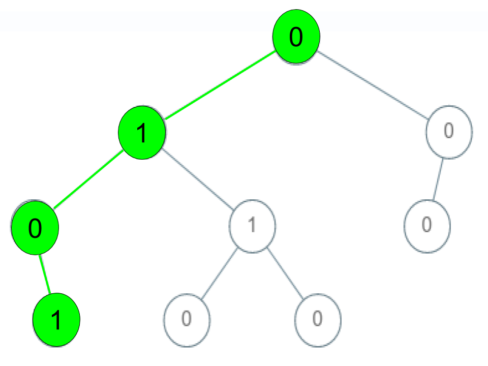
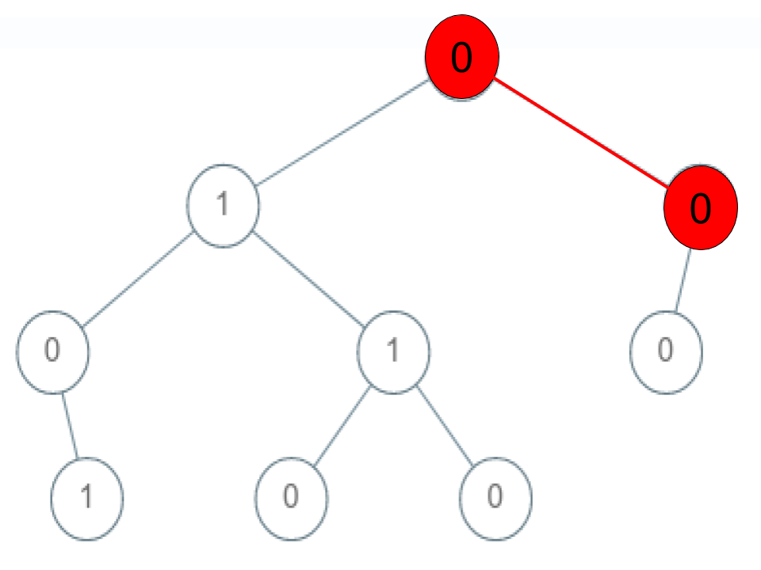
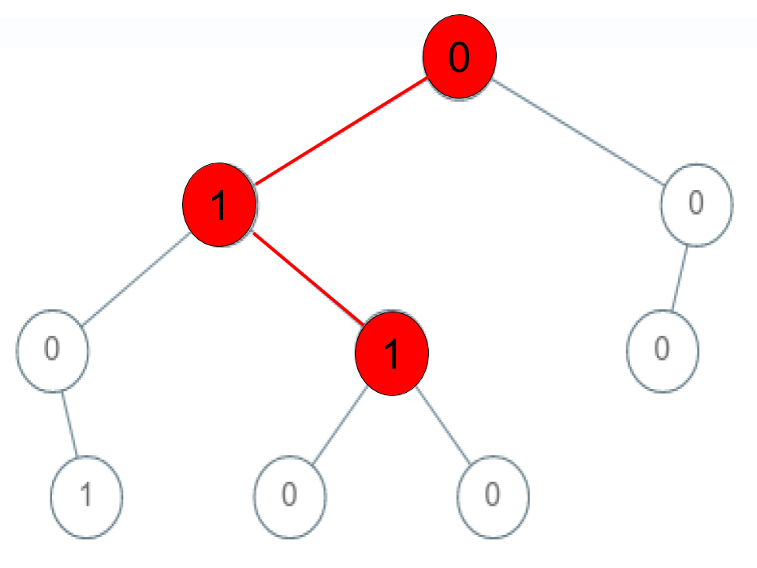

# [1430. Check If a String Is a Valid Sequence from Root to Leaves Path in a Binary Tree](https://leetcode.com/problems/check-if-a-string-is-a-valid-sequence-from-root-to-leaves-path-in-a-binary-tree/)

| Category | Difficulty | Likes | Dislikes |
| :------: | :--------: | :---: | :------: |
| Algorithms | Medium | 219 | 15 |

**Tags:** [`tree`](https://leetcode.com/tag/tree), [`depth-first-search`](https://leetcode.com/tag/depth-first-search), [`breadth-first-search`](https://leetcode.com/tag/breadth-first-search), [`binary-tree`](https://leetcode.com/tag/binary-tree)


## Description

Given a binary tree where each path going from the root to any leaf form a **valid sequence**, check if a given string is a **valid sequence** in such binary tree. 

We get the given string from the concatenation of an array of integers `arr` and the concatenation of all values of the nodes along a path results in a **sequence** in the given binary tree.

 

**Example 1:**

****

```

Input: root = [0,1,0,0,1,0,null,null,1,0,0], arr = [0,1,0,1]
Output: true
Explanation: 
The path 0 -&gt; 1 -&gt; 0 -&gt; 1 is a valid sequence (green color in the figure). 
Other valid sequences are: 
0 -&gt; 1 -&gt; 1 -&gt; 0 
0 -&gt; 0 -&gt; 0

```

**Example 2:**

****

```

Input: root = [0,1,0,0,1,0,null,null,1,0,0], arr = [0,0,1]
Output: false 
Explanation: The path 0 -&gt; 0 -&gt; 1 does not exist, therefore it is not even a sequence.

```

**Example 3:**

****

```

Input: root = [0,1,0,0,1,0,null,null,1,0,0], arr = [0,1,1]
Output: false
Explanation: The path 0 -&gt; 1 -&gt; 1 is a sequence, but it is not a valid sequence.

```

 

**Constraints:**

	- `1 <= arr.length <= 5000`

	- `0 <= arr[i] <= 9`

	- Each node's value is between [0 - 9].

---

**Links:** [Submissions](https://leetcode.com/problems/check-if-a-string-is-a-valid-sequence-from-root-to-leaves-path-in-a-binary-tree/) | [Solutions](https://leetcode.com/problems/check-if-a-string-is-a-valid-sequence-from-root-to-leaves-path-in-a-binary-tree/)
