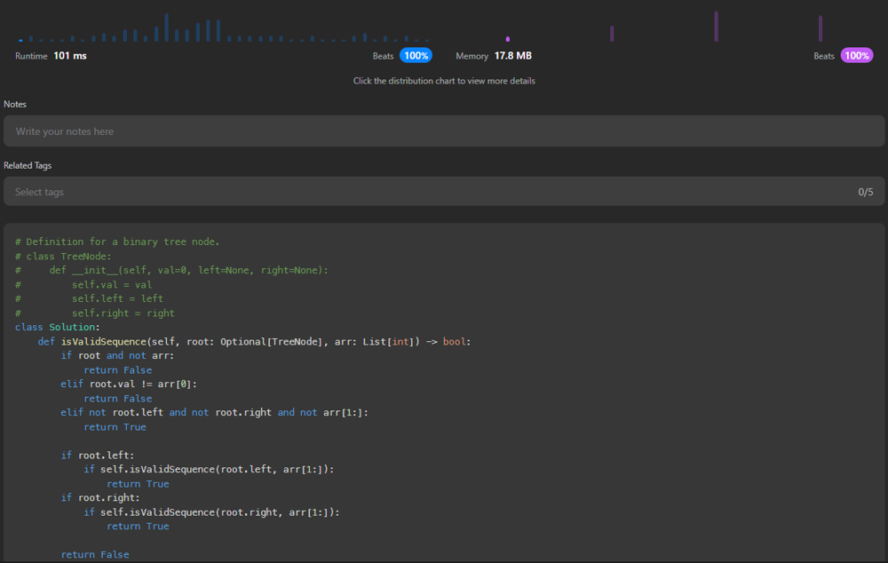

# Python: recursive solution | Beats 100% in both Runtime and Memory

**Author:** remainsxxn
**Votes:** 1
**Link:** [https://leetcode.com/problems/check-if-a-string-is-a-valid-sequence-from-root-to-leaves-path-in-a-binary-tree/solutions/3825777/](https://leetcode.com/problems/check-if-a-string-is-a-valid-sequence-from-root-to-leaves-path-in-a-binary-tree/solutions/3825777/)

---


# Intuition
Apply `isValidSequence` function to the left and right children of the current node as new root nodes, and meanwhile advance `arr` by 1.
Determine the return value of the current function based on the return values from the left and right children.

# Approach
* Operations on current `root`:
    1. If current `root` is not `None` but `arr` is empty, return `False` because the path is not over yet, but we run out of elements in `arr`.
    2. If the value of current `root` does not equal to the first element in current `arr`, return `False` to end searching on this path.
    3. If current `root` does not have any child, which means it is a left node, and `arr[1:]` happens to be empty, then we return `True`. 

* Operations on left child: 
If left child of the current `root` is not `None`, we call the function on it and remove the first element in `arr`, which becomes `arr[1:]`. If the function returns `True`, which means it is a valid path starting from `root.left`, which also indicates that there is a valid path starting from `root`, since we have already confirmed `root.val == arr[0]` in the previous steps. So we immediately return `True` for the current `root`.
* Operations on right child:
Do the same thing for the right child of the current `root`.

If none of the above returns `True`, which means there is no valid path starting from `root`, `root.left` or `root.right`, return `False`.


# Code
```
# Definition for a binary tree node.
# class TreeNode:
#     def __init__(self, val=0, left=None, right=None):
#         self.val = val
#         self.left = left
#         self.right = right
class Solution:
    def isValidSequence(self, root: Optional[TreeNode], arr: List[int]) -> bool:
        if root and not arr:
            return False
        elif root.val != arr[0]:
            return False
        elif not root.left and not root.right and not arr[1:]:
            return True

        if root.left:
            if self.isValidSequence(root.left, arr[1:]):
                return True
        if root.right:
            if self.isValidSequence(root.right, arr[1:]):
                return True

        return False


```