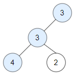

# [1448. Count Good Nodes in Binary Tree](https://leetcode.com/problems/count-good-nodes-in-binary-tree/)

| Category | Difficulty | Likes | Dislikes |
| :------: | :--------: | :---: | :------: |
| Algorithms | Medium | 6268 | 209 |

**Tags:** [`tree`](https://leetcode.com/tag/tree), [`depth-first-search`](https://leetcode.com/tag/depth-first-search), [`breadth-first-search`](https://leetcode.com/tag/breadth-first-search), [`binary-tree`](https://leetcode.com/tag/binary-tree)

**Companies:** `amazon`, `facebook`, `microsoft`, `google`, `docusign`, `goldman-sachs`, `josh-technology`

## Description

Given a binary tree `root`, a node *X* in the tree is named **good** if in the path from root to *X* there are no nodes with a value *greater than* X.


Return the number of **good** nodes in the binary tree.


 


**Example 1:**


****


```

Input: root = [3,1,4,3,null,1,5]
Output: 4
Explanation: Nodes in blue are good.
Root Node (3) is always a good node.
Node 4 -&gt; (3,4) is the maximum value in the path starting from the root.
Node 5 -&gt; (3,4,5) is the maximum value in the path
Node 3 -&gt; (3,1,3) is the maximum value in the path.
```


**Example 2:**


****


```

Input: root = [3,3,null,4,2]
Output: 3
Explanation: Node 2 -&gt; (3, 3, 2) is not good, because &quot;3&quot; is higher than it.
```


**Example 3:**


```

Input: root = [1]
Output: 1
Explanation: Root is considered as good.
```


 


**Constraints:**


	- The number of nodes in the binary tree is in the range `[1, 10^5]`.

	- Each node's value is between `[-10^4, 10^4]`.

---

**Links:** [Submissions](https://leetcode.com/problems/count-good-nodes-in-binary-tree/) | [Solutions](https://leetcode.com/problems/count-good-nodes-in-binary-tree/)
