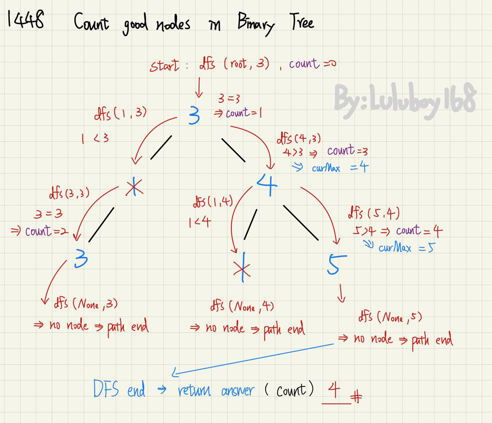
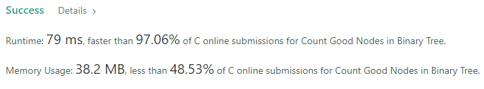

# ✔️C++ | Python | C🔥97% DFS✅Detailed graph explantion | Beginner-friendly | Easy to understand ^_^

**Author:** luluboy168
**Votes:** 163
**Link:** [https://leetcode.com/problems/count-good-nodes-in-binary-tree/solutions/2512547/](https://leetcode.com/problems/count-good-nodes-in-binary-tree/solutions/2512547/)

---

**Idea:**
1. DFS through every path, and keep tracking of biggest value(curMax) in the path.
2. If current node is `>=` the biggest value in the path, we add the answer by one.

Here's an example to show how the code works:

(In **Python**, we use list as a global valuable)
<iframe src="https://leetcode.com/playground/EunmHB7o/shared" frameBorder="0" width="1000" height="400"></iframe>

**Please UPVOTE if you LIKE!!!**

