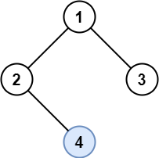
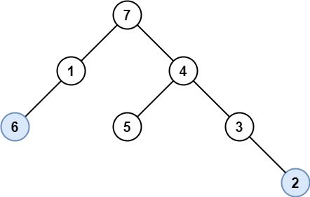
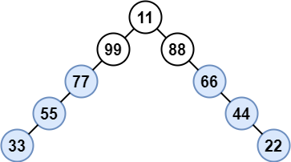

# [1469. Find All The Lonely Nodes](https://leetcode.com/problems/find-all-the-lonely-nodes/)

| Category | Difficulty | Likes | Dislikes |
| :------: | :--------: | :---: | :------: |
| Algorithms | Easy | 518 | 11 |

**Tags:** [`tree`](https://leetcode.com/tag/tree), [`depth-first-search`](https://leetcode.com/tag/depth-first-search), [`breadth-first-search`](https://leetcode.com/tag/breadth-first-search), [`binary-tree`](https://leetcode.com/tag/binary-tree)

**Companies:** `microsoft`

## Description

In a binary tree, a **lonely** node is a node that is the only child of its parent node. The root of the tree is not lonely because it does not have a parent node.

Given the `root` of a binary tree, return *an array containing the values of all lonely nodes* in the tree. Return the list **in any order**.

 

**Example 1:**


```

Input: root = [1,2,3,null,4]
Output: [4]
Explanation: Light blue node is the only lonely node.
Node 1 is the root and is not lonely.
Nodes 2 and 3 have the same parent and are not lonely.

```

**Example 2:**


```

Input: root = [7,1,4,6,null,5,3,null,null,null,null,null,2]
Output: [6,2]
Explanation: Light blue nodes are lonely nodes.
Please remember that order doesn&#39;t matter, [2,6] is also an acceptable answer.

```

**Example 3:**


```


Input: root = [11,99,88,77,null,null,66,55,null,null,44,33,null,null,22]
Output: [77,55,33,66,44,22]
Explanation: Nodes 99 and 88 share the same parent. Node 11 is the root.
All other nodes are lonely.

```

 

**Constraints:**

	- The number of nodes in the `tree` is in the range `[1, 1000].`

	- `1 <= Node.val <= 10^6`

---

**Links:** [Submissions](https://leetcode.com/problems/find-all-the-lonely-nodes/) | [Solutions](https://leetcode.com/problems/find-all-the-lonely-nodes/)
