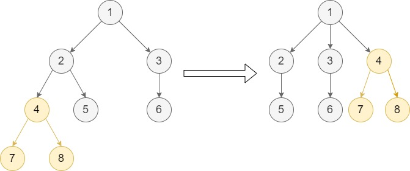
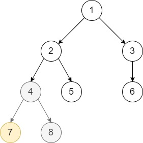
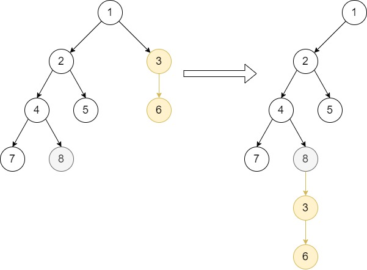
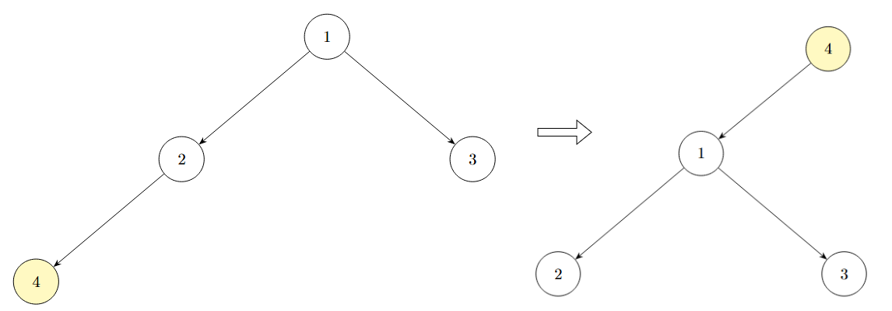

# [1516. Move Sub-Tree of N-Ary Tree](https://leetcode.com/problems/move-sub-tree-of-n-ary-tree/)

| Category | Difficulty | Likes | Dislikes |
| :------: | :--------: | :---: | :------: |
| Algorithms | Hard | 34 | 67 |

**Tags:** [`tree`](https://leetcode.com/tag/tree), [`depth-first-search`](https://leetcode.com/tag/depth-first-search)

**Companies:** `google`

## Description

Given the `root` of an N-ary tree of unique values, and two nodes of the tree `p` and `q`.

You should move the subtree of the node `p` to become a direct child of node `q`. If `p` is already a direct child of `q`, do not change anything. Node `p` **must be** the last child in the children list of node `q`.

Return *the root of the tree* after adjusting it.

 

There are 3 cases for nodes `p` and `q`:

	- Node `q` is in the sub-tree of node `p`.

	- Node `p` is in the sub-tree of node `q`.

	- Neither node `p` is in the sub-tree of node `q` nor node `q` is in the sub-tree of node `p`.

In cases 2 and 3, you just need to move `p` (with its sub-tree) to be a child of `q`, but in case 1 the tree may be disconnected, thus you need to reconnect the tree again. **Please read the examples carefully before solving this problem.**

 

*Nary-Tree input serialization is represented in their level order traversal, each group of children is separated by the null value (See examples).*


For example, the above tree is serialized as `[1,null,2,3,4,5,null,null,6,7,null,8,null,9,10,null,null,11,null,12,null,13,null,null,14]`.

 

**Example 1:**


```

Input: root = [1,null,2,3,null,4,5,null,6,null,7,8], p = 4, q = 1
Output: [1,null,2,3,4,null,5,null,6,null,7,8]
Explanation: This example follows the second case as node p is in the sub-tree of node q. We move node p with its sub-tree to be a direct child of node q.
Notice that node 4 is the last child of node 1.
```

**Example 2:**


```

Input: root = [1,null,2,3,null,4,5,null,6,null,7,8], p = 7, q = 4
Output: [1,null,2,3,null,4,5,null,6,null,7,8]
Explanation: Node 7 is already a direct child of node 4. We don&#39;t change anything.

```

**Example 3:**


```

Input: root = [1,null,2,3,null,4,5,null,6,null,7,8], p = 3, q = 8
Output: [1,null,2,null,4,5,null,7,8,null,null,null,3,null,6]
Explanation: This example follows case 3 because node p is not in the sub-tree of node q and vice-versa. We can move node 3 with its sub-tree and make it as node 8&#39;s child.

```

**Example 4:**


```

Input: root = [1,null,2,3,null,4], p = 1, q = 4
Output: [4,null,1,null,2,3]
Explanation: This example follows case 1 because node q is in the sub-tree of node p. Disconnect 4 with its parent and move node 1 with its sub-tree and make it as node 4&#39;s child.

```

 

**Constraints:**

	- The total number of nodes is between `[2, 1000]`.

	- Each node has a **unique** value.

	- `p != null`

	- `q != null`

	- `p` and `q` are two different nodes (i.e. `p != q`).

---

**Links:** [Submissions](https://leetcode.com/problems/move-sub-tree-of-n-ary-tree/) | [Solutions](https://leetcode.com/problems/move-sub-tree-of-n-ary-tree/)
