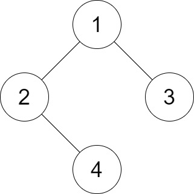
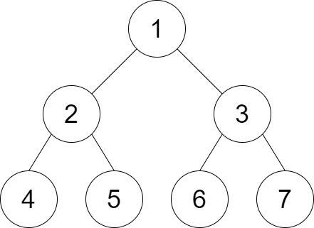

# [1530. Number of Good Leaf Nodes Pairs](https://leetcode.com/problems/number-of-good-leaf-nodes-pairs/)

| Category | Difficulty | Likes | Dislikes |
| :------: | :--------: | :---: | :------: |
| Algorithms | Medium | 2491 | 110 |

**Tags:** [`tree`](https://leetcode.com/tag/tree), [`depth-first-search`](https://leetcode.com/tag/depth-first-search), [`binary-tree`](https://leetcode.com/tag/binary-tree)

**Companies:** `tiktok`, `bytedance`, `google`

## Description

You are given the `root` of a binary tree and an integer `distance`. A pair of two different **leaf** nodes of a binary tree is said to be good if the length of **the shortest path** between them is less than or equal to `distance`.

Return *the number of good leaf node pairs* in the tree.

 

**Example 1:**


```

Input: root = [1,2,3,null,4], distance = 3
Output: 1
Explanation: The leaf nodes of the tree are 3 and 4 and the length of the shortest path between them is 3. This is the only good pair.

```

**Example 2:**


```

Input: root = [1,2,3,4,5,6,7], distance = 3
Output: 2
Explanation: The good pairs are [4,5] and [6,7] with shortest path = 2. The pair [4,6] is not good because the length of ther shortest path between them is 4.

```

**Example 3:**

```

Input: root = [7,1,4,6,null,5,3,null,null,null,null,null,2], distance = 3
Output: 1
Explanation: The only good pair is [2,5].

```

 

**Constraints:**

	- The number of nodes in the `tree` is in the range `[1, 2^10].`

	- `1 <= Node.val <= 100`

	- `1 <= distance <= 10`

---

**Links:** [Submissions](https://leetcode.com/problems/number-of-good-leaf-nodes-pairs/) | [Solutions](https://leetcode.com/problems/number-of-good-leaf-nodes-pairs/)
