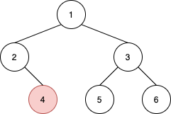
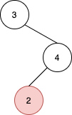

# [1602. Find Nearest Right Node in Binary Tree](https://leetcode.com/problems/find-nearest-right-node-in-binary-tree/)

| Category | Difficulty | Likes | Dislikes |
| :------: | :--------: | :---: | :------: |
| Algorithms | Medium | 332 | 10 |

**Tags:** [`tree`](https://leetcode.com/tag/tree), [`breadth-first-search`](https://leetcode.com/tag/breadth-first-search), [`binary-tree`](https://leetcode.com/tag/binary-tree)

**Companies:** `google`

## Description

Given the `root` of a binary tree and a node `u` in the tree, return *the **nearest** node on the **same level** that is to the **right** of* `u`*, or return* `null` *if *`u` *is the rightmost node in its level*.

 

**Example 1:**


```

Input: root = [1,2,3,null,4,5,6], u = 4
Output: 5
Explanation: The nearest node on the same level to the right of node 4 is node 5.

```

**Example 2:**


```

Input: root = [3,null,4,2], u = 2
Output: null
Explanation: There are no nodes to the right of 2.

```

 

**Constraints:**

	- The number of nodes in the tree is in the range `[1, 10^5]`.

	- `1 <= Node.val <= 10^5`

	- All values in the tree are **distinct**.

	- `u` is a node in the binary tree rooted at `root`.

---

**Links:** [Submissions](https://leetcode.com/problems/find-nearest-right-node-in-binary-tree/) | [Solutions](https://leetcode.com/problems/find-nearest-right-node-in-binary-tree/)
