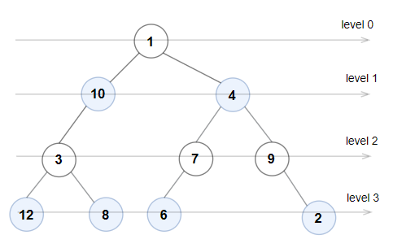
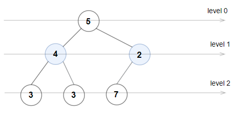
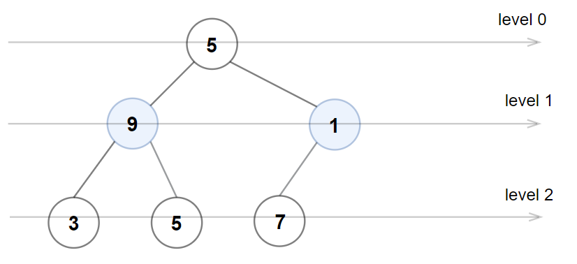

# [1609. Even Odd Tree](https://leetcode.com/problems/even-odd-tree/)

| Category | Difficulty | Likes | Dislikes |
| :------: | :--------: | :---: | :------: |
| Algorithms | Medium | 1869 | 102 |

**Tags:** [`tree`](https://leetcode.com/tag/tree), [`breadth-first-search`](https://leetcode.com/tag/breadth-first-search), [`binary-tree`](https://leetcode.com/tag/binary-tree)

**Companies:** `amazon`, `facebook`, `bloomberg`

## Description

A binary tree is named **Even-Odd** if it meets the following conditions:

	- The root of the binary tree is at level index `0`, its children are at level index `1`, their children are at level index `2`, etc.

	- For every **even-indexed** level, all nodes at the level have **odd** integer values in **strictly increasing** order (from left to right).

	- For every odd-indexed level, all nodes at the level have even integer values in **strictly decreasing** order (from left to right).

Given the `root` of a binary tree, *return *`true`* if the binary tree is **Even-Odd**, otherwise return *`false`*.*

 

**Example 1:**


```

Input: root = [1,10,4,3,null,7,9,12,8,6,null,null,2]
Output: true
Explanation: The node values on each level are:
Level 0: [1]
Level 1: [10,4]
Level 2: [3,7,9]
Level 3: [12,8,6,2]
Since levels 0 and 2 are all odd and increasing and levels 1 and 3 are all even and decreasing, the tree is Even-Odd.

```

**Example 2:**


```

Input: root = [5,4,2,3,3,7]
Output: false
Explanation: The node values on each level are:
Level 0: [5]
Level 1: [4,2]
Level 2: [3,3,7]
Node values in level 2 must be in strictly increasing order, so the tree is not Even-Odd.

```

**Example 3:**


```

Input: root = [5,9,1,3,5,7]
Output: false
Explanation: Node values in the level 1 should be even integers.

```

 

**Constraints:**

	- The number of nodes in the tree is in the range `[1, 10^5]`.

	- `1 <= Node.val <= 10^6`

---

**Links:** [Submissions](https://leetcode.com/problems/even-odd-tree/) | [Solutions](https://leetcode.com/problems/even-odd-tree/)
