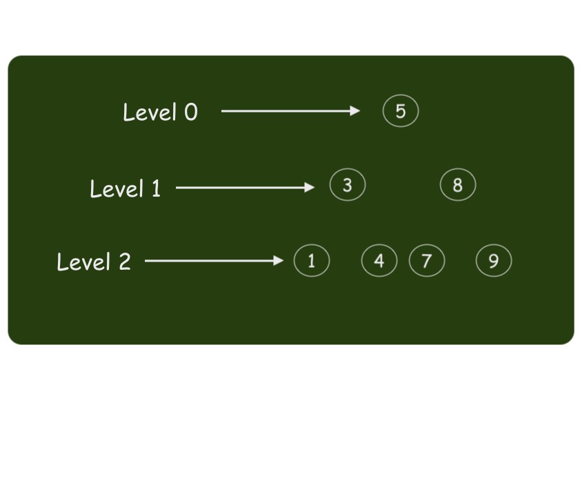
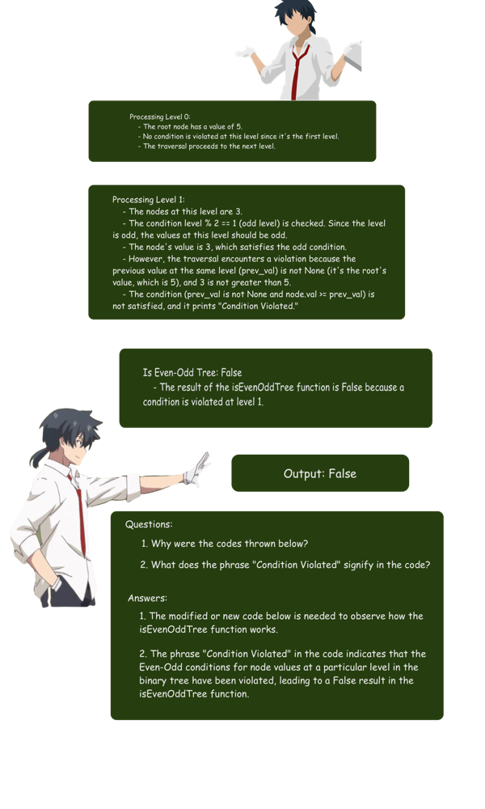
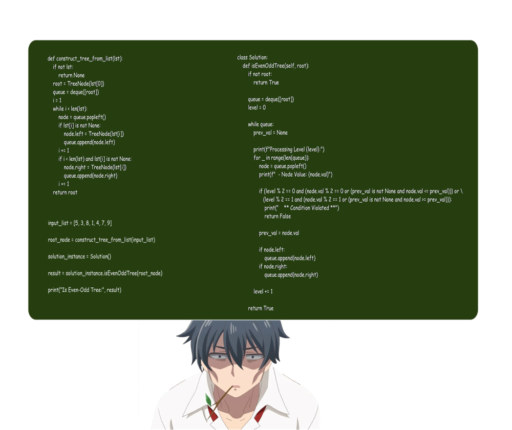

# 🧩 Even-Odd Tree Validator | Python | Python3 | JavaScript | C++🌳🔍

**Author:** DevOgabek
**Votes:** 136
**Link:** [https://leetcode.com/problems/even-odd-tree/solutions/4797529/](https://leetcode.com/problems/even-odd-tree/solutions/4797529/)

---




#  *Explanation:*





# Code
```python []
class Solution:
    def isEvenOddTree(self, root):
        if not root:
            # An empty tree is considered an Even-Odd tree.
            return True

        # Use a deque for efficient queue operations.
        queue = deque([root])
        level = 0

        while queue:
            prev_val = None  # Previous value at the current level.

            # Process all nodes at the current level.
            for _ in range(len(queue)):
                node = queue.popleft()

                # Check if the values follow the Even-Odd conditions.
                if (level % 2 == 0 and (node.val % 2 == 0 or (prev_val is not None and node.val <= prev_val))) or \\
                   (level % 2 == 1 and (node.val % 2 == 1 or (prev_val is not None and node.val >= prev_val))):
                    return False

                prev_val = node.val

                # Add children to the deque.
                if node.left:
                    queue.append(node.left)
                if node.right:
                    queue.append(node.right)

            level += 1

        # All levels satisfy the conditions.
        return True
```
```python3 []
class Solution:
    def isEvenOddTree(self, root: Optional[TreeNode]) -> bool:
        if not root:
            # An empty tree is considered an Even-Odd tree.
            return True

        # Use a deque for efficient queue operations.
        queue = deque([root])
        level = 0

        while queue:
            prev_val = None  # Previous value at the current level.

            # Process all nodes at the current level.
            for _ in range(len(queue)):
                node = queue.popleft()

                # Check if the values follow the Even-Odd conditions.
                if (level % 2 == 0 and (node.val % 2 == 0 or (prev_val is not None and node.val <= prev_val))) or \\
                   (level % 2 == 1 and (node.val % 2 == 1 or (prev_val is not None and node.val >= prev_val))):
                    return False

                prev_val = node.val

                # Add children to the deque.
                if node.left:
                    queue.append(node.left)
                if node.right:
                    queue.append(node.right)

            level += 1

        # All levels satisfy the conditions.
        return True

```
```C++ []
class Solution {
public:
    bool isEvenOddTree(TreeNode* root) {
        if (!root) {
            return true;
        }

        std::queue<TreeNode*> queue;
        int level = 0;

        queue.push(root);

        while (!queue.empty()) {
            int size = queue.size();
            int prev_val = (level % 2 == 0) ? std::numeric_limits<int>::min() : std::numeric_limits<int>::max();

            for (int i = 0; i < size; ++i) {
                TreeNode* node = queue.front();
                queue.pop();

                // Check if the values follow the conditions
                if ((level % 2 == 0 && (node->val % 2 == 0 || node->val <= prev_val)) ||
                    (level % 2 == 1 && (node->val % 2 == 1 || node->val >= prev_val))) {
                    return false;
                }

                prev_val = node->val;

                // Add children to the queue
                if (node->left) {
                    queue.push(node->left);
                }
                if (node->right) {
                    queue.push(node->right);
                }
            }

            level++;
        }

        return true;
    }
};
```
```JavaScript []
var isEvenOddTree = function(root) {
    if (!root) {
        return true;
    }

    let queue = [root];
    let level = 0;

    while (queue.length > 0) {
        let size = queue.length;
        let prevVal = (level % 2 === 0) ? Number.MIN_SAFE_INTEGER : Number.MAX_SAFE_INTEGER;

        for (let i = 0; i < size; i++) {
            let node = queue.shift();

            // Check if the values follow the conditions
            if ((level % 2 === 0 && (node.val % 2 === 0 || node.val <= prevVal)) ||
                (level % 2 === 1 && (node.val % 2 === 1 || node.val >= prevVal))) {
                return false;
            }

            prevVal = node.val;

            // Add children to the queue
            if (node.left) {
                queue.push(node.left);
            }
            if (node.right) {
                queue.push(node.right);
            }
        }

        level++;
    }

    return true;
};

```


## **My solutions**

\uD83D\uDFE2 - $$easy$$  
\uD83D\uDFE1 - $$medium$$ 
\uD83D\uDD34 - $$hard$$

\uD83D\uDFE1 [17. Letter Combinations of a Phone Number](https://leetcode.com/problems/letter-combinations-of-a-phone-number/solutions/4845532/there-is-an-80-chance-of-being-in-the-interview-full-problem-explanation)
\uD83D\uDFE1 [22. Generate Parentheses](https://leetcode.com/problems/generate-parentheses/solutions/4845742/simple-explanation-with-pictures)
\uD83D\uDFE1 [39. Combination Sum](https://leetcode.com/problems/combination-sum/solutions/4847482/beat-8292-full-explanation-with-pictures)
\uD83D\uDFE2 [2540. Minimum Common Value](https://leetcode.com/problems/minimum-common-value/solutions/4845076/beat-9759-full-explanation-with-pictures)
\uD83D\uDFE2 [3005. Count Elements With Maximum Frequency](https://leetcode.com/problems/count-elements-with-maximum-frequency/solutions/4839796/beat-8369-full-explanation-with-pictures)
\uD83D\uDFE2 [3028. Ant on the Boundary](https://leetcode.com/problems/ant-on-the-boundary/solutions/4837433/full-explanation-with-pictures)
\uD83D\uDFE2 [876. Middle of the Linked List](https://leetcode.com/problems/middle-of-the-linked-list/solutions/4834682/beat-10000-full-explanation-with-pictures)
\uD83D\uDFE1 [1750. Minimum Length of String After Deleting Similar Ends](https://leetcode.com/problems/minimum-length-of-string-after-deleting-similar-ends/solutions/4824224/beat-10000-full-explanation-with-pictures)
\uD83D\uDFE1 [948. Bag of Tokens](https://leetcode.com/problems/bag-of-tokens/solutions/4818912/beat-10000-full-explanation-with-pictures)
\uD83D\uDFE1 [19. Remove Nth Node From End of List](https://leetcode.com/problems/remove-nth-node-from-end-of-list/solutions/4813340/beat-10000-full-explanation-with-pictures)
\uD83D\uDFE2 [977. Squares of a Sorted Array](https://leetcode.com/problems/squares-of-a-sorted-array/solutions/4807704/square-sorter-python-python3-javascript-c)
\uD83D\uDFE2 [2864. Maximum Odd Binary Number](https://leetcode.com/problems/maximum-odd-binary-number/solutions/4802402/visual-max-odd-binary-solver-python-python3-javascript-c)
\uD83D\uDFE1 [1609. Even Odd Tree](https://leetcode.com/problems/even-odd-tree/solutions/4797529/even-odd-tree-validator-python-python3-javascript-c)
\uD83D\uDFE2 [9. Palindrome Number](https://leetcode.com/problems/palindrome-number/solutions/4795373/why-not-1-line-of-code-python-python3-c-everyone-can-understand)
\uD83D\uDFE1 [513. Find Bottom Left Tree Value](https://leetcode.com/problems/find-bottom-left-tree-value/solutions/4792022/binary-tree-explorer-mastered-javascript-python-python3-c-10000-efficiency-seeker)
\uD83D\uDFE2 [1. Two Sum](https://leetcode.com/problems/two-sum/solutions/4791305/5-methods-python-c-python3-from-easy-to-difficult)
\uD83D\uDFE2 [543. Diameter of Binary Tree](https://leetcode.com/problems/diameter-of-binary-tree/solutions/4787634/surpassing-9793-memory-magician-excelling-at-9723)
[More...](https://leetcode.com/DevOgabek/)


