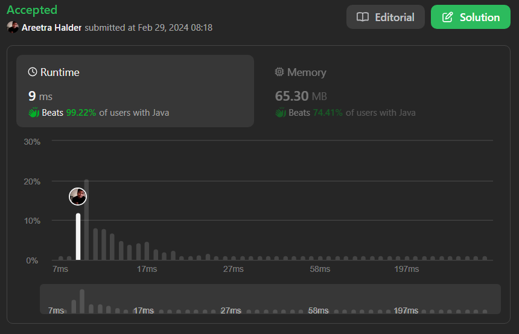

# 🔥✅✅ Beats 99.22% with Proof | Very Easy to Understand ✅✅🔥

**Author:** areetrahalder
**Votes:** 10
**Link:** [https://leetcode.com/problems/even-odd-tree/solutions/4797567/](https://leetcode.com/problems/even-odd-tree/solutions/4797567/)

---

# Upvote - If you are watching the proof



# Intuition
<!-- Describe your first thoughts on how to solve this problem. -->
The intuition behind this solution is to perform a level-order traversal of the binary tree while checking the conditions for an Even-Odd tree at each level.

# Approach
<!-- Describe your approach to solving the problem. -->
1. Use a queue to perform level-order traversal.
2. Initialize a variable `level` to keep track of the current level (starting from 0).
3. Iterate through the nodes at each level and check the conditions for an Even-Odd tree.
4. For even-indexed levels (`level % 2 == 0`), check if the values are odd and strictly increasing.
5. For odd-indexed levels (`level % 2 == 1`), check if the values are even and strictly decreasing.
6. If any condition is violated, return `false`. Otherwise, continue the traversal.
7. If the traversal completes without any violations, return `true`.

# Complexity
- Time complexity: $$O(n)$$
<!-- Add your time complexity here, e.g. $$O(n)$$ -->
> where n is the number of nodes in the tree (each node is visited once).

- Space complexity: $$O(m)$$
<!-- Add your space complexity here, e.g. $$O(n)$$ -->
> where m is the maximum number of nodes at any level in the tree (maximum size of the queue). In the worst case, the last level of the tree might have roughly half of the nodes, so m is approximately n/2.

# Code
```Java []
/**
 * Definition for a binary tree node.
 * public class TreeNode {
 *     int val;
 *     TreeNode left;
 *     TreeNode right;
 *     TreeNode() {}
 *     TreeNode(int val) { this.val = val; }
 *     TreeNode(int val, TreeNode left, TreeNode right) {
 *         this.val = val;
 *         this.left = left;
 *         this.right = right;
 *     }
 * }
 */
class Solution {
    public boolean isEvenOddTree(TreeNode root) {
        if(root == null) return false;
        ArrayDeque<TreeNode> queue = new ArrayDeque<>();
        queue.add(root);
        int level = -1;
        while(!queue.isEmpty()){
            level++;
            int size = queue.size(), prev = 0;
            for(int i = 0; i < size; i++){
                TreeNode curr = queue.poll();

                if(level == 0 && curr.val % 2 == 0){                        
                    return false;
                }
                if(i == 0){
                    if((level % 2 == 0 && curr.val % 2 == 1)
                    || (level % 2 == 1 && curr.val % 2 == 0)
                    ){                    
                        prev = curr.val;
                    }else{
                        return false;
                    }
                }
                else{                    
                    if (level % 2 == 1){
                        if(curr.val % 2 == 0 && prev > curr.val){
                            prev = curr.val;
                        }else{
                            return false;
                        }
                    }else{
                        if(curr.val % 2 == 1 && prev < curr.val){
                            prev = curr.val;
                        }else{
                            return false;
                        }
                    }
                }
                                        
                if(curr.left != null){
                    queue.add(curr.left);
                }
                
                if(curr.right != null){
                    queue.add(curr.right);
                }

            }
        }
        return true;
    }
}
```
```C []
/**
 * Definition for a binary tree node.
 * struct TreeNode {
 *     int val;
 *     struct TreeNode *left;
 *     struct TreeNode *right;
 * };
 */
bool isEvenOddTree(struct TreeNode* root) {
    if (root == NULL)
        return false;
    
    struct TreeNode** queue = malloc(10005 * sizeof(struct TreeNode*));
    int front = -1, rear = -1, level = -1;
    
    queue[++rear] = root;
    
    while (front < rear) {
        level++;
        int size = rear - front;
        int prev = 0;
        
        for (int i = 0; i < size; i++) {
            struct TreeNode* curr = queue[++front];
            
            if (level == 0 && curr->val % 2 == 0)
                return false;
            
            if (i == 0) {
                if ((level % 2 == 0 && curr->val % 2 == 1)
                || (level % 2 == 1 && curr->val % 2 == 0)) {
                    prev = curr->val;
                } else {
                    return false;
                }
            } else {
                if (level % 2 == 1) {
                    if (curr->val % 2 == 0 && prev > curr->val) {
                        prev = curr->val;
                    } else {
                        return false;
                    }
                } else {
                    if (curr->val % 2 == 1 && prev < curr->val) {
                        prev = curr->val;
                    } else {
                        return false;
                    }
                }
            }
            
            if (curr->left != NULL)
                queue[++rear] = curr->left;
            
            if (curr->right != NULL)
                queue[++rear] = curr->right;
        }
    }
    
    free(queue);
    return true;
}
```
```C++ []
/**
 * Definition for a binary tree node.
 * struct TreeNode {
 *     int val;
 *     TreeNode *left;
 *     TreeNode *right;
 * };
 */
class Solution {
public:
    bool isEvenOddTree(TreeNode* root) {
        if (root == nullptr)
            return false;

        queue<TreeNode*> q;
        q.push(root);
        int level = -1;

        while (!q.empty()) {
            level++;
            int size = q.size();
            int prev = 0;

            for (int i = 0; i < size; i++) {
                TreeNode* curr = q.front();
                q.pop();

                if (level == 0 && curr->val % 2 == 0)
                    return false;

                if (i == 0) {
                    if ((level % 2 == 0 && curr->val % 2 == 1)
                    || (level % 2 == 1 && curr->val % 2 == 0)) {
                        prev = curr->val;
                    } else {
                        return false;
                    }
                } else {
                    if (level % 2 == 1) {
                        if (curr->val % 2 == 0 && prev > curr->val) {
                            prev = curr->val;
                        } else {
                            return false;
                        }
                    } else {
                        if (curr->val % 2 == 1 && prev < curr->val) {
                            prev = curr->val;
                        } else {
                            return false;
                        }
                    }
                }

                if (curr->left != nullptr)
                    q.push(curr->left);

                if (curr->right != nullptr)
                    q.push(curr->right);
            }
        }

        return true;
    }
};

```
```C# []
/**
 * Definition for a binary tree node.
 * public class TreeNode {
 *     public int val;
 *     public TreeNode left;
 *     public TreeNode right;
 *     public TreeNode(int val=0, TreeNode left=null, TreeNode right=null) {
 *         this.val = val;
 *         this.left = left;
 *         this.right = right;
 *     }
 * }
 */
public class Solution {
    public bool IsEvenOddTree(TreeNode root) {
        if (root == null)
            return false;

        Queue<TreeNode> queue = new Queue<TreeNode>();
        queue.Enqueue(root);
        int level = -1;

        while (queue.Count > 0) {
            level++;
            int size = queue.Count;
            int prev = 0;

            for (int i = 0; i < size; i++) {
                TreeNode curr = queue.Dequeue();

                if (level == 0 && curr.val % 2 == 0)
                    return false;

                if (i == 0) {
                    if ((level % 2 == 0 && curr.val % 2 == 1)
                    || (level % 2 == 1 && curr.val % 2 == 0)) {
                        prev = curr.val;
                    } else {
                        return false;
                    }
                } else {
                    if (level % 2 == 1) {
                        if (curr.val % 2 == 0 && prev > curr.val) {
                            prev = curr.val;
                        } else {
                            return false;
                        }
                    } else {
                        if (curr.val % 2 == 1 && prev < curr.val) {
                            prev = curr.val;
                        } else {
                            return false;
                        }
                    }
                }

                if (curr.left != null)
                    queue.Enqueue(curr.left);

                if (curr.right != null)
                    queue.Enqueue(curr.right);
            }
        }

        return true;
    }
}
```
```Python []
# Definition for a binary tree node.
# class TreeNode(object):
#     def __init__(self, val=0, left=None, right=None):
#         self.val = val
#         self.left = left
#         self.right = right

class Solution(object):
    def isEvenOddTree(self, root):
        """
        :type root: TreeNode
        :rtype: bool
        """
        if not root:
            return False
        
        queue = deque()
        queue.append(root)
        level = -1
        
        while queue:
            level += 1
            size = len(queue)
            prev = 0
            
            for i in range(size):
                curr = queue.popleft()

                if level == 0 and curr.val % 2 == 0:
                    return False

                if i == 0:
                    if (level % 2 == 0 and curr.val % 2 == 1) or (level % 2 == 1 and curr.val % 2 == 0):
                        prev = curr.val
                    else:
                        return False
                else:
                    if level % 2 == 1:
                        if curr.val % 2 == 0 and prev > curr.val:
                            prev = curr.val
                        else:
                            return False
                    else:
                        if curr.val % 2 == 1 and prev < curr.val:
                            prev = curr.val
                        else:
                            return False

                if curr.left:
                    queue.append(curr.left)
                
                if curr.right:
                    queue.append(curr.right)

        return True
```
```Python3 []
# Definition for a binary tree node.
# class TreeNode:
#     def __init__(self, val=0, left=None, right=None):
#         self.val = val
#         self.left = left
#         self.right = right
from collections import deque
from typing import Optional

class Solution:
    def isEvenOddTree(self, root: Optional[TreeNode]) -> bool:
        if not root:
            return False
        
        queue = deque([root])
        level = -1
        
        while queue:
            level += 1
            size = len(queue)
            prev = 0
            
            for i in range(size):
                curr = queue.popleft()

                if level == 0 and curr.val % 2 == 0:
                    return False

                if i == 0:
                    if (level % 2 == 0 and curr.val % 2 == 1) or (level % 2 == 1 and curr.val % 2 == 0):
                        prev = curr.val
                    else:
                        return False
                else:
                    if level % 2 == 1:
                        if curr.val % 2 == 0 and prev > curr.val:
                            prev = curr.val
                        else:
                            return False
                    else:
                        if curr.val % 2 == 1 and prev < curr.val:
                            prev = curr.val
                        else:
                            return False

                if curr.left:
                    queue.append(curr.left)
                
                if curr.right:
                    queue.append(curr.right)

        return True
```
```Javascript []
/**
 * Definition for a binary tree node.
 * function TreeNode(val, left, right) {
 *     this.val = (val===undefined ? 0 : val)
 *     this.left = (left===undefined ? null : left)
 *     this.right = (right===undefined ? null : right)
 * }
 */
/**
 * @param {TreeNode} root
 * @return {boolean}
 */
var isEvenOddTree = function(root) {
    if (!root) return false;
    
    let queue = [root];
    let level = -1;
    
    while (queue.length > 0) {
        level++;
        let size = queue.length;
        let prev = 0;
        
        for (let i = 0; i < size; i++) {
            let curr = queue.shift();

            if (level === 0 && curr.val % 2 === 0) {
                return false;
            }

            if (i === 0) {
                if ((level % 2 === 0 && curr.val % 2 === 1) ||
                    (level % 2 === 1 && curr.val % 2 === 0)) {
                    prev = curr.val;
                } else {
                    return false;
                }
            } else {
                if (level % 2 === 1) {
                    if (curr.val % 2 === 0 && prev > curr.val) {
                        prev = curr.val;
                    } else {
                        return false;
                    }
                } else {
                    if (curr.val % 2 === 1 && prev < curr.val) {
                        prev = curr.val;
                    } else {
                        return false;
                    }
                }
            }

            if (curr.left) {
                queue.push(curr.left);
            }

            if (curr.right) {
                queue.push(curr.right);
            }
        }
    }
    
    return true;
};

```
```Typescript []
/**
 * Definition for a binary tree node.
 * class TreeNode {
 *     val: number
 *     left: TreeNode | null
 *     right: TreeNode | null
 *     constructor(val?: number, left?: TreeNode | null, right?: TreeNode | null) {
 *         this.val = (val===undefined ? 0 : val)
 *         this.left = (left===undefined ? null : left)
 *         this.right = (right===undefined ? null : right)
 *     }
 * }
 */

function isEvenOddTree(root: TreeNode | null): boolean {
    if (root === null) return false;

    const queue: TreeNode[] = [];
    queue.push(root);
    let level = -1;

    while (queue.length > 0) {
        level++;
        const size = queue.length;
        let prev = 0;

        for (let i = 0; i < size; i++) {
            const curr = queue.shift()!;

            if (level === 0 && curr.val % 2 === 0) {
                return false;
            }

            if (i === 0) {
                if ((level % 2 === 0 && curr.val % 2 === 1)
                    || (level % 2 === 1 && curr.val % 2 === 0)
                ) {
                    prev = curr.val;
                } else {
                    return false;
                }
            } else {
                if (level % 2 === 1) {
                    if (curr.val % 2 === 0 && prev > curr.val) {
                        prev = curr.val;
                    } else {
                        return false;
                    }
                } else {
                    if (curr.val % 2 === 1 && prev < curr.val) {
                        prev = curr.val;
                    } else {
                        return false;
                    }
                }
            }

            if (curr.left !== null) {
                queue.push(curr.left);
            }

            if (curr.right !== null) {
                queue.push(curr.right);
            }
        }
    }

    return true;
}
```

# Upvote - Please

