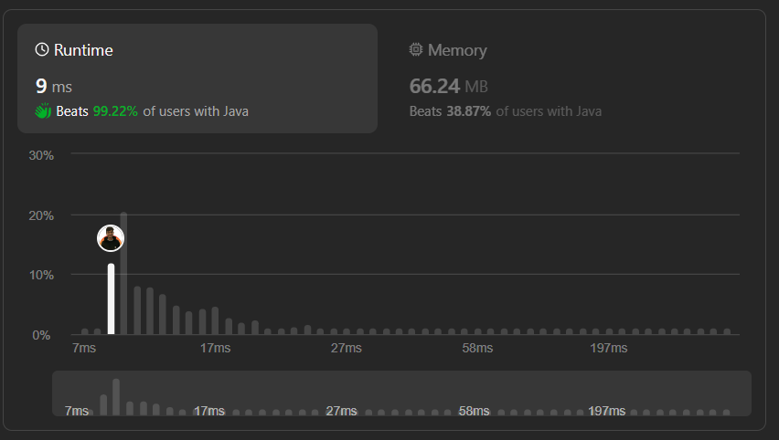

# Beats 💯%|| 🍉Complete & Clean Explaination 🔥|| || Java,C++,Python,Javasctipt,C,C#,PHP,Typescript🔥

**Author:** dharmikgohil
**Votes:** 4
**Link:** [https://leetcode.com/problems/even-odd-tree/solutions/4801009/](https://leetcode.com/problems/even-odd-tree/solutions/4801009/)

---



# Intuition
The problem requires determining whether a given binary tree is an "even-odd" tree. To solve this, we need to traverse the tree level by level and check if certain conditions are met for each level.

# Approach
1. We will perform a breadth-first search (BFS) traversal of the binary tree.
2. At each level, we will check whether the values follow the rules of an even-odd tree:
   - For even levels (0-indexed), all values should be odd and strictly increasing.
   - For odd levels, all values should be even and strictly decreasing.
3. We will use a queue to perform the BFS traversal.
4. During traversal, we will keep track of the level's even/odd status and the previous value encountered.
5. If any violation of the rules is found, we return false immediately. Otherwise, we return true at the end.

# Complexity
- Time complexity: `\\(O(n)\\)`, where `\\(n\\)` is the number of nodes in the binary tree. We visit each node once during the BFS traversal.
- Space complexity: `\\(O(n)\\)`, where `\\(n\\)` is the maximum number of nodes in a level of the binary tree. This is the space required for the queue during BFS traversal.

# Codes (Complete Explaination below)

```Java []
class Solution {
    public boolean isEvenOddTree(TreeNode root) {
        if (root == null) {
            return true; // An empty tree is considered as an even-odd tree
        }
        Queue<TreeNode> queue = new LinkedList<>();
        queue.add(root);
        boolean isLevelEven = true;

        while (!queue.isEmpty()) {
            int levelSize = queue.size();
            int previousValue = isLevelEven ? Integer.MIN_VALUE : Integer.MAX_VALUE; // Set previousValue accordingly
            boolean currentLevelEven = isLevelEven;
            for (int i = 0; i < levelSize; i++) {
                TreeNode curr = queue.poll();

                if (currentLevelEven && (curr.val % 2 == 0 || curr.val <= previousValue)) {
                    return false;
                }

                if (!currentLevelEven && (curr.val % 2 != 0 || curr.val >= previousValue)) {
                    return false;
                }
                previousValue = curr.val;

                if (curr.left != null) {
                    queue.add(curr.left);
                }

                if (curr.right != null) {
                    queue.add(curr.right);
                }
            }

            isLevelEven = !isLevelEven;
        }
        return true;
    }
}
```
```C++ []

class Solution {
public:
    bool isEvenOddTree(TreeNode* root) {
        if (root == nullptr) {
            return true; // An empty tree is considered as an even-odd tree
        }

        queue<TreeNode*> queue;
        queue.push(root);
        bool isLevelEven = true;

        while (!queue.empty()) {
            int levelSize = queue.size();
            int previousValue = isLevelEven ? INT_MIN : INT_MAX; // Set previousValue accordingly
            bool currentLevelEven = isLevelEven;

            for (int i = 0; i < levelSize; i++) {
                TreeNode* curr = queue.front();
                queue.pop();

                if (currentLevelEven && (curr->val % 2 == 0 || curr->val <= previousValue)) {
                    return false;
                }

                if (!currentLevelEven && (curr->val % 2 != 0 || curr->val >= previousValue)) {
                    return false;
                }
                previousValue = curr->val;

                if (curr->left != nullptr) {
                    queue.push(curr->left);
                }

                if (curr->right != nullptr) {
                    queue.push(curr->right);
                }
            }

            isLevelEven = !isLevelEven;
        }
        return true;
    }
};
```
```Python []

class Solution:
    def isEvenOddTree(self, root: TreeNode) -> bool:
        if root is None:
            return True  # An empty tree is considered as an even-odd tree

        queue = deque()
        queue.append(root)
        isLevelEven = True

        while queue:
            levelSize = len(queue)
            previousValue = float('-inf') if isLevelEven else float('inf')
            currentLevelEven = isLevelEven

            for _ in range(levelSize):
                curr = queue.popleft()

                if currentLevelEven and (curr.val % 2 == 0 or curr.val <= previousValue):
                    return False

                if not currentLevelEven and (curr.val % 2 != 0 or curr.val >= previousValue):
                    return False
                previousValue = curr.val

                if curr.left:
                    queue.append(curr.left)

                if curr.right:
                    queue.append(curr.right)

            isLevelEven = not isLevelEven

        return True
```
```Javascript []
var isEvenOddTree = function(root) {
    if (root === null) {
        return true; // An empty tree is considered as an even-odd tree
    }

    const queue = [];
    queue.push(root);
    let isLevelEven = true;

    while (queue.length > 0) {
        const levelSize = queue.length;
        let previousValue = isLevelEven ? -Infinity : Infinity;
        let currentLevelEven = isLevelEven;

        for (let i = 0; i < levelSize; i++) {
            const curr = queue.shift();

            if (currentLevelEven && (curr.val % 2 === 0 || curr.val <= previousValue)) {
                return false;
            }

            if (!currentLevelEven && (curr.val % 2 !== 0 || curr.val >= previousValue)) {
                return false;
            }
            previousValue = curr.val;

            if (curr.left !== null) {
                queue.push(curr.left);
            }

            if (curr.right !== null) {
                queue.push(curr.right);
            }
        }

        isLevelEven = !isLevelEven;
    }
    return true;
};
```
```C []

bool isEvenOddTree(struct TreeNode *root) {
    if (root == NULL) {
        return true; // An empty tree is considered as an even-odd tree
    }

    struct TreeNode *queue[10000]; // Assuming a maximum of 10000 nodes
    int front = 0, rear = 0;
    queue[rear++] = root;
    bool isLevelEven = true;

    while (front < rear) {
        int levelSize = rear - front;
        int previousValue = isLevelEven ? INT_MIN : INT_MAX; // Set previousValue accordingly
        bool currentLevelEven = isLevelEven;

        for (int i = 0; i < levelSize; i++) {
            struct TreeNode *curr = queue[front++];
            
            if (currentLevelEven && (curr->val % 2 == 0 || curr->val <= previousValue)) {
                return false;
            }

            if (!currentLevelEven && (curr->val % 2 != 0 || curr->val >= previousValue)) {
                return false;
            }
            previousValue = curr->val;

            if (curr->left != NULL) {
                queue[rear++] = curr->left;
            }

            if (curr->right != NULL) {
                queue[rear++] = curr->right;
            }
        }

        isLevelEven = !isLevelEven;
    }
    return true;
}
```
```C# []

public class Solution {
    public bool IsEvenOddTree(TreeNode root) {
        if (root == null) {
            return true; // An empty tree is considered as an even-odd tree
        }

        Queue<TreeNode> queue = new Queue<TreeNode>();
        queue.Enqueue(root);
        bool isLevelEven = true;

        while (queue.Count > 0) {
            int levelSize = queue.Count;
            int previousValue = isLevelEven ? int.MinValue : int.MaxValue; // Set previousValue accordingly
            bool currentLevelEven = isLevelEven;

            for (int i = 0; i < levelSize; i++) {
                TreeNode curr = queue.Dequeue();

                if (currentLevelEven && (curr.val % 2 == 0 || curr.val <= previousValue)) {
                    return false;
                }

                if (!currentLevelEven && (curr.val % 2 != 0 || curr.val >= previousValue)) {
                    return false;
                }
                previousValue = curr.val;

                if (curr.left != null) {
                    queue.Enqueue(curr.left);
                }

                if (curr.right != null) {
                    queue.Enqueue(curr.right);
                }
            }

            isLevelEven = !isLevelEven;
        }
        return true;
    }
}
```
```PHP []

class Solution {
    /**
     * @param TreeNode $root
     * @return Boolean
     */
    function isEvenOddTree($root) {
        if ($root === null) {
            return true; // An empty tree is considered as an even-odd tree
        }

        $queue = [];
        array_push($queue, $root);
        $isLevelEven = true;

        while (!empty($queue)) {
            $levelSize = count($queue);
            $previousValue = $isLevelEven ? PHP_INT_MIN : PHP_INT_MAX;
            $currentLevelEven = $isLevelEven;

            for ($i = 0; $i < $levelSize; $i++) {
                $curr = array_shift($queue);

                if ($currentLevelEven && ($curr->val % 2 === 0 || $curr->val <= $previousValue)) {
                    return false;
                }

                if (!$currentLevelEven && ($curr->val % 2 !== 0 || $curr->val >= $previousValue)) {
                    return false;
                }
                $previousValue = $curr->val;

                if ($curr->left !== null) {
                    array_push($queue, $curr->left);
                }

                if ($curr->right !== null) {
                    array_push($queue, $curr->right);
                }
            }

            $isLevelEven = !$isLevelEven;
        }
        return true;
    }
}
```
```Typescript []

function isEvenOddTree(root: TreeNode | null): boolean {
    if (root === null) {
        return true; // An empty tree is considered as an even-odd tree
    }

    const queue: TreeNode[] = [];
    queue.push(root);
    let isLevelEven = true;

    while (queue.length > 0) {
        const levelSize = queue.length;
        let previousValue = isLevelEven ? Number.MIN_SAFE_INTEGER : Number.MAX_SAFE_INTEGER;
        let currentLevelEven = isLevelEven;

        for (let i = 0; i < levelSize; i++) {
            const curr = queue.shift()!;

            if (currentLevelEven && (curr.val % 2 === 0 || curr.val <= previousValue)) {
                return false;
            }

            if (!currentLevelEven && (curr.val % 2 !== 0 || curr.val >= previousValue)) {
                return false;
            }
            previousValue = curr.val;

            if (curr.left !== null) {
                queue.push(curr.left);
            }

            if (curr.right !== null) {
                queue.push(curr.right);
            }
        }

        isLevelEven = !isLevelEven;
    }
    return true;
}
```


# Code With Complete Explaination
```
/**
 * Definition for a binary tree node.
 * public class TreeNode {
 *     int val;
 *     TreeNode left;
 *     TreeNode right;
 *     TreeNode() {}
 *     TreeNode(int val) { this.val = val; }
 *     TreeNode(int val, TreeNode left, TreeNode right) {
 *         this.val = val;
 *         this.left = left;
 *         this.right = right;
 *     }
 * }
 */
class Solution {
    public boolean isEvenOddTree(TreeNode root) {
        // Check if the tree is empty, if so, it is considered as an even-odd tree
        if (root == null) {
            return true;
        }

        // Create a queue for level-order traversal
        Queue<TreeNode> queue = new LinkedList<>();
        queue.add(root); // Add the root node to the queue
        boolean isLevelEven = true; // Flag to track whether the current level is even or odd

        // Perform level-order traversal
        while (!queue.isEmpty()) {
            int levelSize = queue.size(); // Get the number of nodes in the current level
            int previousValue = isLevelEven ? Integer.MIN_VALUE : Integer.MAX_VALUE;
            // Initialize previousValue based on whether the current level is even or odd
            boolean currentLevelEven = isLevelEven; // Store the current level's even/odd status before toggling

            // Process each node in the current level
            for (int i = 0; i < levelSize; i++) {
                TreeNode curr = queue.poll(); // Dequeue the current node

                // Check if the current level is even and if the current node's value violates the rules
                if (currentLevelEven && (curr.val % 2 == 0 || curr.val <= previousValue)) {
                    return false;
                }

                // Check if the current level is odd and if the current node's value violates the rules
                if (!currentLevelEven && (curr.val % 2 != 0 || curr.val >= previousValue)) {
                    return false;
                }

                previousValue = curr.val; // Update previousValue with the current node's value

                // Enqueue the left child if it exists
                if (curr.left != null) {
                    queue.add(curr.left);
                }

                // Enqueue the right child if it exists
                if (curr.right != null) {
                    queue.add(curr.right);
                }
            }

            // Toggle isLevelEven only if nodes were processed in the current level
            isLevelEven = !isLevelEven; // Toggle the even/odd level status for the next level
        }

        // If the traversal completes without encountering any violations, return true
        return true;
    }
}
```
# Please UPVOTE If you find Helpful\uD83E\uDD7A\uD83D\uDC4D