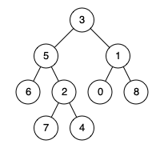

# Java. Difference from 236 is you need to search the entire tree.

**Author:** o_inari
**Votes:** 243
**Link:** [https://leetcode.com/problems/lowest-common-ancestor-of-a-binary-tree-ii/solutions/933835/](https://leetcode.com/problems/lowest-common-ancestor-of-a-binary-tree-ii/solutions/933835/)

---

This question is similar to [236. Last Common Ancestor of Binary Tree](https://leetcode.com/problems/lowest-common-ancestor-of-a-binary-tree/). Question 236 has two important premises: 
1. It is guaranteed that both p and q are in the tree.
2. A node can be a descendant of itself.

In the case of p = 5 and q = 4:


Because of the premises, we can return either p OR q as soon as we find one of them. Here is the code:

```
public TreeNode lowestCommonAncestor(TreeNode root, TreeNode p, TreeNode q) {
	if (root == p || root == q || root == null) return root;
    TreeNode left = lowestCommonAncestor(root.left, p, q);     
    TreeNode right = lowestCommonAncestor(root.right, p, q);
    return left == null ? right : right == null ? left : root;
}
```

But for this question, the premises are different:
1. It is NOT guaranteed that both p and q are in the tree. 
2. A node can still be a descendant of itself.

Hence,
1. We need a way to record if we've seen both p and q
2. We need to traverse the entire tree even after we've found one of them.

Here are the differences in code. The rest is the same.
1. Use either `boolean` or integers as flags
2. Keep traversing down the entire tree. If you return early, the above example would be null, because the code stops when it finds 5 and does not keep searching for 4.

Solution 1: Use 2 booleans 
```
class Solution {
    boolean pFound = false;
    boolean qFound = false;

    public TreeNode lowestCommonAncestor(TreeNode root, TreeNode p, TreeNode q) {
        TreeNode LCA = LCA(root, p, q);
        return pFound && qFound ? LCA : null;
    }
    
    public TreeNode LCA(TreeNode root, TreeNode p, TreeNode q) {
        if (root == null) return root;
        TreeNode left = LCA(root.left, p, q);     
        TreeNode right = LCA(root.right, p, q);
        if (root == p) {
            pFound = true;
            return root;
        }
        if (root == q) {
            qFound = true;
            return root;
        }
        return left == null ? right : right == null ? left : root;
    }
}
```

Solution 2: Use integers

```
class Solution {
	int count = 0;
	
    public TreeNode lowestCommonAncestor(TreeNode root, TreeNode p, TreeNode q) {
        TreeNode LCA = LCA(root, p, q);
        return count == 2 ? LCA : null;
    }
    
    public TreeNode LCA(TreeNode root, TreeNode p, TreeNode q) {
        if (root == null) return root;
        TreeNode left = LCA(root.left, p, q);     
        TreeNode right = LCA(root.right, p, q);
        if (root == p || root == q) {
            count++;
            return root;
        }
        return left == null ? right : right == null ? left : root;
    }
}
```

Time Complexity: O(N)
Space Complexity: O(H), H is the height of the tree