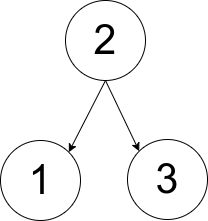
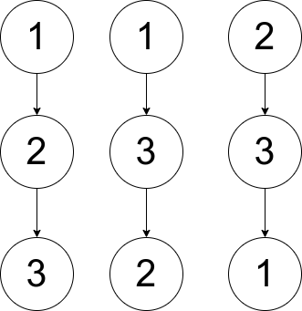

# [1719. Number Of Ways To Reconstruct A Tree](https://leetcode.com/problems/number-of-ways-to-reconstruct-a-tree/)

| Category | Difficulty | Likes | Dislikes |
| :------: | :--------: | :---: | :------: |
| Algorithms | Hard | 233 | 157 |

**Tags:** [`tree`](https://leetcode.com/tag/tree), [`graph`](https://leetcode.com/tag/graph)

**Companies:** `uber`

## Description

You are given an array `pairs`, where `pairs[i] = [x_i, y_i]`, and:

	- There are no duplicates.

	- `x_i  1`

A **rooted tree** is a tree that has a single root node, and all edges are oriented to be outgoing from the root.

An **ancestor** of a node is any node on the path from the root to that node (excluding the node itself). The root has no ancestors.

 

**Example 1:**


```

Input: pairs = [[1,2],[2,3]]
Output: 1
Explanation: There is exactly one valid rooted tree, which is shown in the above figure.

```

**Example 2:**


```

Input: pairs = [[1,2],[2,3],[1,3]]
Output: 2
Explanation: There are multiple valid rooted trees. Three of them are shown in the above figures.

```

**Example 3:**

```

Input: pairs = [[1,2],[2,3],[2,4],[1,5]]
Output: 0
Explanation: There are no valid rooted trees.
```

 

**Constraints:**

	- `1 <= pairs.length <= 10^5`

	- `1 <= x_i < y_i <= 500`

	- The elements in `pairs` are unique.

---

**Links:** [Submissions](https://leetcode.com/problems/number-of-ways-to-reconstruct-a-tree/) | [Solutions](https://leetcode.com/problems/number-of-ways-to-reconstruct-a-tree/)
