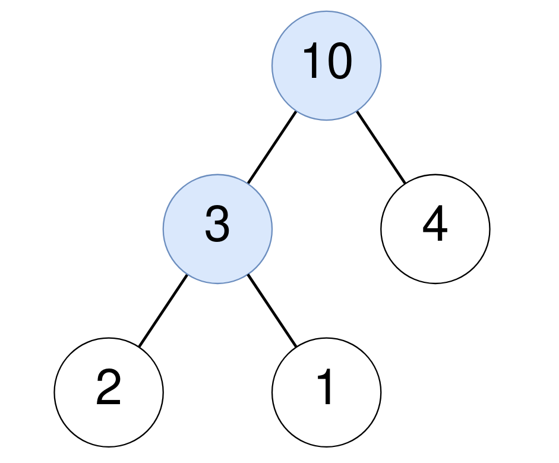
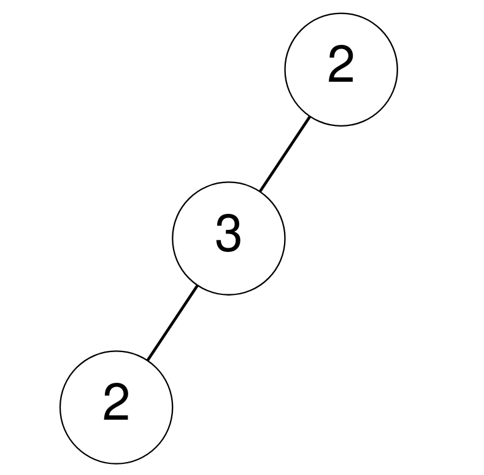
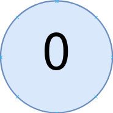

# [1973. Count Nodes Equal to Sum of Descendants](https://leetcode.com/problems/count-nodes-equal-to-sum-of-descendants/)

| Category | Difficulty | Likes | Dislikes |
| :------: | :--------: | :---: | :------: |
| Algorithms | Medium | 184 | 10 |

**Tags:** [`tree`](https://leetcode.com/tag/tree), [`depth-first-search`](https://leetcode.com/tag/depth-first-search), [`binary-tree`](https://leetcode.com/tag/binary-tree)

**Companies:** `facebook`

## Description

Given the `root` of a binary tree, return *the number of nodes where the value of the node is equal to the **sum** of the values of its descendants*.

A **descendant** of a node `x` is any node that is on the path from node `x` to some leaf node. The sum is considered to be `0` if the node has no descendants.

 

**Example 1:**


```

Input: root = [10,3,4,2,1]
Output: 2
Explanation:
For the node with value 10: The sum of its descendants is 3+4+2+1 = 10.
For the node with value 3: The sum of its descendants is 2+1 = 3.

```

**Example 2:**


```

Input: root = [2,3,null,2,null]
Output: 0
Explanation:
No node has a value that is equal to the sum of its descendants.

```

**Example 3:**


```

Input: root = [0]
Output: 1
For the node with value 0: The sum of its descendants is 0 since it has no descendants.

```

 

**Constraints:**

	- The number of nodes in the tree is in the range `[1, 10^5]`.

	- `0 <= Node.val <= 10^5`

---

**Links:** [Submissions](https://leetcode.com/problems/count-nodes-equal-to-sum-of-descendants/) | [Solutions](https://leetcode.com/problems/count-nodes-equal-to-sum-of-descendants/)
