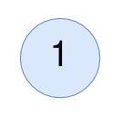

# [2265. Count Nodes Equal to Average of Subtree](https://leetcode.com/problems/count-nodes-equal-to-average-of-subtree/)

| Category | Difficulty | Likes | Dislikes |
| :------: | :--------: | :---: | :------: |
| Algorithms | Medium | 2336 | 58 |

**Tags:** [`tree`](https://leetcode.com/tag/tree), [`depth-first-search`](https://leetcode.com/tag/depth-first-search), [`binary-tree`](https://leetcode.com/tag/binary-tree)

**Companies:** `facebook`, `google`, `microsoft`

## Description

Given the `root` of a binary tree, return *the number of nodes where the value of the node is equal to the **average** of the values in its **subtree***.

**Note:**

	- The **average** of `n` elements is the **sum** of the `n` elements divided by `n` and **rounded down** to the nearest integer.

	- A **subtree** of `root` is a tree consisting of `root` and all of its descendants.

 

**Example 1:**


```

Input: root = [4,8,5,0,1,null,6]
Output: 5
Explanation: 
For the node with value 4: The average of its subtree is (4 + 8 + 5 + 0 + 1 + 6) / 6 = 24 / 6 = 4.
For the node with value 5: The average of its subtree is (5 + 6) / 2 = 11 / 2 = 5.
For the node with value 0: The average of its subtree is 0 / 1 = 0.
For the node with value 1: The average of its subtree is 1 / 1 = 1.
For the node with value 6: The average of its subtree is 6 / 1 = 6.

```

**Example 2:**


```

Input: root = [1]
Output: 1
Explanation: For the node with value 1: The average of its subtree is 1 / 1 = 1.

```

 

**Constraints:**

	- The number of nodes in the tree is in the range `[1, 1000]`.

	- `0 <= Node.val <= 1000`

---

**Links:** [Submissions](https://leetcode.com/problems/count-nodes-equal-to-average-of-subtree/) | [Solutions](https://leetcode.com/problems/count-nodes-equal-to-average-of-subtree/)
