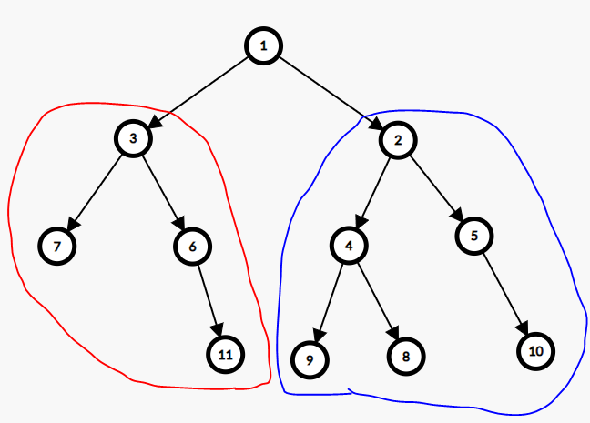
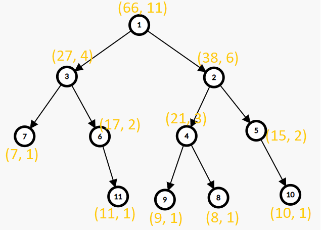

# 🚀 100% || DFS || Explained Intuition🚀

**Author:** MohamedMamdouh20
**Votes:** 93
**Link:** [https://leetcode.com/problems/count-nodes-equal-to-average-of-subtree/solutions/4237091/](https://leetcode.com/problems/count-nodes-equal-to-average-of-subtree/solutions/4237091/)

---

# Problem Description

Given the **root** of a binary tree. The task is to determine the **number** of nodes in the tree whose value **matches** the floored **average** of all the values within their respective **subtrees**. In other words, you need to count the nodes where the node's value is equal to the integer average of all values in its subtree.

- Here's some additional information to keep in mind:

    - The **average** of a set of elements is calculated by **summing** those elements and **dividing** the sum by the **number** of elements.
    - A **subtree** of a given node **includes** the node **itself** and all of its **descendant** nodes.

The **goal** is to find the count of nodes in the binary tree that **meet** this condition.

- **Constraints:**
    - The number of nodes in the tree is in the range `[1, 1000]`.
    - `0 <= Node.val <= 1000`.
    
---


# Intuition

Hello there,\uD83D\uDE04

Let's look\uD83D\uDC40 at today's problem.
In today's problem, We have a **tree**\uD83C\uDF32 and each node in it have a value and for each node we have to check if its value is **equal** to the average of values in its **subtree**. If so, calculate number of nodes with this description.\uD83E\uDD28

But before that what is a **subtree** of a node ?\uD83E\uDD14
A subtree in general is a part of a tree\uD83C\uDF32 but for a specific node the subtree is the part of the tree that containing all of its children and descnedants going down to the **leaves**.\uD83C\uDF43
let's see an example.


Here the subtree of `node 2` is the part with **blue** color. the subtree of `node 3` is the part with **red** color and also we can consider the **whole tree** as a subtree for `node 1`.

Now how we get the values and number of nodes for all of the node subtree?\uD83E\uDD14
I will pretend that I didn't say the algorithm in the title.\uD83D\uDE02
We can do it with a simple algorithm that **traverses** the tree and there is no simpler tha **DFS**, Our hero today\uD83E\uDDB8\u200D\u2642\uFE0F.

- And since any **tree**:
    - has only **one** **root**.
    - **doesn't** have **loops**.
    
Then we can apply **DFS** at the only **root** of the tree and without concerning about the loops.
The **DFS** Function of any node will **check** for all nodes in its subtree that meet our requirements and return the number of nodes in its subtree and the sum of values for its subtree.\uD83D\uDCAA


This is an example how our DFS will look like for each node since it will return `(sum of values of subtree, number of nodes)`.

And this is the solution for our today'S problem I hope that you understood it\uD83D\uDE80\uD83D\uDE80


---


# Approach
1. Initialize an integer variable `matchingSubtreeCount` to keep track of subtrees with matching averages.
2. Create a Depth-First Search **DFS** function `calculateSubtreeValues` that takes a `currentNode` as input and returns a pair of integers. These integers represent:
   - The **sum** of values within the current subtree.
   - The **number** of nodes within the current subtree.
3. In the `calculateSubtreeValues` function:
    - **Base Case**: check if the `currentNode` is null. If it is, return `{0, 0}`, signifying that both the sum and number of nodes are zero for a null node.
    - The **sum** of values in the current subtree is the **sum** of values in the left and right subtrees **plus** the value of the `currentNode` and The **number** of nodes is **number** of nodes in the left and right subtrees then **increment** it by 1 for the `currentNode`.
    - **Increment** the `matchingSubtreeCount` if the current node's value matches the average of its subtree.
    - **Return** a pair of values `{sumOfValues, numberOfNodes}` representing the calculated values for the current subtree.
11. In the main function, perform **DFS** from the root then return `matchingSubtreeCount` after traversing over all the nodes.


# Complexity
- **Time complexity:**$O(N)$
Since the DFS **traverse** over all the nodes of the tree then the complexity is `O(N)` where `N` is the number of nodes within the tree.
- **Space complexity:**$O(N)$
Since the DFS is a **recursive** call and it reserves a **memory stack frame** for each call so the **maximum** number of calls it can make in the same time is `N` calls so complexity is `O(N)`;


---


# Code
```C++ []
class Solution {
public:
    int matchingSubtreeCount = 0; // Initialize the count of subtrees with matching averages.

    // A Depth-First Search (DFS) function and returns a pair of values:
    // - The sum of values within the current subtree.
    // - The number of nodes within the current subtree.
    pair<int, int> calculateSubtreeValues(TreeNode* currentNode) {
        if (currentNode == nullptr)
            return {0, 0}; // Base case: Return 0 for both sum and number of nodes if the node is null.

        // Recursively calculate values for the left and right subtrees.
        auto leftSubtree = calculateSubtreeValues(currentNode->left);
        auto rightSubtree = calculateSubtreeValues(currentNode->right);

        // Calculate the sum of values and the number of nodes in the current subtree.
        int sumOfValues = leftSubtree.first + rightSubtree.first + currentNode->val;
        int numberOfNodes = leftSubtree.second + rightSubtree.second + 1;

        // Check if the current node's value matches the average of its subtree.
        if (sumOfValues / numberOfNodes == currentNode->val)
            matchingSubtreeCount++; 

        return {sumOfValues, numberOfNodes}; // Return the calculated values for the current subtree.
    }

    int averageOfSubtree(TreeNode* root) {
        calculateSubtreeValues(root); // Start the DFS from the root node.
        return matchingSubtreeCount; 
    }
};
```
```Java []
class Solution {
    private int matchingSubtreeCount = 0; // Initialize the count of subtrees with matching averages.

    // A Depth-First Search (DFS) function that returns an array of two values:
    // - The sum of values within the current subtree.
    // - The number of nodes within the current subtree.
    private int[] calculateSubtreeValues(TreeNode currentNode) {
        if (currentNode == null)
            return new int[]{0, 0}; // Base case: Return 0 for both sum and number of nodes if the node is null.

        // Recursively calculate values for the left and right subtrees.
        int[] leftSubtree = calculateSubtreeValues(currentNode.left);
        int[] rightSubtree = calculateSubtreeValues(currentNode.right);

        // Calculate the sum of values and the number of nodes in the current subtree.
        int sumOfValues = leftSubtree[0] + rightSubtree[0] + currentNode.val;
        int numberOfNodes = leftSubtree[1] + rightSubtree[1] + 1;

        // Check if the current node's value matches the average of its subtree.
        if (sumOfValues / numberOfNodes == currentNode.val)
            matchingSubtreeCount++;

        return new int[]{sumOfValues, numberOfNodes}; // Return the calculated values for the current subtree.
    }

    public int averageOfSubtree(TreeNode root) {
        calculateSubtreeValues(root); // Start the DFS from the root node.
        return matchingSubtreeCount; 
    }
}
```
```Python []
class Solution:
    def __init__(self):
        self.matchingSubtreeCount = 0  # Initialize the count of subtrees with matching averages.

    # A Depth-First Search (DFS) function that returns a tuple of two values:
    # - The sum of values within the current subtree.
    # - The number of nodes within the current subtree.
    def calculateSubtreeValues(self, currentNode):
        if currentNode is None:
            return 0, 0  # Base case: Return 0 for both sum and number of nodes if the node is None.

        # Recursively calculate values for the left and right subtrees.
        leftSubtree  = self.calculateSubtreeValues(currentNode.left)
        rightSubtree = self.calculateSubtreeValues(currentNode.right)

        # Calculate the sum of values and the number of nodes in the current subtree.
        sumOfValues  = leftSubtree [0] + rightSubtree[0] + currentNode.val
        numberOfNodes  = leftSubtree [1] + rightSubtree[1] + 1

        # Check if the current node's value matches the average of its subtree.
        if sumOfValues  // numberOfNodes  == currentNode.val:
            self.matchingSubtreeCount += 1

        return sumOfValues , numberOfNodes   # Return the calculated values for the current subtree.


    def averageOfSubtree(self, root):
        self.calculateSubtreeValues(root)  # Start the DFS from the root node.
        return self.matchingSubtreeCount 

```


