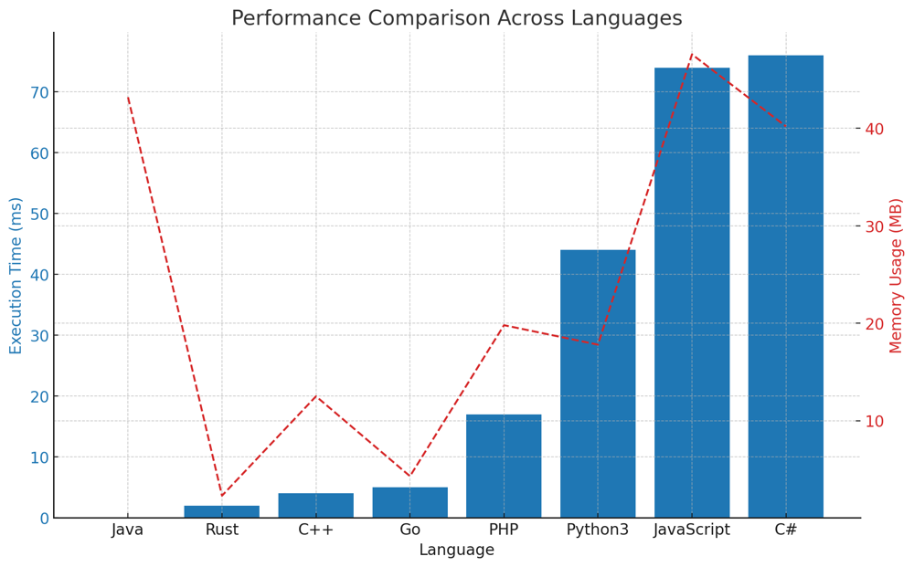

# ✅ 89.45% Post-order traversal

**Author:** vanAmsen
**Votes:** 74
**Link:** [https://leetcode.com/problems/count-nodes-equal-to-average-of-subtree/solutions/4236928/](https://leetcode.com/problems/count-nodes-equal-to-average-of-subtree/solutions/4236928/)

---

# Intuition
The problem asks us to count the number of nodes where the node's value is equal to the average of its subtree (including itself). To calculate the average, we need the sum and count of nodes in the subtree. Our first thought could be to traverse the tree and, for every node, calculate the sum and count of nodes in its subtree and then check if the average matches the node's value. However, this would lead to recalculating the sum and count for overlapping subtrees, resulting in a time complexity of $O(n^2)$. Instead, we can optimize our approach to calculate the sum and count while traversing the tree in a single pass.

# Live Coding & More
https://youtu.be/vCD1hGT5e8M?si=JfZ7YX5_VMeOETIa

# Approach

To solve the problem, we employ a post-order traversal approach. In post-order traversal, the tree is traversed in such a way that we first explore the left subtree, then the right subtree, and finally the node itself. This method is particularly suitable for this problem because, to determine the average value of a subtree rooted at a node, we need information from its left and right subtrees first. 

## Base Case
Our recursive function's first duty is to identify if it has reached a leaf node, i.e., a node that doesn't have children. If the node being processed is `None`, it indicates that it's a leaf, and as such, we return both a sum and count of 0. This is because, for non-existent children of leaf nodes, there's no value to add or count to increment.

## Recursive Logic

For every node in the tree, we perform the following steps:

1. **Left Subtree Processing**:
   We recursively calculate the sum and count of nodes for the left child of the current node. This gives us the total value of all nodes and the number of nodes in the left subtree.

2. **Right Subtree Processing**:
   Similarly, we recursively calculate the sum and count of nodes for the right child of the current node. This provides the total value of all nodes and the number of nodes in the right subtree.

3. **Current Node's Subtree Calculation**:
   - **Sum**: To calculate the sum of the values in the subtree rooted at the current node, we add the node's own value to the sums from the left and right subtrees. 
   - **Count**: The count of nodes in the subtree rooted at the current node is found by adding 1 (for the current node itself) to the counts from the left and right subtrees.
   
4. **Average Comparison**:
   We check if the average of the subtree rooted at the current node matches the node's value. The average is calculated by performing integer division of the sum by the count. If they match, it indicates that the node's value is indeed the average of its subtree, and we increment our result counter.

5. **Return Values**:
   Finally, for the benefit of the parent node in the recursive chain, we return the current node's subtree sum and count. This ensures that as the recursion unwinds, each parent node gets the aggregate values of its children and can perform its own calculations.

By following this approach, the algorithm efficiently traverses the tree, calculating and checking averages in one pass, without needing to revisit nodes or perform redundant calculations.

# Complexity
- **Time complexity**: $O(n)$. We perform a single traversal of the tree, visiting each node exactly once.
- **Space complexity**: $O(h)$, where $h$ is the height of the tree. This accounts for the space used by the call stack during the recursive traversal.


# Code
``` Python []
class Solution:
    def averageOfSubtree(self, root: TreeNode) -> int:
        result = 0

        def traverse(node):
            nonlocal result
            
            if not node:
                return 0, 0
            
            left_sum, left_count = traverse(node.left)
            right_sum, right_count = traverse(node.right)
            
            curr_sum = node.val + left_sum + right_sum
            curr_count = 1 + left_count + right_count
            
            if curr_sum // curr_count == node.val:
                result += 1
            
            return curr_sum, curr_count
        
        traverse(root)
        return result
```
``` C++ []
class Solution {
public:
    int averageOfSubtree(TreeNode* root) {
        int result = 0;
        traverse(root, result);
        return result;
    }

private:
    pair<int, int> traverse(TreeNode* node, int& result) {
        if (!node) return {0, 0};
        
        auto [left_sum, left_count] = traverse(node->left, result);
        auto [right_sum, right_count] = traverse(node->right, result);
        
        int curr_sum = node->val + left_sum + right_sum;
        int curr_count = 1 + left_count + right_count;
        
        if (curr_sum / curr_count == node->val) result++;
        
        return {curr_sum, curr_count};
    }
};
```
``` Java []
class Solution {
    public int averageOfSubtree(TreeNode root) {
        int[] result = new int[1];
        traverse(root, result);
        return result[0];
    }

    private int[] traverse(TreeNode node, int[] result) {
        if (node == null) return new int[]{0, 0};
        
        int[] left = traverse(node.left, result);
        int[] right = traverse(node.right, result);
        
        int currSum = node.val + left[0] + right[0];
        int currCount = 1 + left[1] + right[1];
        
        if (currSum / currCount == node.val) result[0]++;
        
        return new int[]{currSum, currCount};
    }
}
```
``` Go []
func averageOfSubtree(root *TreeNode) int {
    result := 0
    traverse(root, &result)
    return result
}

func traverse(node *TreeNode, result *int) (int, int) {
    if node == nil {
        return 0, 0
    }
    
    leftSum, leftCount := traverse(node.Left, result)
    rightSum, rightCount := traverse(node.Right, result)
    
    currSum := node.Val + leftSum + rightSum
    currCount := 1 + leftCount + rightCount
    
    if currSum / currCount == node.Val {
        *result++
    }
    
    return currSum, currCount
}
```
``` Rust []
use std::rc::Rc;
use std::cell::RefCell;
impl Solution {
    pub fn average_of_subtree(root: Option<Rc<RefCell<TreeNode>>>) -> i32 {
        fn traverse(node: Option<Rc<RefCell<TreeNode>>>, result: &mut i32) -> (i32, i32) {
            if let Some(n) = node {
                let n = n.borrow();
                let (left_sum, left_count) = traverse(n.left.clone(), result);
                let (right_sum, right_count) = traverse(n.right.clone(), result);
                
                let curr_sum = n.val + left_sum + right_sum;
                let curr_count = 1 + left_count + right_count;
                
                if curr_sum / curr_count == n.val {
                    *result += 1;
                }
                
                (curr_sum, curr_count)
            } else {
                (0, 0)
            }
        }
        
        let mut result = 0;
        traverse(root, &mut result);
        result
    }
}
```
``` JavaScript []
var averageOfSubtree = function(root) {
    let result = 0;
    
    const traverse = node => {
        if (!node) return [0, 0];
        
        const [leftSum, leftCount] = traverse(node.left);
        const [rightSum, rightCount] = traverse(node.right);
        
        const currSum = node.val + leftSum + rightSum;
        const currCount = 1 + leftCount + rightCount;
        
        if (Math.floor(currSum / currCount) === node.val) result++;
        
        return [currSum, currCount];
    };
    
    traverse(root);
    return result;
};
```
``` PHP []
class Solution {

    /**
     * @param TreeNode $root
     * @return Integer
     */
    function averageOfSubtree($root) {
        $result = 0;
        $this->traverse($root, $result);
        return $result;
    }
    
    function traverse($node, &$result) {
        if ($node === null) return [0, 0];
        
        list($leftSum, $leftCount) = $this->traverse($node->left, $result);
        list($rightSum, $rightCount) = $this->traverse($node->right, $result);
        
        $currSum = $node->val + $leftSum + $rightSum;
        $currCount = 1 + $leftCount + $rightCount;
        
        if (intval($currSum / $currCount) == $node->val) $result++;
        
        return [$currSum, $currCount];
    }
}
```
``` C# []
public class Solution {
    public int AverageOfSubtree(TreeNode root) {
        int result = 0;
        Traverse(root, ref result);
        return result;
    }

    private (int, int) Traverse(TreeNode node, ref int result) {
        if (node == null) return (0, 0);
        
        var (leftSum, leftCount) = Traverse(node.left, ref result);
        var (rightSum, rightCount) = Traverse(node.right, ref result);
        
        int currSum = node.val + leftSum + rightSum;
        int currCount = 1 + leftCount + rightCount;
        
        if (currSum / currCount == node.val) result++;
        
        return (currSum, currCount);
    }
}
```

# Performance

| Language   | Execution Time (ms) | Memory Usage |
|------------|---------------------|--------------|
| Java       | 0                   | 43.2 MB     |
| Rust       | 2                   | 2.3 MB      |
| C++        | 4                   | 12.5 MB     |
| Go         | 5                   | 4.3 MB      |
| PHP        | 17                  | 19.8 MB     |
| Python3    | 44                  | 17.8 MB     |
| JavaScript | 74                  | 47.6 MB     |
| C#         | 76                  | 40.2 MB     |




# What We Learned
This problem teaches us the importance of optimizing our approach to avoid recalculating values for overlapping subtrees. By using a post-order traversal, we can calculate the sum and count for each subtree in a single pass, significantly improving the time complexity from $O(n^2)$ to $O(n)$. It also emphasizes the utility of using a nonlocal variable to keep track of the result during recursive traversal.