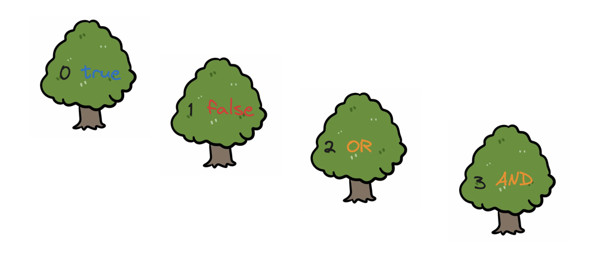
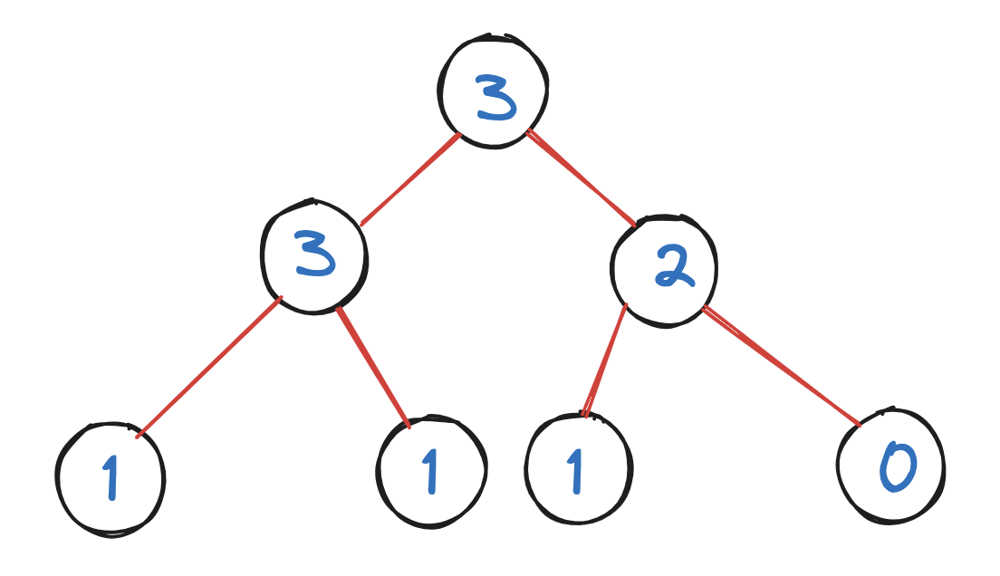
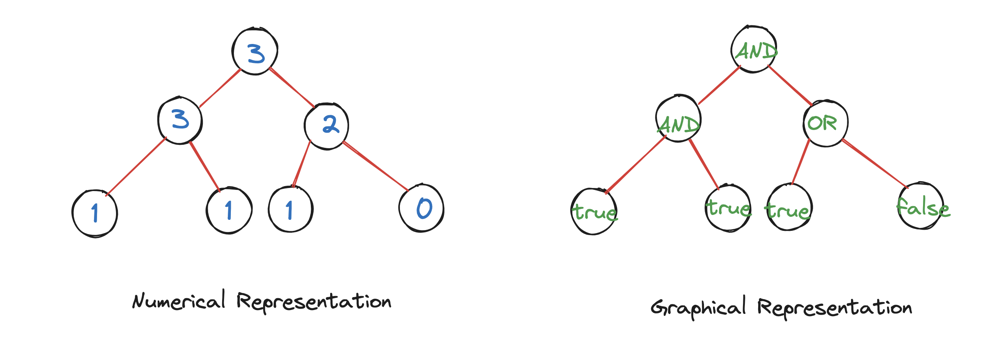
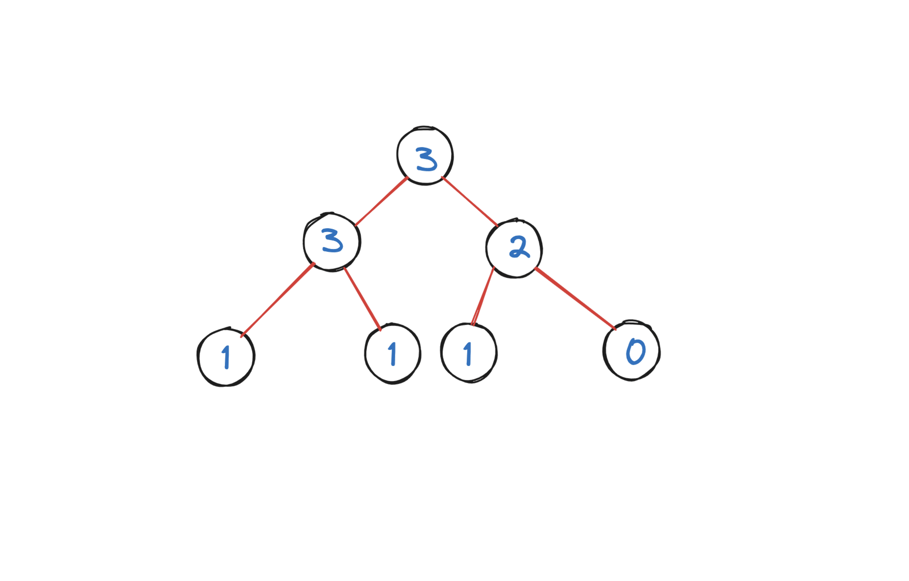

# Fully Visual Explanation in Java/C++/Python

**Author:** hi-malik
**Votes:** 28
**Link:** [https://leetcode.com/problems/evaluate-boolean-binary-tree/solutions/5162869/](https://leetcode.com/problems/evaluate-boolean-binary-tree/solutions/5162869/)

---

The question is very simple, let's break it down and understand it!

We have a tree, which has these 4 types of value. And each value respresent something,
* **`0`** -> **`FALSE`**


* **`1`** -> **`TRUE`**
* **`2`** -> **`OR`**
* **`3`** -> **`AND`**



But the value going to be present in the number form >


Or we can look at it's graphical representation for better understanding >


**Let's start solving the problem,**

To start the traversal, we going to use **Post Order Traversal**
The, **post order traversal** principle say's :
```
First traverse to #LEFT
Then to #RIGHT
and finally to #ROOT
```

Let's understand with an example and doing the traversal with the help of **ANIMATION**



Let\\s code it up :
**JAVA**
```
class Solution {
    public boolean evaluateTree(TreeNode root) {
        // Base condition, if it's a leaf node
        if(root.left == null && root.right == null){
            if(root.val == 0) return false;
            return true;
        }
        // If it's not a leaf node, then go to left subtree
        boolean left = evaluateTree(root.left);
        // then go to right subtree
        boolean right = evaluateTree(root.right);
        // OR operation
        if(root.val == 2) return left || right;
        return left && right; // AND operation
    }
}
```
**C++**
```
class Solution {
public:
    bool evaluateTree(TreeNode* root) {
        // Base condition, if it's a leaf node
        if(root->left == nullptr && root->right == nullptr){
            if(root->val == 0) return false;
            return true;
        }
        // If it's not a leaf node, then go to left subtree
        bool left = evaluateTree(root->left);
        // then go to right subtree
        bool right = evaluateTree(root->right);
        // OR operation
        if(root->val == 2) return left || right;
        return left && right; // AND operation
    }
};
```
**PYTHON**
```
class Solution(object):
    def evaluateTree(self, root):
        # Base condition, if it's a leaf node
        if not root.left and not root.right:
            if root.val == 0:
                return False
            return True
        # If it's not a leaf node, then go to left subtree
        left = self.evaluateTree(root.left)
        # then go to right subtree
        right = self.evaluateTree(root.right)
        # OR operation
        if root.val == 2:
            return left or right
        return left and right  # AND operation
```

___
Let's talk about
___

* **Time Complexity :-** BigO(N), there were N nodes, it took O(N) time.

* **Space Complexity :-** BigO(logN), we use recursion (a kind of loop where a function calls itself) to go through the tree. In the worst case it could be BigO(N) too