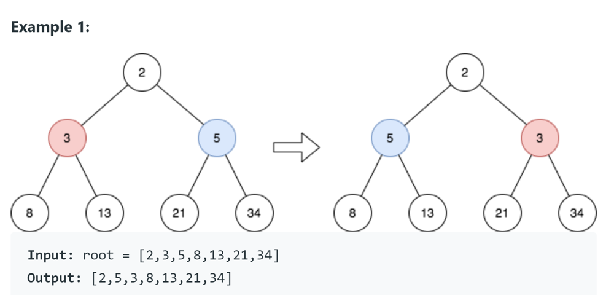

# Python/JS/Go/C++ O(n) by DFS [w/ Comment]

**Author:** brianchiang_tw
**Votes:** 1
**Link:** [https://leetcode.com/problems/reverse-odd-levels-of-binary-tree/solutions/2655349/](https://leetcode.com/problems/reverse-odd-levels-of-binary-tree/solutions/2655349/)

---

Python O(n) by DFS

---

**Example**:

3, 5 are on odd level => swap value => 5, 3




---

**Implementation**

Python:

```
class Solution:
    def reverseOddLevels(self, root: Optional[TreeNode]) -> Optional[TreeNode]:
        
        # worker function help us to swap node value on odd level
        def worker(_left, _right, odd_level):
            
            # check current level nodes are non-leaf
            if not (_left and _right):
                return
                
            if odd_level:

                # swap node value on odd level
                _left.val, _right.val = _right.val, _left.val

            # DFS to next level, and toggle boolean flag
            worker(_left.left, _right.right, not odd_level)
            worker(_left.right, _right.left, not odd_level)

            return
        
        # --------------------------------------
        
        # We start our task on level 1
        worker(root.left, root.right, True)
        return root
```

---

Javscript:

```
var reverseOddLevels = function(root) {

    var worker = function(a, b, oddLevel){
        
        // check current level nodes are non-leaf
        if( (a == null) || (b ==null) ){
            return;
        }
        
        // swap node value on odd level
        if( oddLevel ){
            [a.val, b.val] = [b.val, a.val];
        }
        
        // DFS to next level, and toggle boolean flag
        worker(a.left, b.right, !oddLevel);
        worker(a.right, b.left, !oddLevel);
        return;
    }
    
    //----------------------------------------
    
    // We start our task on level 1
    worker(root.left, root.right, true);
    
    return root
};


```

---

Go:

```
func reverseOddLevels(root *TreeNode) *TreeNode {

    var worker func(*TreeNode, *TreeNode, bool)
    
    worker = func(a *TreeNode, b *TreeNode, oddLevel bool){
        
        // check current level nodes are non-leaf
        if( a == nil || b == nil ){
            return
        }
        
        // swap node value on odd level
        if( oddLevel ){
            a.Val, b.Val = b.Val, a.Val
        }
        
        // DFS to next level, and toggle boolean flag
        worker(a.Left, b.Right, !oddLevel)
        worker(a.Right, b.Left, !oddLevel)
        return
    }
    
    //----------------------------------------
    
    // We start our task on level 1
    worker(root.Left, root.Right, true)
    return root
}
```

---

C++

```
class Solution {
        
public:
    
    TreeNode* reverseOddLevels(TreeNode* root) {
        
		// We start our task on level 1
        worker( root->left, root->right, true );
        return root;
    }
    
private:
    void worker(TreeNode *a, TreeNode *b, bool oddLevel){
        
        // Base case:
        if( !( a && b ) ){
            // check currentlevel nodes are non-leaf
            return;
        }
        
        // General cases:
        // swap node value on odd level
        if( oddLevel ){
            swap(a->val, b->val);
        }
        
        // DFS to next level, and toggle boolean flag
        worker( a->left, b->right, !oddLevel);
        worker( a->right, b->left, !oddLevel);
        return;
    }
    
};
```