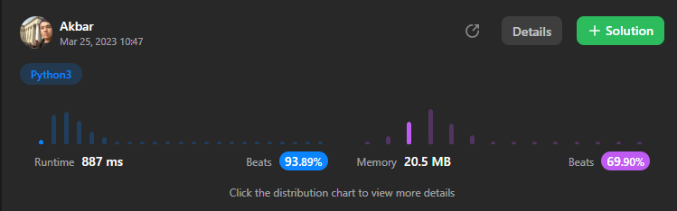

# Python3 || Beats 93.89%

**Author:** abdullayev_akbar
**Votes:** 17
**Link:** [https://leetcode.com/problems/reverse-odd-levels-of-binary-tree/solutions/3338266/](https://leetcode.com/problems/reverse-odd-levels-of-binary-tree/solutions/3338266/)

---


# Please UPVOTE\uD83D\uDE0A

# Python3
```
# Definition for a binary tree node.
# class TreeNode:
#     def __init__(self, val=0, left=None, right=None):
#         self.val = val
#         self.left = left
#         self.right = right
class Solution:
    def reverseOddLevels(self, root: Optional[TreeNode]) -> Optional[TreeNode]:
        v=[root]
        l=0
        while v:
            l+=1
            vc=[]
            for i in v:
                if(i.left):
                    vc+=[i.left]
                if(i.right):
                    vc+=[i.right]
            if(l%2==1):
                for i in range((len(vc)+1)//2):
                    vc[i].val,vc[len(vc)-i-1].val=vc[len(vc)-i-1].val,vc[i].val
            v=vc
        return root


```