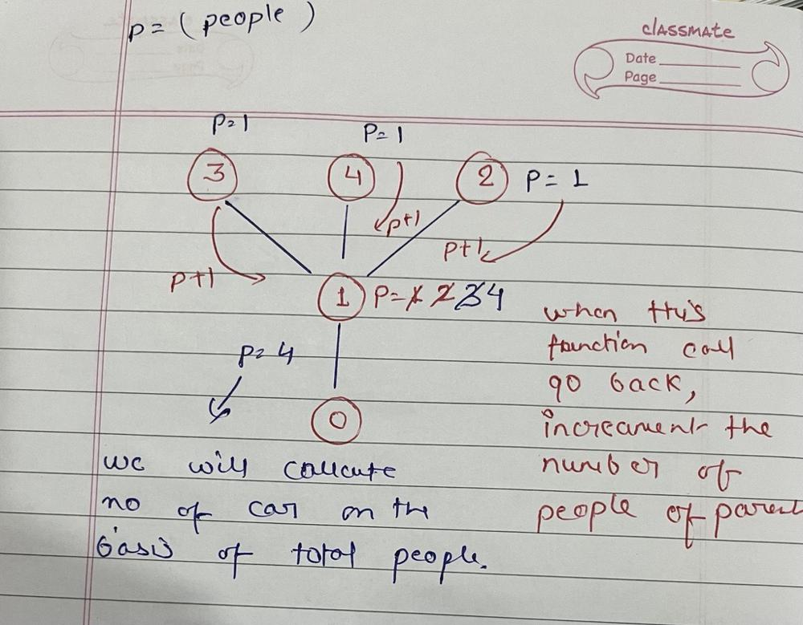

# JavaScript Solution || with explanation

**Author:** astiksarathe
**Votes:** 11
**Link:** [https://leetcode.com/problems/minimum-fuel-cost-to-report-to-the-capital/solutions/3041408/](https://leetcode.com/problems/minimum-fuel-cost-to-report-to-the-capital/solutions/3041408/)

---

# Intuition
We will track the number of people in the subtree and calculate the number of cars required based on the number of people. 
For example, if there are 4 people and each car has 2 seats, then 2 cars are required. If there are 5 people and each car has 2 seats, then a minimum of 3 cars are required.
Will calculate this on every node




# Code
```
/**
 * @param {number[][]} roads
 * @param {number} seats
 * @return {number}
 */
var minimumFuelCost = function(roads, seats) {
    const adjList = createAdjacencyList(roads);
    let ans = 0

    const dfs = (curNode, preNode) => {
        let people = 1
        for(let child of adjList[curNode]){ 
            if(child !== preNode){
                people += dfs(child, curNode)
            }
        }
        if(curNode) 
            ans += Math.ceil(people/seats)

        return people
    }
    dfs(0, -1)

    return ans
};


const createAdjacencyList = (edges) => {
    const N = edges.length
    const adjList = Array(N+1).fill().map(() => []);

    // Add the edges to the adjacency list
    for(const edge of edges){
        const [node1, node2] = edge;
        adjList[node1].push(node2);
        adjList[node2].push(node1);
    }
    return adjList;
}
```

**Please UpVote**