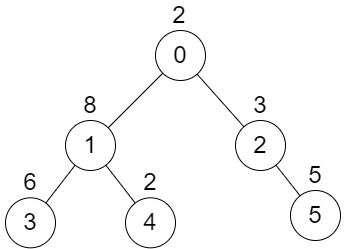
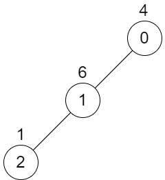

# [2479. Maximum XOR of Two Non-Overlapping Subtrees](https://leetcode.com/problems/maximum-xor-of-two-non-overlapping-subtrees/)

| Category | Difficulty | Likes | Dislikes |
| :------: | :--------: | :---: | :------: |
| Algorithms | Hard | 32 | 5 |

**Tags:** [`tree`](https://leetcode.com/tag/tree), [`depth-first-search`](https://leetcode.com/tag/depth-first-search), [`graph`](https://leetcode.com/tag/graph), [`trie`](https://leetcode.com/tag/trie)

**Companies:** `directi`, `medianet`

## Description

There is an undirected tree with `n` nodes labeled from `0` to `n - 1`. You are given the integer `n` and a 2D integer array `edges` of length `n - 1`, where `edges[i] = [a_i, b_i]` indicates that there is an edge between nodes `a_i` and `b_i` in the tree. The root of the tree is the node labeled `0`.

Each node has an associated **value**. You are given an array `values` of length `n`, where `values[i]` is the **value** of the `i^th` node.

Select any two **non-overlapping** subtrees. Your **score** is the bitwise XOR of the sum of the values within those subtrees.

Return *the* ***maximum*** possible **score** you can achieve. *If it is impossible to find two nonoverlapping subtrees*, return `0`.

**Note** that:

	- The **subtree** of a node is the tree consisting of that node and all of its descendants.

	- Two subtrees are **non-overlapping **if they do not share **any common** node.

 

**Example 1:**


```

Input: n = 6, edges = [[0,1],[0,2],[1,3],[1,4],[2,5]], values = [2,8,3,6,2,5]
Output: 24
Explanation: Node 1&#39;s subtree has sum of values 16, while node 2&#39;s subtree has sum of values 8, so choosing these nodes will yield a score of 16 XOR 8 = 24. It can be proved that is the maximum possible score we can obtain.

```

**Example 2:**


```

Input: n = 3, edges = [[0,1],[1,2]], values = [4,6,1]
Output: 0
Explanation: There is no possible way to select two non-overlapping subtrees, so we just return 0.

```

 

**Constraints:**

	- `2 <= n <= 5 * 10^4`

	- `edges.length == n - 1`

	- `0 <= a_i, b_i < n`

	- `values.length == n`

	- `1 <= values[i] <= 10^9`

	- It is guaranteed that `edges` represents a valid tree.

---

**Links:** [Submissions](https://leetcode.com/problems/maximum-xor-of-two-non-overlapping-subtrees/) | [Solutions](https://leetcode.com/problems/maximum-xor-of-two-non-overlapping-subtrees/)
