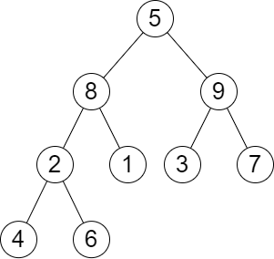

# [2583. Kth Largest Sum in a Binary Tree](https://leetcode.com/problems/kth-largest-sum-in-a-binary-tree/)

| Category | Difficulty | Likes | Dislikes |
| :------: | :--------: | :---: | :------: |
| Algorithms | Medium | 1049 | 38 |

**Tags:** [`tree`](https://leetcode.com/tag/tree), [`breadth-first-search`](https://leetcode.com/tag/breadth-first-search), [`sorting`](https://leetcode.com/tag/sorting), [`binary-tree`](https://leetcode.com/tag/binary-tree)

**Companies:** `bloomberg`, `amazon`

## Description

You are given the `root` of a binary tree and a positive integer `k`.

The **level sum** in the tree is the sum of the values of the nodes that are on the **same** level.

Return* the *`k^th`* **largest** level sum in the tree (not necessarily distinct)*. If there are fewer than `k` levels in the tree, return `-1`.

**Note** that two nodes are on the same level if they have the same distance from the root.

 

**Example 1:**


```

Input: root = [5,8,9,2,1,3,7,4,6], k = 2
Output: 13
Explanation: The level sums are the following:
- Level 1: 5.
- Level 2: 8 + 9 = 17.
- Level 3: 2 + 1 + 3 + 7 = 13.
- Level 4: 4 + 6 = 10.
The 2nd largest level sum is 13.

```

**Example 2:**


```

Input: root = [1,2,null,3], k = 1
Output: 3
Explanation: The largest level sum is 3.

```

 

**Constraints:**

	- The number of nodes in the tree is `n`.

	- `2 <= n <= 10^5`

	- `1 <= Node.val <= 10^6`

	- `1 <= k <= n`

---

**Links:** [Submissions](https://leetcode.com/problems/kth-largest-sum-in-a-binary-tree/) | [Solutions](https://leetcode.com/problems/kth-largest-sum-in-a-binary-tree/)
