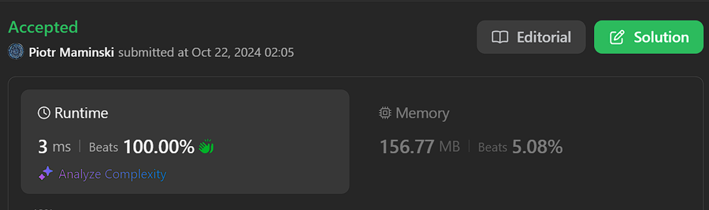
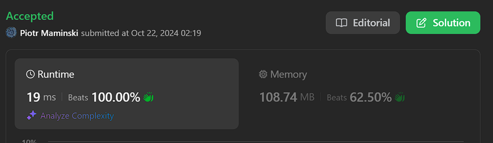

# ✅ Explained step by step | Beats 100% | ✅ Working 22.10.2024

**Author:** Piotr_Maminski
**Votes:** 8
**Link:** [https://leetcode.com/problems/kth-largest-sum-in-a-binary-tree/solutions/5949683/](https://leetcode.com/problems/kth-largest-sum-in-a-binary-tree/solutions/5949683/)

---

```python3 []
from typing import Optional
from collections import deque

class TreeNode:
    def __init__(self, val=0, left=None, right=None):
        self.val = val
        self.left = left
        self.right = right

class Solution:
    def kthLargestLevelSum(self, root: Optional[TreeNode], k: int) -> int:
        # List to store the sum of each level
        level_sums = []

        # If the tree is empty, return -1
        if not root:
            return -1

        # Queue for level-order traversal
        q = deque([root])

        while q:
            # Variable to store the sum of the current level
            level_sum = 0

            # Number of nodes at the current level
            level_size = len(q)

            # Process each node at the current level
            for _ in range(level_size):
                node = q.popleft()

                # Add the node's value to the level sum
                level_sum += node.val

                # Add child nodes to the queue for the next level
                if node.left:
                    q.append(node.left)
                if node.right:
                    q.append(node.right)

            # Add the sum of the current level to the list
            level_sums.append(level_sum)

        # If there are fewer levels than k, return -1
        if len(level_sums) < k:
            return -1

        # Sort the level sums in descending order and return the kth largest
        return sorted(level_sums, reverse=True)[k-1]
```
```cpp []
class Solution {
public:
    long long kthLargestLevelSum(TreeNode* root, int k) {
        // Vector to store the sum of each level
        std::vector<std::int64_t> levelSums;

        // Variables to keep track of maximum sum and its level (not used in this solution)
        int64_t maxSum = std::numeric_limits<int64_t>::min();
        int maxSumLevel = INT_MAX;

        // If the tree is empty, return 0
        if (root == nullptr)
            return 0;

        // Queue for level-order traversal
        std::queue<TreeNode*> q;
        q.push(root);

        int currentLevel = 1;
        while (!q.empty()) {
            // Variable to store the sum of the current level
            int64_t levelSum = 0;

            // Number of nodes at the current level
            auto pending = q.size();
            while (pending--) {
                // Process each node at the current level
                auto* node = q.front();
                q.pop();

                // Add the node's value to the level sum
                levelSum += node->val;

                // Add child nodes to the queue for the next level
                if (node->left)
                    q.push(node->left);
                if (node->right)
                    q.push(node->right);
            }

            // Add the sum of the current level to the vector
            levelSums.emplace_back(levelSum);

            // Move to the next level
            ++currentLevel;
        }

        // If there are fewer levels than k, return -1
        if (levelSums.size() < k)
            return -1;

        // Use nth_element to partially sort the vector
        // This places the kth largest element at the correct position
        std::nth_element(
            levelSums.begin(),
            levelSums.begin() + (k - 1),
            levelSums.end(),
            std::greater<>()
        );

        // Return the kth largest level sum
        auto kth = *(levelSums.begin() + k - 1);
        return kth;
    }
};
```
```java []
import java.util.*;

class TreeNode {
    int val;
    TreeNode left;
    TreeNode right;
    TreeNode(int val) { this.val = val; }
    TreeNode(int val, TreeNode left, TreeNode right) {
        this.val = val;
        this.left = left;
        this.right = right;
    }
}

class Solution {
    public long kthLargestLevelSum(TreeNode root, int k) {
        // List to store the sum of each level
        List<Long> levelSums = new ArrayList<>();

        // If the tree is empty, return -1
        if (root == null)
            return -1;

        // Queue for level-order traversal
        Queue<TreeNode> q = new LinkedList<>();
        q.offer(root);

        int currentLevel = 1;
        while (!q.isEmpty()) {
            // Variable to store the sum of the current level
            long levelSum = 0;

            // Number of nodes at the current level
            int pending = q.size();
            for (int i = 0; i < pending; i++) {
                // Process each node at the current level
                TreeNode node = q.poll();

                // Add the node's value to the level sum
                levelSum += node.val;

                // Add child nodes to the queue for the next level
                if (node.left != null)
                    q.offer(node.left);
                if (node.right != null)
                    q.offer(node.right);
            }

            // Add the sum of the current level to the list
            levelSums.add(levelSum);

            // Move to the next level
            currentLevel++;
        }

        // If there are fewer levels than k, return -1
        if (levelSums.size() < k)
            return -1;

        // Sort the list in descending order
        Collections.sort(levelSums, Collections.reverseOrder());

        // Return the kth largest level sum
        return levelSums.get(k - 1);
    }
}
```
```csharp []
public class Solution {
    public long KthLargestLevelSum(TreeNode root, int k) {
        // List to store the sum of each level
        List<long> levelSums = new List<long>();

        // If the tree is empty, return -1
        if (root == null) {
            return -1;
        }

        // Queue for level-order traversal
        Queue<TreeNode> q = new Queue<TreeNode>();
        q.Enqueue(root);

        while (q.Count > 0) {
            // Variable to store the sum of the current level
            long levelSum = 0;

            // Number of nodes at the current level
            int levelSize = q.Count;

            // Process each node at the current level
            for (int i = 0; i < levelSize; i++) {
                TreeNode node = q.Dequeue();

                // Add the node's value to the level sum
                levelSum += node.val;

                // Add child nodes to the queue for the next level
                if (node.left != null) {
                    q.Enqueue(node.left);
                }
                if (node.right != null) {
                    q.Enqueue(node.right);
                }
            }

            // Add the sum of the current level to the list
            levelSums.Add(levelSum);
        }

        // If there are fewer levels than k, return -1
        if (levelSums.Count < k) {
            return -1;
        }

        // Sort the level sums in descending order and return the kth largest
        levelSums.Sort((a, b) => b.CompareTo(a));
        return levelSums[k - 1];
    }
}
```
```rust []
use std::cell::RefCell;
use std::cmp::Reverse;
use std::collections::VecDeque;
use std::rc::Rc;


impl Solution {
    pub fn kth_largest_level_sum(root: Option<Rc<RefCell<TreeNode>>>, k: i32) -> i64 {
        // Vector to store the sum of each level
        let mut level_sums: Vec<i64> = Vec::new();

        // If the tree is empty, return -1
        let root = match root {
            Some(node) => node,
            None => return -1,
        };

        // Queue for level-order traversal
        let mut queue = VecDeque::new();
        queue.push_back(root);

        while !queue.is_empty() {
            // Variable to store the sum of the current level
            let mut level_sum: i64 = 0;

            // Number of nodes at the current level
            let level_size = queue.len();

            for _ in 0..level_size {
                // Process each node at the current level
                if let Some(node) = queue.pop_front() {
                    let node = node.borrow();

                    // Add the node's value to the level sum
                    level_sum += node.val as i64;

                    // Add child nodes to the queue for the next level
                    if let Some(left) = node.left.clone() {
                        queue.push_back(left);
                    }
                    if let Some(right) = node.right.clone() {
                        queue.push_back(right);
                    }
                }
            }

            // Add the sum of the current level to the vector
            level_sums.push(level_sum);
        }

        // If there are fewer levels than k, return -1
        if level_sums.len() < k as usize {
            return -1;
        }

        // Sort the level sums in descending order
        level_sums.sort_unstable_by_key(|&x| Reverse(x));

        // Return the kth largest level sum
        level_sums[k as usize - 1]
    }
}
```
```golang []
package main

import (
	"container/list"
	"sort"
)

func kthLargestLevelSum(root *TreeNode, k int) int64 {
	// Slice to store the sum of each level
	var levelSums []int64

	// If the tree is empty, return -1
	if root == nil {
		return -1
	}

	// Queue for level-order traversal
	queue := list.New()
	queue.PushBack(root)

	for queue.Len() > 0 {
		// Variable to store the sum of the current level
		var levelSum int64

		// Number of nodes at the current level
		pending := queue.Len()
		for i := 0; i < pending; i++ {
			// Process each node at the current level
			node := queue.Remove(queue.Front()).(*TreeNode)

			// Add the node's value to the level sum
			levelSum += int64(node.Val)

			// Add child nodes to the queue for the next level
			if node.Left != nil {
				queue.PushBack(node.Left)
			}
			if node.Right != nil {
				queue.PushBack(node.Right)
			}
		}

		// Add the sum of the current level to the slice
		levelSums = append(levelSums, levelSum)
	}

	// If there are fewer levels than k, return -1
	if len(levelSums) < k {
		return -1
	}

	// Sort the levelSums slice in descending order
	sort.Slice(levelSums, func(i, j int) bool {
		return levelSums[i] > levelSums[j]
	})

	// Return the kth largest level sum
	return levelSums[k-1]
}
```
```javascript [JS]
// JavaScript

var kthLargestLevelSum = function(root, k) {
    // Initialize an array to store the sum of node values at each level
    var result = [];

    // Define a helper function to traverse the tree
    var traverse = (node, level = 0) => {
        // Base case: if the node is null, return
        if (!node) return null;

        // If the level already exists in the result array, add the current node's value to it
        if (result[level] !== undefined) result[level] += node.val;
        // If the level doesn't exist, initialize it with the current node's value
        else result[level] = node.val;

        // Recursively traverse the left subtree, incrementing the level
        traverse(node.left, level + 1);
        // Recursively traverse the right subtree, incrementing the level
        traverse(node.right, level + 1);
    }

    // Start the traversal from the root
    traverse(root);

    // If the kth largest level sum doesn't exist (k is greater than the number of levels), return -1
    if (!result[k - 1]) return -1;

    // Sort the result array in descending order and return the kth largest sum
    return result.sort((a,b) => b - a)[k - 1];
};
```
```typescript [TS]
// TypeScript

// Define the TreeNode interface
interface TreeNode {
    val: number;
    left: TreeNode | null;
    right: TreeNode | null;
}

function kthLargestLevelSum(root: TreeNode | null, k: number): number {
    // Initialize an array to store the sum of node values at each level
    const result: number[] = [];

    // Define a helper function to traverse the tree
    const traverse = (node: TreeNode | null, level: number = 0): void => {
        // Base case: if the node is null, return
        if (!node) return;

        // If the level already exists in the result array, add the current node's value to it
        if (result[level] !== undefined) result[level] += node.val;
        // If the level doesn't exist, initialize it with the current node's value
        else result[level] = node.val;

        // Recursively traverse the left subtree, incrementing the level
        traverse(node.left, level + 1);
        // Recursively traverse the right subtree, incrementing the level
        traverse(node.right, level + 1);
    }

    // Start the traversal from the root
    traverse(root);

    // If the kth largest level sum doesn't exist (k is greater than the number of levels), return -1
    if (!result[k - 1]) return -1;

    // Sort the result array in descending order and return the kth largest sum
    return result.sort((a, b) => b - a)[k - 1];
}
```
```swift []
class Solution {
    func kthLargestLevelSum(_ root: TreeNode?, _ k: Int) -> Int {
        // Array to store the sum of each level
        var levelSums: [Int64] = []
        
        // If the tree is empty, return -1
        guard let root = root else {
            return -1
        }
        
        // Queue for level-order traversal
        var queue: [TreeNode] = [root]
        
        while !queue.isEmpty {
            // Variable to store the sum of the current level
            var levelSum: Int64 = 0
            
            // Number of nodes at the current level
            let nodesAtCurrentLevel = queue.count
            
            for _ in 0..<nodesAtCurrentLevel {
                // Process each node at the current level
                let node = queue.removeFirst()
                
                // Add the node's value to the level sum
                levelSum += Int64(node.val)
                
                // Add child nodes to the queue for the next level
                if let left = node.left {
                    queue.append(left)
                }
                if let right = node.right {
                    queue.append(right)
                }
            }
            
            // Add the sum of the current level to the array
            levelSums.append(levelSum)
        }
        
        // If there are fewer levels than k, return -1
        if levelSums.count < k {
            return -1
        }
        
        // Sort the level sums in descending order
        levelSums.sort(by: >)
        
        // Return the kth largest level sum
        return Int(levelSums[k - 1])
    }
}
```
```php []
/**
 * Definition for a binary tree node.
 * class TreeNode {
 *     public $val = null;
 *     public $left = null;
 *     public $right = null;
 *     function __construct($val = 0, $left = null, $right = null) {
 *         $this->val = $val;
 *         $this->left = $left;
 *         $this->right = $right;
 *     }
 * }
 */
class Solution {
    /**
     * @param TreeNode $root
     * @param Integer $k
     * @return Integer
     */
    function kthLargestLevelSum($root, $k) {
        // Array to store the sum of each level
        $levelSums = [];
        
        // If the tree is empty, return -1
        if ($root === null) {
            return -1;
        }
        
        // Queue for level-order traversal
        $queue = new SplQueue();
        $queue->enqueue($root);
        
        while (!$queue->isEmpty()) {
            // Variable to store the sum of the current level
            $levelSum = 0;
            
            // Number of nodes at the current level
            $nodesAtCurrentLevel = $queue->count();
            
            for ($i = 0; $i < $nodesAtCurrentLevel; $i++) {
                // Process each node at the current level
                $node = $queue->dequeue();
                
                // Add the node's value to the level sum
                $levelSum += $node->val;
                
                // Add child nodes to the queue for the next level
                if ($node->left !== null) {
                    $queue->enqueue($node->left);
                }
                if ($node->right !== null) {
                    $queue->enqueue($node->right);
                }
            }
            
            // Add the sum of the current level to the array
            $levelSums[] = $levelSum;
        }
        
        // If there are fewer levels than k, return -1
        if (count($levelSums) < $k) {
            return -1;
        }
        
        // Sort the level sums in descending order
        rsort($levelSums);
        
        // Return the kth largest level sum
        return $levelSums[$k - 1];
    }
}
```


### Complexity 
- Time complexity: O(n log n)

- Space complexity: O(n)

## Explain step by step


---


1. Define the TreeNode class:

- Create a class to represent nodes in a binary tree.
- Each node has a value and left and right child pointers.
2. Define the Solution class with the kthLargestLevelSum method:

- This method takes a root node and an integer k as input.
3. Initialize an empty list to store the sum of each level.

4. Check if the tree is empty:

- If the root is None, return -1 as there are no levels.
5. Initialize a queue for level-order traversal:

- Use a deque and add the root node to it.
6. Perform level-order traversal:

- While the queue is not empty: a. Initialize a variable to store the sum of the current level. b. Get the number of nodes at the current level. c. Process each node at the current level:
    - Remove the node from the front of the queue.
    - Add the node's value to the level sum.
    - If the node has a left child, add it to the queue.
    - If the node has a right child, add it to the queue. d. After processing all nodes at the current level, add the level sum to the list.
7. Check if there are enough levels:

- If the number of levels is less than k, return -1.
8. Find the kth largest level sum:

- Sort the list of level sums in descending order.
- Return the (k-1)th element of the sorted list (as indexing starts at 0).

This solution uses a breadth-first search (BFS) approach to traverse the tree level by level, calculating the sum of node values at each level. It then sorts the level sums to find the kth largest sum.

---





