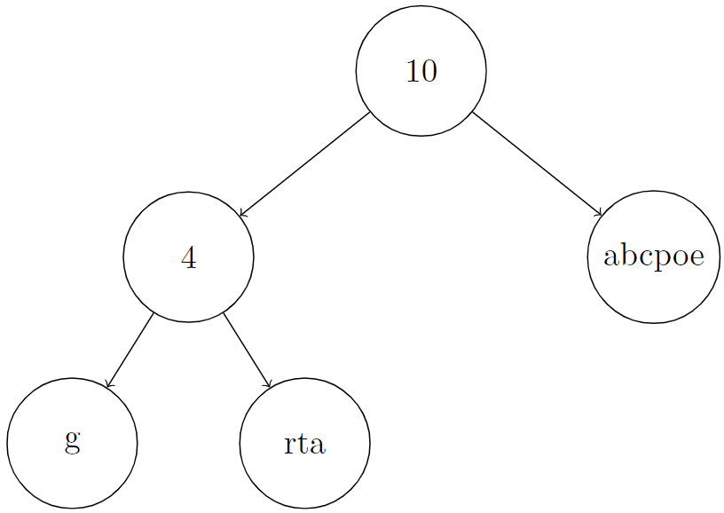
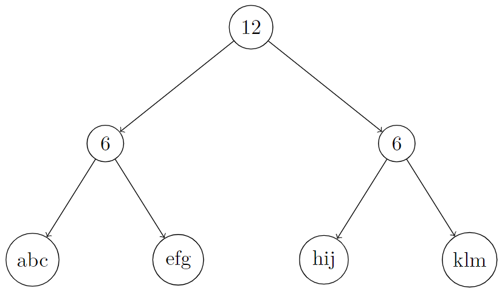
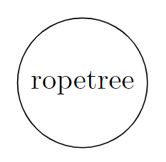

# [2689. Extract Kth Character From The Rope Tree](https://leetcode.com/problems/extract-kth-character-from-the-rope-tree/)

| Category | Difficulty | Likes | Dislikes |
| :------: | :--------: | :---: | :------: |
| Algorithms | Easy | 41 | 27 |

**Tags:** [`tree`](https://leetcode.com/tag/tree), [`depth-first-search`](https://leetcode.com/tag/depth-first-search), [`binary-tree`](https://leetcode.com/tag/binary-tree)

**Companies:** `google`

## Description

You are given the `root` of a binary tree and an integer `k`. Besides the left and right children, every node of this tree has two other properties, a **string** `node.val` containing only lowercase English letters (possibly empty) and a non-negative integer `node.len`. There are two types of nodes in this tree:

	- **Leaf**: These nodes have no children, `node.len = 0`, and `node.val` is some **non-empty** string.

	- **Internal**: These nodes have at least one child (also at most two children), `node.len > 0`, and `node.val` is an **empty** string.

The tree described above is called a *Rope* binary tree. Now we define `S[node]` recursively as follows:

	- If `node` is some leaf node, `S[node] = node.val`,

	- Otherwise if `node` is some internal node, `S[node] = concat(S[node.left], S[node.right])` and `S[node].length = node.len`.

Return* k-th character of the string* `S[root]`.

**Note:** If `s` and `p` are two strings, `concat(s, p)` is a string obtained by concatenating `p` to `s`. For example, `concat("ab", "zz") = "abzz"`.

 

**Example 1:**

```

Input: root = [10,4,&quot;abcpoe&quot;,&quot;g&quot;,&quot;rta&quot;], k = 6
Output: &quot;b&quot;
Explanation: In the picture below, we put an integer on internal nodes that represents node.len, and a string on leaf nodes that represents node.val.
You can see that S[root] = concat(concat(&quot;g&quot;, &quot;rta&quot;), &quot;abcpoe&quot;) = &quot;grtaabcpoe&quot;. So S[root][5], which represents 6th character of it, is equal to &quot;b&quot;.

```



**Example 2:**

```

Input: root = [12,6,6,&quot;abc&quot;,&quot;efg&quot;,&quot;hij&quot;,&quot;klm&quot;], k = 3
Output: &quot;c&quot;
Explanation: In the picture below, we put an integer on internal nodes that represents node.len, and a string on leaf nodes that represents node.val.
You can see that S[root] = concat(concat(&quot;abc&quot;, &quot;efg&quot;), concat(&quot;hij&quot;, &quot;klm&quot;)) = &quot;abcefghijklm&quot;. So S[root][2], which represents the 3rd character of it, is equal to &quot;c&quot;.

```



**Example 3:**

```

Input: root = [&quot;ropetree&quot;], k = 8
Output: &quot;e&quot;
Explanation: In the picture below, we put an integer on internal nodes that represents node.len, and a string on leaf nodes that represents node.val.
You can see that S[root] = &quot;ropetree&quot;. So S[root][7], which represents 8th character of it, is equal to &quot;e&quot;.

```



 

**Constraints:**

	- The number of nodes in the tree is in the range `[1, 10^3]`

	- `node.val` contains only lowercase English letters

	- `0  0` and `node.val` is empty

	- `1 <= k <= S[root].length`

---

**Links:** [Submissions](https://leetcode.com/problems/extract-kth-character-from-the-rope-tree/) | [Solutions](https://leetcode.com/problems/extract-kth-character-from-the-rope-tree/)
