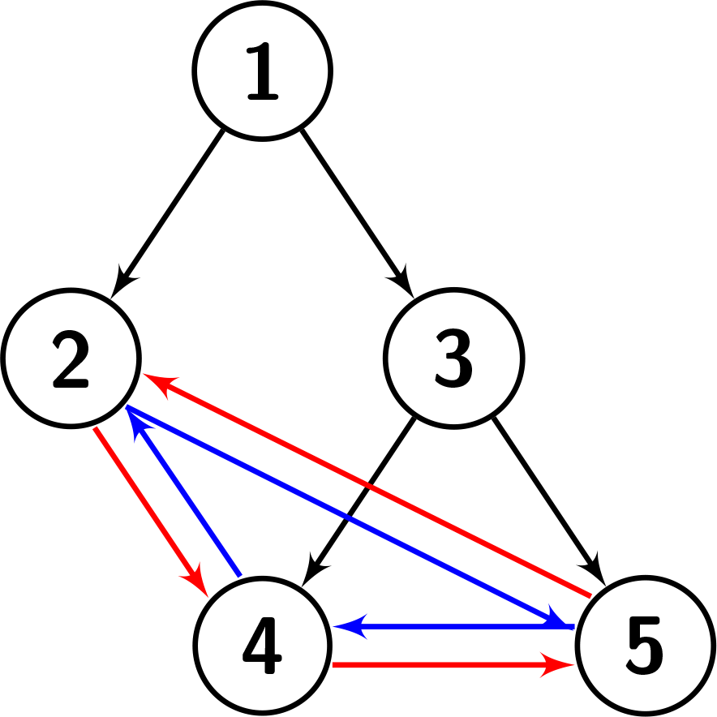
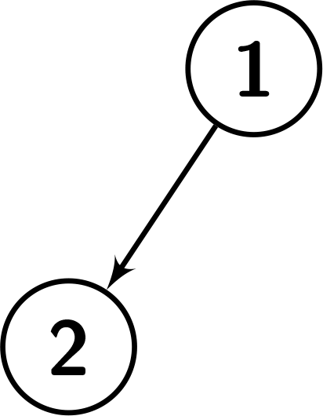
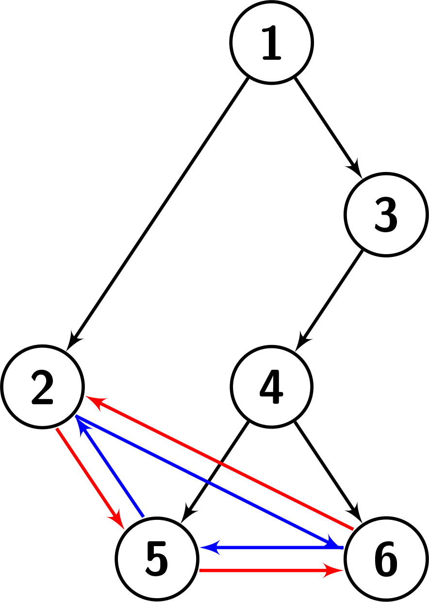

# [2773. Height of Special Binary Tree](https://leetcode.com/problems/height-of-special-binary-tree/)

| Category | Difficulty | Likes | Dislikes |
| :------: | :--------: | :---: | :------: |
| Algorithms | Medium | 18 | 43 |

**Tags:** [`tree`](https://leetcode.com/tag/tree), [`depth-first-search`](https://leetcode.com/tag/depth-first-search), [`breadth-first-search`](https://leetcode.com/tag/breadth-first-search), [`binary-tree`](https://leetcode.com/tag/binary-tree)


## Description

You are given a `root`, which is the root of a **special** binary tree with `n` nodes. The nodes of the special binary tree are numbered from `1` to `n`. Suppose the tree has `k` leaves in the following order: `b_1  1`, and `b_k` otherwise.

Return* the height of the given tree.*

**Note:** The height of a binary tree is the length of the **longest path** from the root to any other node.

 

**Example 1:**

```

Input: root = [1,2,3,null,null,4,5]
Output: 2
Explanation: The given tree is shown in the following picture. Each leaf&#39;s left child is the leaf to its left (shown with the blue edges). Each leaf&#39;s right child is the leaf to its right (shown with the red edges). We can see that the graph has a height of 2.

```



**Example 2:**

```

Input: root = [1,2]
Output: 1
Explanation: The given tree is shown in the following picture. There is only one leaf, so it doesn&#39;t have any left or right child. We can see that the graph has a height of 1.

```



**Example 3:**

```

Input: root = [1,2,3,null,null,4,null,5,6]
Output: 3
Explanation: The given tree is shown in the following picture. Each leaf&#39;s left child is the leaf to its left (shown with the blue edges). Each leaf&#39;s right child is the leaf to its right (shown with the red edges). We can see that the graph has a height of 3.

```



 

**Constraints:**

	- `n == number of nodes in the tree`

	- `2 <= n <= 10^4`

	- `1 <= node.val <= n`

	- The input is generated such that each `node.val` is unique.

---

**Links:** [Submissions](https://leetcode.com/problems/height-of-special-binary-tree/) | [Solutions](https://leetcode.com/problems/height-of-special-binary-tree/)
