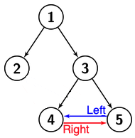

# A leaf if node.left.right == node Then solve as #104

**Author:** vokasik
**Votes:** 0
**Link:** [https://leetcode.com/problems/height-of-special-binary-tree/solutions/5019241/](https://leetcode.com/problems/height-of-special-binary-tree/solutions/5019241/)

---

This is LC [#104](https://leetcode.com/problems/maximum-depth-of-binary-tree/) with a modified leaf detection.
How to detect if a node is a leaf?



**node.left.right == node**

```
class Solution:
    def heightOfTree(self, root: Optional[TreeNode]) -> int:
        def dfs(node):
            if not node or node.left and node.left.right == node:
                return 0
            return max(dfs(node.left), dfs(node.right)) + 1            
        return dfs(root)
```
Cheers!