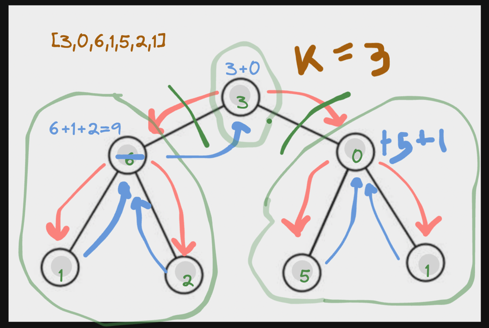

# Easy Solution | With Recursive Tree | Simple | Cpp | Java | Python | 🐍 | 🔥

**Author:** mynk28nv
**Votes:** 2
**Link:** [https://leetcode.com/problems/maximum-number-of-k-divisible-components/solutions/4114631/](https://leetcode.com/problems/maximum-number-of-k-divisible-components/solutions/4114631/)

---

# Approach

- We go to the depth of tree and and if we find it divisible by k than , we split that edge and increment our componenets
- else we merge(add the value) that componenet to its parent 
- we repeat this until our dfs calls end 




# Cpp
```
class Solution {
public:
    int maxKDivisibleComponents(int n, vector<vector<int>>& edges, vector<int>& values, int k) {
        vector<int> adj[n+1];
        for(auto it : edges){
            adj[it[0]].push_back(it[1]);
            adj[it[1]].push_back(it[0]);
        }
        int res = 0 ;
        vector<int> vis(n,0);
        vis[0]=1;
        function<int(int)> dfs = [&](int node) {
            int leaf=  values[node];
            vis[node] = 1 ;
            for(auto it : adj[node]){
                if(!vis[it])
                    leaf+=dfs(it);
            }
            if(leaf%k==0){
                res +=1 ;
                leaf  = 0 ;
            }
            return leaf ;

        };

        dfs(0);
        if(res==0) return 1 ;
        return res ;
    }
};
```

# Java

```

public class Solution {
    public int maxKDivisibleComponents(int n, int[][] edges, int[] values, int k) {
        List<Integer>[] adj = new ArrayList[n + 1];
        for (int i = 0; i <= n; i++) {
            adj[i] = new ArrayList<>();
        }

        for (int[] edge : edges) {
            adj[edge[0]].add(edge[1]);
            adj[edge[1]].add(edge[0]);
        }

        int[] vis = new int[n];
        vis[0] = 1;

        int[] res = {0}; 

        dfs(0, adj, values, k, res, vis);

        if (res[0] == 0) {
            return 1;
        }

        return res[0];
    }

    private int dfs(int node, List<Integer>[] adj, int[] values, int k, int[] res, int[] vis) {
        int leaf = values[node];
        vis[node] = 1;

        for (int it : adj[node]) {
            if (vis[it] == 0) {
                leaf += dfs(it, adj, values, k, res, vis);
            }
        }

        if (leaf % k == 0) {
            res[0]++;
            leaf = 0;
        }

        return leaf;
    }
}

```
# Python
```
class Solution:
    def maxKDivisibleComponents(self, n, edges, values, k):
        adj = [[] for _ in range(n + 1)]

        for edge in edges:
            adj[edge[0]].append(edge[1])
            adj[edge[1]].append(edge[0])

        res = [0]  

        vis = [0] * n
        vis[0] = 1

        def dfs(node):
            leaf = values[node]
            vis[node] = 1

            for it in adj[node]:
                if vis[it] == 0:
                    leaf += dfs(it)

            if leaf % k == 0:
                res[0] += 1
                leaf = 0

            return leaf

        dfs(0)

        if res[0] == 0:
            return 1

        return res[0]
```