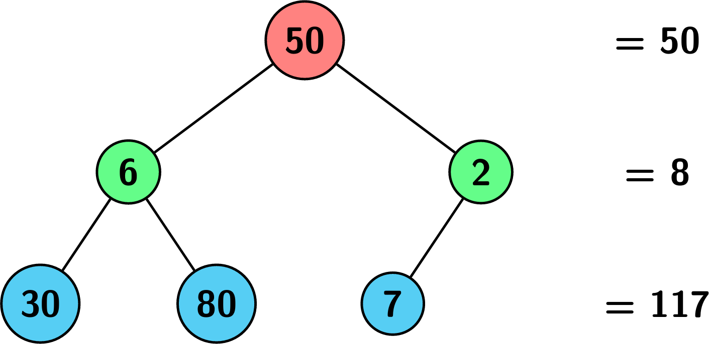
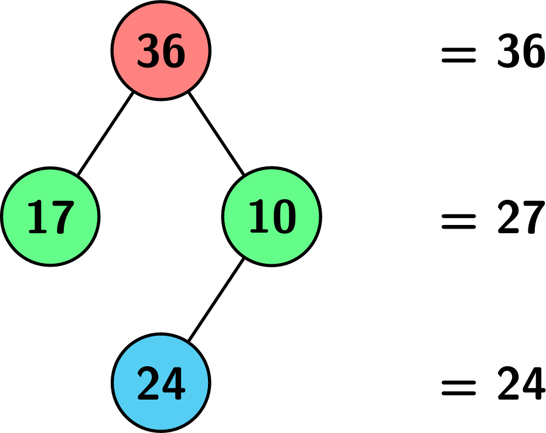
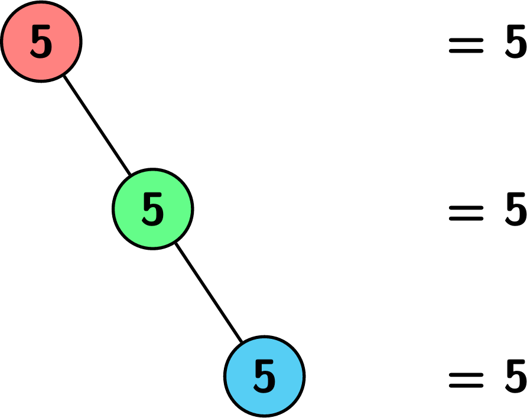

# [3157. Find the Level of Tree with Minimum Sum](https://leetcode.com/problems/find-the-level-of-tree-with-minimum-sum/)

| Category | Difficulty | Likes | Dislikes |
| :------: | :--------: | :---: | :------: |
| Algorithms | Medium | 19 | 3 |

**Tags:** [`tree`](https://leetcode.com/tag/tree), [`depth-first-search`](https://leetcode.com/tag/depth-first-search), [`breadth-first-search`](https://leetcode.com/tag/breadth-first-search), [`binary-tree`](https://leetcode.com/tag/binary-tree)

**Companies:** `microsoft`

## Description

Given the root of a binary tree `root` where each node has a value, return the level of the tree that has the **minimum** sum of values among all the levels (in case of a tie, return the **lowest** level).

**Note** that the root of the tree is at level 1 and the level of any other node is its distance from the root + 1.

 

**Example 1:**

**Input:** root = [50,6,2,30,80,7]

**Output:** 2

**Explanation:**

**Example 2:**

**Input:** root = [36,17,10,null,null,24]

**Output:** 3

**Explanation:**

**Example 3:**

**Input:** root = [5,null,5,null,5]

**Output:** 1

**Explanation:**

 

**Constraints:**

	- The number of nodes in the tree is in the range `[1, 10^5]`.

	- `1 <= Node.val <= 10^9`

---

**Links:** [Submissions](https://leetcode.com/problems/find-the-level-of-tree-with-minimum-sum/) | [Solutions](https://leetcode.com/problems/find-the-level-of-tree-with-minimum-sum/)
