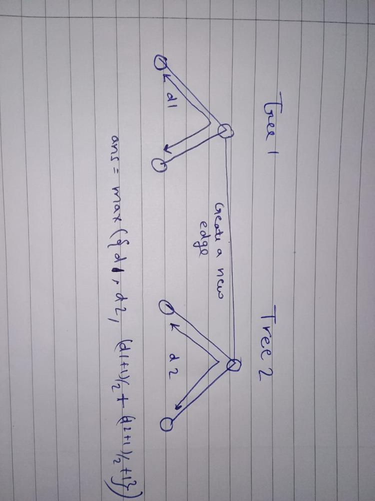

# Simple C++ | Using Diameter | 100% in Runtime and Memory

**Author:** govind70821
**Votes:** 22
**Link:** [https://leetcode.com/problems/find-minimum-diameter-after-merging-two-trees/solutions/5390023/](https://leetcode.com/problems/find-minimum-diameter-after-merging-two-trees/solutions/5390023/)

---

# Intuition
<!-- Describe your first thoughts on how to solve this problem. -->
First Find diameter of both trees and connect an edge between the mid points of two diameter. The merged tree will be the minimum diameter possible after merging two trees.
See the picture for better understanding.



# Complexity
- Time complexity: O(n+m)
<!-- Add your time complexity here, e.g. $$O(n)$$ -->


- Space complexity: O(n+m)
<!-- Add your space complexity here, e.g. $$O(n)$$ -->


# Code
```
class Solution
{
public:
    int solve(vector<vector<int>> &adj, int st, int &farn)
    {
        int n = adj.size();
        farn = st;
        vector<int> dis(n, -1);
        helper(adj, st, 0, farn,dis);
        return dis[farn];
    }

    void helper(vector<vector<int>> &adj, int node, int distance, int &farn,vector<int> &dis)
    {
        dis[node] = distance;
        if (distance > dis[farn])
            farn = node;
        for (auto it : adj[node])
            if (dis[it] == -1)
                helper(adj, it, distance + 1, farn,dis);
    }
    int minimumDiameterAfterMerge(vector<vector<int>> &nums1, vector<vector<int>> &nums2)
    {
        int n = nums1.size();
        int m = nums2.size();
        vector<vector<int>> adj1(n + 1);
        vector<vector<int>> adj2(m + 1);
        for (auto &it : nums1)
        {
            adj1[it[1]].push_back(it[0]);
            adj1[it[0]].push_back(it[1]);
        }
        for (auto &it : nums2)
        {

            adj2[it[1]].push_back(it[0]);
            adj2[it[0]].push_back(it[1]);
        }

        int far1 = 0;
        solve(adj1, 0, far1);
        int diameter1 = solve(adj1, far1, far1);

        int far2 = 0;
        solve(adj2, 0, far2);
        int diameter2 = solve(adj2, far2, far2);

        // cout<<diameter1<<" "<<diameter2<<" ";
        return max({(diameter1 + 1) / 2 + (diameter2 + 1) / 2 + 1, diameter1, diameter2});
    }
};

```