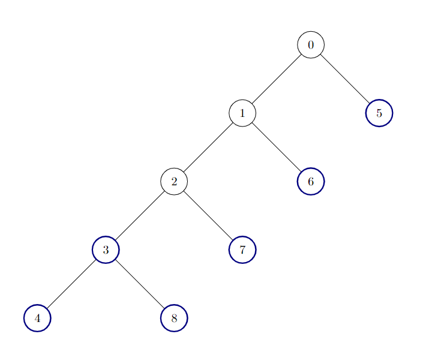

# [3249. Count the Number of Good Nodes](https://leetcode.com/problems/count-the-number-of-good-nodes/)

| Category | Difficulty | Likes | Dislikes |
| :------: | :--------: | :---: | :------: |
| Algorithms | Medium | 176 | 47 |

**Tags:** [`tree`](https://leetcode.com/tag/tree), [`depth-first-search`](https://leetcode.com/tag/depth-first-search)

## Description

There is an **undirected** tree with `n` nodes labeled from `0` to `n - 1`, and rooted at node `0`. You are given a 2D integer array `edges` of length `n - 1`, where `edges[i] = [a_i, b_i]` indicates that there is an edge between nodes `a_i` and `b_i` in the tree.

A node is **good** if all the subtrees rooted at its children have the same size.

Return the number of **good** nodes in the given tree.

A **subtree** of `treeName` is a tree consisting of a node in `treeName` and all of its descendants.

 

**Example 1:**

**Input:** edges = [[0,1],[0,2],[1,3],[1,4],[2,5],[2,6]]

**Output:** 7

**Explanation:**

All of the nodes of the given tree are good.

**Example 2:**

**Input:** edges = [[0,1],[1,2],[2,3],[3,4],[0,5],[1,6],[2,7],[3,8]]

**Output:** 6

**Explanation:**

There are 6 good nodes in the given tree. They are colored in the image above.

**Example 3:**

**Input:** edges = [[0,1],[1,2],[1,3],[1,4],[0,5],[5,6],[6,7],[7,8],[0,9],[9,10],[9,12],[10,11]]

**Output:** 12

**Explanation:**

All nodes except node 9 are good.

 

**Constraints:**

	- `2 <= n <= 10^5`

	- `edges.length == n - 1`

	- `edges[i].length == 2`

	- `0 <= a_i, b_i < n`

	- The input is generated such that `edges` represents a valid tree.

---

**Links:** [Submissions](https://leetcode.com/problems/count-the-number-of-good-nodes/) | [Solutions](https://leetcode.com/problems/count-the-number-of-good-nodes/)
