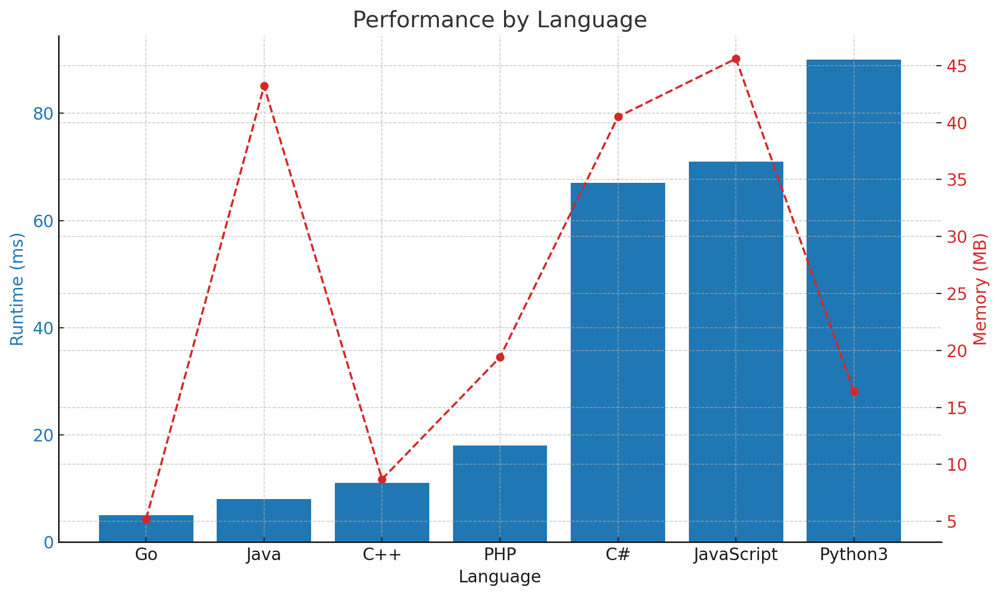

# ✅ 98.55% Manacher's algorithm

**Author:** vanAmsen
**Votes:** 62
**Link:** [https://leetcode.com/problems/longest-palindromic-substring/solutions/4212241/](https://leetcode.com/problems/longest-palindromic-substring/solutions/4212241/)

---

# Intuition
When tackling the problem of finding the longest palindromic substring, one might initially think of generating all possible substrings and checking each for palindromicity. However, this approach is inefficient. A more nuanced understanding would lead us to the realization that for each character in the string, it could potentially be the center of a palindrome. Using this intuition, we can attempt to expand around each character to check for palindromes. But how can we make sure to handle palindromes of both even and odd lengths? This is where Manacher's algorithm comes in, transforming the string in a way that we only need to handle palindromes centered around a single character.

## Live Codding & Comments
https://youtu.be/6Bq8j2dhzJc?si=zPnSjdkRaNzo5KMa

# Approach

**Manacher's Algorithm** is a powerful technique that allows us to find the longest palindromic substring in a given string in linear time. Here's a detailed breakdown of the algorithm's approach:

### 1. String Transformation
We first transform the original string to simplify the algorithm. This transformation achieves two things:
- It ensures that every potential center of a palindrome is surrounded by identical characters (`#`), which simplifies the process of expanding around a center.
- It adds special characters `^` at the beginning and `$` at the end of the string to avoid any boundary checks during the palindrome expansion.

For instance, the string `"babad"` is transformed into `"^#b#a#b#a#d#$"`.

### 2. Initialization
We maintain an array `P` with the same length as the transformed string. Each entry `P[i]` denotes the radius (half-length) of the palindrome centered at position `i`.

We also introduce two critical pointers:
- `C`: The center of the palindrome that has the rightmost boundary.
- `R`: The right boundary of this palindrome.

Both `C` and `R` start at the beginning of the string.

### 3. Iterating Through the String
For every character in the transformed string, we consider it as a potential center for a palindrome.

**a. Using Previously Computed Information**:  
If the current position is to the left of `R`, its mirror position about the center `C` might have information about a palindrome centered at the current position. We can leverage this to avoid unnecessary calculations.

**b. Expanding Around the Center**:  
Starting from the current radius at position `i` (which might be derived from its mirror or initialized to 0), we attempt to expand around `i` and check if the characters are the same.

**c. Updating `C` and `R`**:  
If the palindrome centered at `i` extends beyond `R`, we update `C` to `i` and `R` to the new boundary.

### 4. Extracting the Result
Once we've computed the palindromic radii for all positions in the transformed string, we find the position with the largest radius in `P`. This position represents the center of the longest palindromic substring. We then extract and return this palindrome from the original string.

# Complexity
- Time complexity: $O(n)$
Manacher's algorithm processes each character in the transformed string once, making the time complexity linear.

- Space complexity: $O(n)$
We use an array `P` to store the palindrome radii, making the space complexity linear as well.

# Code
``` Python []
class Solution:
    def longestPalindrome(self, s: str) -> str:
        T = '#'.join('^{}$'.format(s))
        n = len(T)
        P = [0] * n
        C = R = 0
        
        for i in range(1, n-1):
            P[i] = (R > i) and min(R - i, P[2*C - i])
            while T[i + 1 + P[i]] == T[i - 1 - P[i]]:
                P[i] += 1
            
            if i + P[i] > R:
                C, R = i, i + P[i]
      
        max_len, center_index = max((n, i) for i, n in enumerate(P))
        return s[(center_index - max_len) // 2: (center_index + max_len) // 2]
```
``` Go []
func longestPalindrome(s string) string {
    T := "^#" + strings.Join(strings.Split(s, ""), "#") + "#$"
    n := len(T)
    P := make([]int, n)
    C, R := 0, 0
    
    for i := 1; i < n-1; i++ {
        if R > i {
            P[i] = min(R-i, P[2*C-i])
        }
        for T[i+1+P[i]] == T[i-1-P[i]] {
            P[i]++
        }
        if i + P[i] > R {
            C, R = i, i + P[i]
        }
    }
    
    maxLen := 0
    centerIndex := 0
    for i, v := range P {
        if v > maxLen {
            maxLen = v
            centerIndex = i
        }
    }
    return s[(centerIndex-maxLen)/2 : (centerIndex+maxLen)/2]
}

func min(a, b int) int {
    if a < b {
        return a
    }
    return b
}
```
``` Java []
public class Solution {
    public String longestPalindrome(String s) {
        StringBuilder sb = new StringBuilder("^#");
        for (char c : s.toCharArray()) {
            sb.append(c).append("#");
        }
        sb.append("$");
        String T = sb.toString();
        
        int n = T.length();
        int[] P = new int[n];
        int C = 0, R = 0;
        
        for (int i = 1; i < n-1; i++) {
            P[i] = (R > i) ? Math.min(R - i, P[2*C - i]) : 0;
            while (T.charAt(i + 1 + P[i]) == T.charAt(i - 1 - P[i]))
                P[i]++;
            
            if (i + P[i] > R) {
                C = i;
                R = i + P[i];
            }
        }
        
        int max_len = 0, center_index = 0;
        for (int i = 0; i < n; i++) {
            if (P[i] > max_len) {
                max_len = P[i];
                center_index = i;
            }
        }
        return s.substring((center_index - max_len) / 2, (center_index + max_len) / 2);
    }
}
```
``` C++ []
class Solution {
public:
    std::string longestPalindrome(std::string s) {
        std::string T = "^#";
        for (char c : s) {
            T += c;
            T += '#';
        }
        T += "$";

        int n = T.size();
        std::vector<int> P(n, 0);
        int C = 0, R = 0;

        for (int i = 1; i < n-1; ++i) {
            P[i] = (R > i) ? std::min(R - i, P[2*C - i]) : 0;
            while (T[i + 1 + P[i]] == T[i - 1 - P[i]])
                P[i]++;

            if (i + P[i] > R) {
                C = i;
                R = i + P[i];
            }
        }

        int max_len = *std::max_element(P.begin(), P.end());
        int center_index = std::distance(P.begin(), std::find(P.begin(), P.end(), max_len));
        return s.substr((center_index - max_len) / 2, max_len);
    }
};
```
``` PHP []
class Solution {
    function longestPalindrome($s) {
        $T = "^#".implode("#", str_split($s))."#$";
        $n = strlen($T);
        $P = array_fill(0, $n, 0);
        $C = $R = 0;
        
        for ($i = 1; $i < $n-1; $i++) {
            $P[$i] = ($R > $i) ? min($R - $i, $P[2*$C - $i]) : 0;
            while ($T[$i + 1 + $P[$i]] == $T[$i - 1 - $P[$i]])
                $P[$i]++;
            
            if ($i + $P[$i] > $R) {
                $C = $i;
                $R = $i + $P[$i];
            }
        }
        
        $max_len = max($P);
        $center_index = array_search($max_len, $P);
        return substr($s, ($center_index - $max_len) / 2, $max_len);
    }
}
```
``` C# []
public class Solution {
    public string LongestPalindrome(string s) {
        string T = "^#" + string.Join("#", s.ToCharArray()) + "#$";
        int n = T.Length;
        int[] P = new int[n];
        int C = 0, R = 0;
        
        for (int i = 1; i < n-1; i++) {
            P[i] = (R > i) ? Math.Min(R - i, P[2*C - i]) : 0;
            while (T[i + 1 + P[i]] == T[i - 1 - P[i]])
                P[i]++;
            
            if (i + P[i] > R) {
                C = i;
                R = i + P[i];
            }
        }
        
        int max_len = P.Max();
        int center_index = Array.IndexOf(P, max_len);
        return s.Substring((center_index - max_len) / 2, max_len);
    }
}
```
``` JavaScript []
var longestPalindrome = function(s) {
        let T = "^#" + s.split("").join("#") + "#$";
        let n = T.length;
        let P = new Array(n).fill(0);
        let C = 0, R = 0;
        
        for (let i = 1; i < n-1; i++) {
            P[i] = (R > i) ? Math.min(R - i, P[2*C - i]) : 0;
            while (T[i + 1 + P[i]] === T[i - 1 - P[i]])
                P[i]++;
            
            if (i + P[i] > R) {
                C = i;
                R = i + P[i];
            }
        }
        
        let max_len = Math.max(...P);
        let center_index = P.indexOf(max_len);
        return s.substring((center_index - max_len) / 2, (center_index + max_len) / 2);
    }
```

# Performance
| Language   | Runtime (ms) | Memory (MB) |
|------------|--------------|-------------|
| Go         | 5            | 5.2         |
| Java       | 8            | 43.2        |
| C++        | 11           | 8.7         |
| PHP        | 18           | 19.4        |
| C#         | 67           | 40.5        |
| JavaScript | 71           | 45.6        |
| Python3    | 90           | 16.4        |




# What did we learn?
We learned about Manacher's algorithm, a linear-time solution to the longest palindromic substring problem. By transforming the string and leveraging the properties of palindromes, we can efficiently determine the longest palindrome without checking every possible substring.

# Why does it work?
Manacher's algorithm works by taking advantage of the symmetrical nature of palindromes. It avoids redundant checks by using the information from previously computed palindromes. The transformation of the string ensures that we don't need to separately handle even and odd length palindromes.

# What is the optimization here?
The brilliance of Manacher's algorithm lies in its ability to reduce the problem from quadratic to linear time. By using the palindrome information already computed and the nature of palindromes themselves, the algorithm avoids unnecessary checks, making it one of the most optimal solutions for this problem.