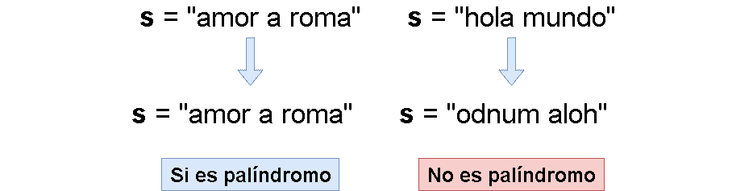

# 🔥🔥 Explicación y Resolución Del Ejercicio En Español Java | Python | PHP | C++ | JavaScript 🔥🔥

**Author:** hermescoder02
**Votes:** 4
**Link:** [https://leetcode.com/problems/valid-palindrome/solutions/4094868/](https://leetcode.com/problems/valid-palindrome/solutions/4094868/)

---

# Lectura

*Pal\xEDndromo v\xE1lido (Java, Python, PHP, C++, Javascript)*

Una frase es un pal\xEDndromo si, despu\xE9s de convertir todas las letras may\xFAsculas en min\xFAsculas y eliminar todos los caracteres no alfanum\xE9ricos, se lee igual hacia adelante y hacia atr\xE1s. Los caracteres alfanum\xE9ricos incluyen letras y n\xFAmeros.

Dada un string se busca saber si es pal\xEDndromo, si es as\xED, retorna true, si no, false



En el ejemplo se puede apreciar, que el valor de la primera frase, se lee igual hacia adelante y hacia atr\xE1s, en cambio, la segunda frase no.


# Explicaci\xF3n del ejercicio Paso por paso

https://youtu.be/cBV3As-en5c

Si te gust\xF3 el contenido \xA1visita mi canal de youtube!: 
\u2705https://www.youtube.com/@hermescoder

Si deseas profundizar m\xE1s en este tema \xA1visita mi blog!: 
\u2705https://hermescoder.com/valid-palindrome-leetcode-espanol.html

# C\xF3digo 

```Java []
public class Solution {

    public static boolean isPalindrome(String s) {
        // paso#1
        s = s.toLowerCase();

        // paso#2
        int i = 0;
        int j = s.length() - 1;

        // paso#3
        while (i < j) {
            // paso#4
            if (get(s.charAt(i))) {
                // paso#5
                while (j > i) {
                    // paso#6
                    boolean es_alfanumerico = get(s.charAt(j));

                    // paso#6.1
                    if (!es_alfanumerico) {
                        j--;
                    }

                    // paso#6.2
                    else {
                        // paso#6.2.1
                        if (s.charAt(i) != s.charAt(j)) {
                            return false;
                        }

                        // paso#6.2.2
                        if (s.charAt(i) == s.charAt(j)) {
                            break;
                        }
                    }
                }

                // paso 7
                j--;
            }

            // paso#8
            i++;
        }

        // paso#9
        return true;
    }

    private static boolean get(char c) {
        String string = "abcdefghijklmnopqrstuvwxyz0123456789";
        return string.indexOf(c) != -1;
    }
}
```
```Python []
class Solution(object):
    def isPalindrome(self, s):
        """
        Checks if a string is a palindrome.

        Args:
            s: The string to be checked.

        Returns:
            True if the string is a palindrome, False otherwise.
        """

        # paso#1
        s = s.lower()

        # paso#2
        i = 0
        j = len(s) - 1

        # paso#3
        while i < j:
            # paso#4
            if self.get(s[i]):
                # paso#5
                while j > i:
                    # paso#6
                    is_alphanumeric = self.get(s[j])

                    # paso#6.1
                    if not is_alphanumeric:
                        j -= 1

                    # paso#6.2
                    else:
                        # paso#6.2.1
                        if s[i] != s[j]:
                            return False

                        # paso#6.2.2
                        if s[i] == s[j]:
                            break

                # paso 7
                j -= 1

            # paso#8
            i += 1

        # paso#9
        return True

    def get(self, char):
        string = "abcdefghijklmnopqrstuvwxyz0123456789"
        return char in string
```
```PHP []
class Solution {

    /**
     * @param String $s
     * @return Boolean
     */
    function isPalindrome($s) {

        //paso#1
        $s=strtolower($s);  
        //paso#2    
        $i=0;
        $j=strlen($s)-1;

        //paso#3
        while($i<$j){
            //paso#4
                if($this->get($s[$i])){
                //paso#5
                while($j>$i){
                    //paso#6
                    $es_alfanumerico=$this->get($s[$j]);

                    //paso#6.1
                    if(!$es_alfanumerico) $j--;
        
                    //paso#6.2
                    else{
                        //paso#6.2.1
                        if($s[$i]!=$s[$j]) return false;
                        //paso#6.2.2
                        if ($s[$i]==$s[$j]) break;
                    }
                }
                //paso 7
                $j--;
            }
            //paso#8
            $i++;
        }
        //paso#9
        return true;
    }
    
    private function get($char){
        $string="abcdefghijklmnopqrstuvwxyz0123456789";
        if(strpos($string, $char) !== false) return true;
        return false;
    }
}
```
```C++ []
class Solution {
public:
  /**
   * Comprueba si una cadena es un pal\xEDndromo.

   * Args:
   *   s: La cadena a comprobar.

   * Returns:
   *   True si la cadena es un pal\xEDndromo, False en caso contrario.
   */
  bool isPalindrome(string s) {
    // Paso #1
    for (int i = 0; i < s.length(); i++) {
      s[i] = std::tolower(s[i]);
    }

    // Paso #2
    int i = 0;
    int j = s.length() - 1;

    // Paso #3
    while (i < j) {
      // Paso #4
      if (get(s[i])) {
        // Paso #5
        while (j > i) {
          // Paso #6
          bool is_alphanumeric = get(s[j]);

          // Paso #6.1
          if (!is_alphanumeric) {
            j--;
          }

          // Paso #6.2
          else {
            // Paso #6.2.1
            if (s[i] != s[j]) {
              return false;
            }

            // Paso #6.2.2
            if (s[i] == s[j]) {
              break;
            }
          }
        }

        // Paso #7
        j--;
      }

      // Paso #8
      i++;
    }

    // Paso #9
    return true;
  }

private:
  /**
   * Comprueba si un car\xE1cter es alfanum\xE9rico.

   * Args:
   *   char: El car\xE1cter a comprobar.

   * Returns:
   *   True si el car\xE1cter es alfanum\xE9rico, False en caso contrario.
   */
  bool get(char c) {
    const string string = "abcdefghijklmnopqrstuvwxyz0123456789";
    return string.find(c) != string.npos;
  }
};
```
```JavaScript  []
/**
 * @param {string} s
 * @return {boolean}
 */
var isPalindrome = function(s) {
    // paso #1
    s = s.toLowerCase();

    // paso #2
    let i = 0;
    let j = s.length - 1;

    // paso #3
    while (i < j) {
      // paso #4
      if (get(s[i])) {
        // paso #5
        while (j > i) {
          // paso #6
          const es_alfanumerico = get(s[j]);

          // paso #6.1
          if (!es_alfanumerico) j--;

          // paso #6.2
          else {
            // paso #6.2.1
            if (s[i] !== s[j]) return false;

            // paso #6.2.2
            if (s[i] === s[j]) break;
          }
        }

        // paso #7
        j--;
      }

      // paso #8
      i++;
    }

    // paso #9
    return true;
}

var get = function(char) {
    const string = 'abcdefghijklmnopqrstuvwxyz0123456789';
    return string.indexOf(char) !== -1;
  }

  
```


