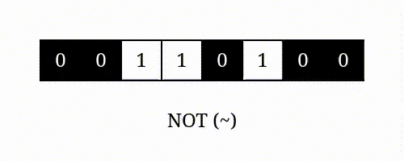

# [Python 3] Two solutions || beats 99% || 33ms

**Author:** yourick
**Votes:** 130
**Link:** [https://leetcode.com/problems/valid-palindrome/solutions/3864359/](https://leetcode.com/problems/valid-palindrome/solutions/3864359/)

---

##### Solution using operator `~`:
```python3 []
class Solution:
    def isPalindrome(self, s: str) -> bool:
        s = [c.lower() for c in s if c.isalnum()]
        return all (s[i] == s[~i] for i in range(len(s)//2))
```
###### Operator `~` is the bitwise NOT operator. It performs [logical negation](https://en.wikipedia.org/wiki/Negation) on a given number by flipping all of its bits: `~x == -x-1` , `~0 == -1`, `~1 == -2` and etc.



---


##### Solution using two pointers:
```python3 []
class Solution:
    def isPalindrome(self, s: str) -> bool:
        i, j = 0, len(s) - 1
        while i < j:
            while i < j and not s[i].isalnum(): i += 1
            while i < j and not s[j].isalnum(): j -= 1

            if s[i].lower() != s[j].lower(): return False
            i += 1
            j -= 1

        return True
```

---


#### Problems to practise using operator `~`
[344. Reverse String](https://leetcode.com/problems/reverse-string/description/)
```python3 []
class Solution:
    def reverseString(self, s: List[str]) -> None:
        for i in range(len(s)//2):
            s[i], s[~i] = s[~i], s[i]
```
[1572. Matrix Diagonal Sum](https://leetcode.com/problems/matrix-diagonal-sum/description/)
~ using to traverse by matrix antidiagonal (the second diagonal)
```python3 []
class Solution:
    def diagonalSum(self, mat: List[List[int]]) -> int:
        res = 0
        for i in range(len(mat)):
            res = res + mat[i][i] + mat[i][~i]

        if (len(mat)) % 2:
            mid = len(mat)//2
            res -= mat[mid][mid]
        
        return res
```


