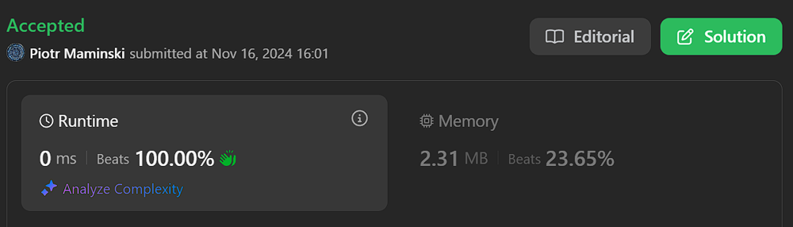

# 🚀 Video Solution | Short and Simple

**Author:** Piotr_Maminski
**Votes:** 14
**Link:** [https://leetcode.com/problems/valid-palindrome/solutions/6051745/](https://leetcode.com/problems/valid-palindrome/solutions/6051745/)

---

https://youtu.be/jJXJ16kPFWg?si=suQtyqBOhgVD4-3f

# #1 String comparison + filter(): Shorter and Faster (python,Go,JS,TS,Rust - Beats 100%))
```python3 []
class Solution:
    def isPalindrome(self, s: str) -> bool:
        s = "".join(filter(str.isalnum, s.lower()))
        return s == s[::-1]
```
```cpp []
class Solution {
public:
    bool isPalindrome(string s) {
        string filtered;
        for (char c : s) {
            if (isalnum(c)) {
                filtered += tolower(c);
            }
        }
        
        string reversed = filtered;
        reverse(reversed.begin(), reversed.end());
        return filtered == reversed;
    }
};
```
```java []
class Solution {
    public boolean isPalindrome(String s) {
        String cleanStr = s.replaceAll("[^a-zA-Z0-9]", "").toLowerCase();
        return cleanStr.equals(new StringBuilder(cleanStr).reverse().toString());
    }
}
```
```csharp []
public class Solution {
    public bool IsPalindrome(string s) {
        string cleaned = new string(s.ToLower().Where(char.IsLetterOrDigit).ToArray());
        return cleaned.SequenceEqual(cleaned.Reverse());
    }
}
```
```golang []
func isPalindrome(s string) bool {
    var cleaned strings.Builder
    for _, char := range strings.ToLower(s) {
        if unicode.IsLetter(char) || unicode.IsDigit(char) {
            cleaned.WriteRune(char)
        }
    }
    cleanedStr := cleaned.String()
    for i := 0; i < len(cleanedStr)/2; i++ {
        if cleanedStr[i] != cleanedStr[len(cleanedStr)-1-i] {
            return false
        }
    }
    return true
}
```
```swift []
class Solution {
    func isPalindrome(_ s: String) -> Bool {
        let newStr = s.lowercased().filter { $0.isLetter || $0.isNumber }
        return String(newStr) == String(newStr.reversed())
    }
}
```
```javascript [JS]
// JavaScript

var isPalindrome = function(s) {
    const newStr = s.toLowerCase().replace(/[^a-z0-9]/g, '');
    return newStr === newStr.split('').reverse().join('');
};
```
```typescript [TS]
// TypeScript

function isPalindrome(s: string): boolean {
    const newStr = s.toLowerCase().replace(/[^a-z0-9]/g, '');
    return newStr === newStr.split('').reverse().join('');
}
```
```rust []
impl Solution {
    pub fn is_palindrome(s: String) -> bool {
        let new_str: String = s.chars()
            .filter(|c| c.is_alphanumeric())
            .map(|c| c.to_ascii_lowercase())
            .collect();
        new_str == new_str.chars().rev().collect::<String>()
    }
}
```
```ruby []
def is_palindrome(s)
    new_str = s.downcase.gsub(/[^a-z0-9]/, '')
    new_str == new_str.reverse
end
```


- Complexy: Time O(n) & Space O(n) 


# #2 String comparison (from video)
```python3 []
class Solution:
    def isPalindrome(self, s: str) -> bool:
        newStr = ""

        for c in s:
            if c.isalnum():
                newStr += c.lower()
        return newStr == newStr[::-1]
```
```cpp []
class Solution {
public:
    bool isPalindrome(string s) {
        string newStr = "";
        
        for (char c : s) {
            if (isalnum(c)) {
                newStr += tolower(c);
            }
        }
        
        string reversed = newStr;
        reverse(reversed.begin(), reversed.end());
        
        return newStr == reversed;
    }
};
```
```java []
class Solution {
    public boolean isPalindrome(String s) {
        StringBuilder newStr = new StringBuilder();
        
        for (char c : s.toCharArray()) {
            if (Character.isLetterOrDigit(c)) {
                newStr.append(Character.toLowerCase(c));
            }
        }
        
        String forward = newStr.toString();
        String reverse = newStr.reverse().toString();
        
        return forward.equals(reverse);
    }
}
```
```csharp []
public class Solution {
    public bool IsPalindrome(string s) {
        string newStr = new string(s.Where(char.IsLetterOrDigit)
                                  .Select(char.ToLower)
                                  .ToArray());
        return newStr.SequenceEqual(newStr.Reverse());
    }
}
```

- Complexy: Time O(n) & Space O(n) 

# #3 Classic Two Pointers (Java,C++,Rust beats - 100%)

```python3 []
class Solution:
    def isPalindrome(self, s: str) -> bool:
        l = 0           # left
        r = len(s) - 1  # right
        
        while l < r:
            while l < r and not s[l].isalnum():
                l += 1
            while l < r and not s[r].isalnum():
                r -= 1
                
            if s[l].lower() != s[r].lower():
                return False
            l += 1
            r -= 1
            
        return True

```
```cpp []
class Solution {
public:
    bool isPalindrome(string s) {
        int l = 0;              // left
        int r = s.length() - 1; // right
        
        while (l < r) {
            while (l < r && !isalnum(s[l])) l++;
            while (l < r && !isalnum(s[r])) r--;
            
            if (tolower(s[l]) != tolower(s[r])) return false;
            l++;
            r--;
        }
        return true;
    }
};
```
```java []
class Solution {
    public boolean isPalindrome(String s) {
        int l = 0;              // left
        int r = s.length() - 1; // right
        
        while (l < r) {
            while (l < r && !Character.isLetterOrDigit(s.charAt(l))) l++;
            while (l < r && !Character.isLetterOrDigit(s.charAt(r))) r--;
            
            if (Character.toLowerCase(s.charAt(l)) != Character.toLowerCase(s.charAt(r))) return false;
            l++;
            r--;
        }
        return true;
    }
}
```
```csharp []
public class Solution {
    public bool IsPalindrome(string s) {
        int l = 0;            // left
        int r = s.Length - 1; // right
        
        while (l < r) {
            while (l < r && !char.IsLetterOrDigit(s[l])) l++;
            while (l < r && !char.IsLetterOrDigit(s[r])) r--;
            
            if (char.ToLower(s[l]) != char.ToLower(s[r])) return false;
            l++;
            r--;
        }
        return true;
    }
}
```
```golang []
func isPalindrome(s string) bool {
    l, r := 0, len(s)-1 // left, right
    
    for l < r {
        for l < r && !isAlphanumeric(s[l]) {
            l++
        }
        for l < r && !isAlphanumeric(s[r]) {
            r--
        }
        
        if strings.ToLower(string(s[l])) != strings.ToLower(string(s[r])) {
            return false
        }
        l++
        r--
    }
    return true
}

func isAlphanumeric(c byte) bool {
    return (c >= 'A' && c <= 'Z') || (c >= 'a' && c <= 'z') || (c >= '0' && c <= '9')
}
```
```swift []
class Solution {
    func isPalindrome(_ s: String) -> Bool {
        let chars = Array(s)
        var l = 0               // left
        var r = chars.count - 1 //right
        
        while l < r {
            while l < r && !chars[l].isAlphanumeric {
                l += 1
            }
            while l < r && !chars[r].isAlphanumeric {
                r -= 1
            }
            
            if chars[l].lowercased() != chars[r].lowercased() {
                return false
            }
            l += 1
            r -= 1
        }
        return true
    }
}

extension Character {
    var isAlphanumeric: Bool {
        return isLetter || isNumber
    }
}
```
```javascript [JS]
// JavaScript

var isPalindrome = function(s) {
    let l = 0;            // left
    let r = s.length - 1; // right
    
    while (l < r) {
        while (l < r && !/[a-zA-Z0-9]/.test(s[l])) l++;
        while (l < r && !/[a-zA-Z0-9]/.test(s[r])) r--;
        
        if (s[l].toLowerCase() !== s[r].toLowerCase()) return false;
        l++;
        r--;
    }
    return true;
};
```
```typescript [TS]
// TypeScript

function isPalindrome(s: string): boolean {
    let l: number = 0;              // left
    let r: number = s.length - 1;   // right
    
    while (l < r) {
        while (l < r && !isAlphanumeric(s[l])) l++;
        while (l < r && !isAlphanumeric(s[r])) r--;
        
        if (s[l].toLowerCase() !== s[r].toLowerCase()) return false;
        l++;
        r--;
    }
    return true;
}

function isAlphanumeric(char: string): boolean {
    return /[a-zA-Z0-9]/.test(char);
}
```
```rust []
impl Solution {
    pub fn is_palindrome(s: String) -> bool {
        let chars: Vec<char> = s.chars().collect();
        
        if chars.is_empty() {
            return true;
        }
        
        let mut l = 0;                  // left
        let mut r = chars.len() - 1;    // right
        
        while l < r {
            while l < r && !chars[l].is_alphanumeric() {
                l += 1;
            }
            while l < r && !chars[r].is_alphanumeric() {
                r = r.saturating_sub(1);
            }
            
            if l < r {
                if chars[l].to_ascii_lowercase() != chars[r].to_ascii_lowercase() {
                    return false;
                }
                l += 1;
                r = r.saturating_sub(1);
            }
        }
        true
    }
}
```
```ruby []
def is_palindrome(s)
    l = 0               # left
    r = s.length - 1    # right
    
    while l < r
        while l < r && !s[l].match?(/[A-Za-z0-9]/)
            l += 1
        end
        while l < r && !s[r].match?(/[A-Za-z0-9]/)
            r -= 1
        end
        
        if s[l].downcase != s[r].downcase
            return false
        end
        l += 1
        r -= 1
    end
    true
end
```

- Complexy: Time O(n) & Space O(1) 


---


# Most common String Interview Problems
List based on my research (interviews, reddit, github) Probably not 100% accurate but very close to my recruitments. Leetcode Premium is probably more accurate [I don't have]

**Easy:** [[20. Valid Parentheses]](https://leetcode.com/problems/valid-parentheses/solutions/6013115/solution) [[28. Find the Index of the First Occurrence in a String]](https://leetcode.com/problems/find-the-index-of-the-first-occurrence-in-a-string) [[13. Roman to Integer]](https://leetcode.com/problems/roman-to-integer/solutions/6021029/beats-100-explained-step-by-step-list-most-common-string-interview-problems/) [[125. Valid Palindrome]](https://leetcode.com/problems/valid-palindrome/solutions/6051745/video-solution-short-and-simple) [[680. Valid Palindrome II]](https://leetcode.com/problems/valid-palindrome-ii/solutions/6049559/short) [[67. Add Binary]](https://leetcode.com/problems/add-binary)


**Medium/Hard:** [[8. String to Integer (atoi)]](https://leetcode.com/problems/string-to-integer-atoi/solutions/6013112/solution/) [[3. Longest Substring Without Repeating Characters]](https://leetcode.com/problems/longest-substring-without-repeating-characters/solutions/6013106/solutions/) [[5. Longest Palindromic Substring]](https://leetcode.com/problems/longest-palindromic-substring/solutions/6013111/solution/) [[937. Reorder Data in Log Files]](https://leetcode.com/problems/reorder-data-in-log-files) [[68. Text Justification]](https://leetcode.com/problems/text-justification) [[32. Longest Valid Parentheses]](https://leetcode.com/problems/longest-valid-parentheses) [[12. Integer to Roman]](https://leetcode.com/problems/integer-to-roman/solutions/6023402/solutions) [[22. Generate Parentheses]](https://leetcode.com/problems/generate-parentheses) [[65. Valid Number]](https://leetcode.com/problems/valid-number) [[49. Group Anagrams]](https://leetcode.com/problems/group-anagrams)



