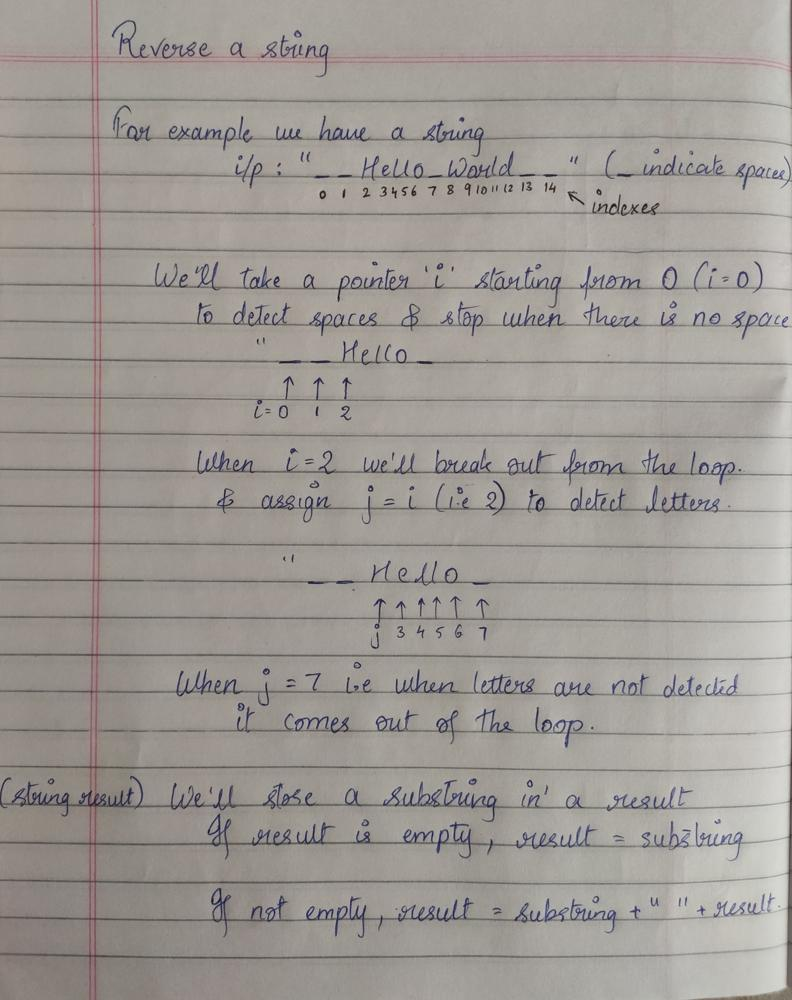

# C++ Solution || Understandable for Beginners

**Author:** shaikhhafsa25
**Votes:** 132
**Link:** [https://leetcode.com/problems/reverse-words-in-a-string/solutions/1666108/](https://leetcode.com/problems/reverse-words-in-a-string/solutions/1666108/)

---



```
string reverseWords(string s) {
        string result;
        int i = 0, n = s.length();
        
        while(i < n){
			//to detect spaces and ignore them
            while(i < n && s[i] == ' ') i++;
            
            if(i >= n) break;
            
            int j = i;
            
			//to detect characters and break when we detect any space
            while(j < n && s[j] != ' ') j++;
            
			//to take out the first word
            string sub = s.substr(i, j-i);
            
            if(result.length() == 0) result = sub;
            
            else result = sub + " " + result;
            
            i = j+1;
        }
        
        return result;
```
If you understood and liked this solution encourage me by giving me a vote up :)