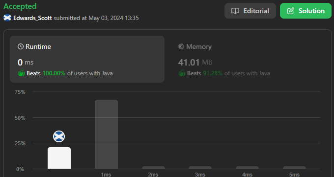

# ☠💀💯 Faster✅💯 Lesser🧠 🎯 C++✅Python3✅Java✅C✅Python✅C#✅💥🔥💫Explained☠💥🔥 Beats 💯

**Author:** Edwards310
**Votes:** 7
**Link:** [https://leetcode.com/problems/compare-version-numbers/solutions/5105384/](https://leetcode.com/problems/compare-version-numbers/solutions/5105384/)

---

# Intuition



```C++ []
class Solution {
public:
    int compareVersion(string version1, string version2) {
        int i = 0, j = 0;
        int len1 = version1.length(), len2 = version2.length();
        int num1 = 0, num2 = 0;
        while (i < len1 or j < len2) {
            while (i < len1 and version1.at(i) != '.')
                num1 = num1 * 10 + (version1.at(i++) - '0');
            while (j < len2 and version2.at(j) != '.')
                num2 = num2 * 10 + (version2.at(j++) - '0');

            if (num1 > num2)
                return 1;
            else if (num1 < num2)
                return -1;
            num1 = 0, num2 = 0;
            if (i < len1)
                i++;
            if (j < len2)
                j++;
        }
        return 0;
    }
};
```
```python3 []
class Solution:
    def compareVersion(self, version1: str, version2: str) -> int:
        i = j = 0
        n1 , n2 = len(version1) , len(version2)
        num1 = num2 = 0
        while i < n1 or j < n2:
            while i < n1 and version1[i] != '.':
                num1 = num1 * 10 + (ord(version1[i]) - ord('0'))
                i += 1
            while j < n2 and version2[j] != '.':
                num2 = num2 * 10 + (ord(version2[j]) - ord('0'))
                j += 1
            if num1 > num2:
                return 1
            elif num1 < num2:
                return -1
            num1 = 0
            num2 = 0
            if i < n1:
                i += 1
            if j < n2:
                j += 1
        return 0
```
```C []
int compareVersion(char* version1, char* version2) {
    int i = 0, j = 0;
    int len1 = strlen(version1), len2 = strlen(version2);
    int num1 = 0, num2 = 0;
    while (i < len1 || j < len2) {
        while (i < len1 && version1[i] != '.')
            num1 = num1 * 10 + (version1[i++] - '0');
        while (j < len2 && version2[j] != '.')
            num2 = num2 * 10 + (version2[j++] - '0');

        if (num1 > num2)
            return 1;
        else if (num1 < num2)
            return -1;
        num1 = 0, num2 = 0;
        if (i < len1)
            i++;
        if (j < len2)
            j++;
    }
    return 0;
}
```
```Java []
class Solution {
    public int compareVersion(String version1, String version2) {
        int i = 0, j = 0;
        int len1 = version1.length(), len2 = version2.length();
        int num1 = 0, num2 = 0;
        while (i < len1 || j < len2) {
            while (i < len1 && version1.charAt(i) != '.')
                num1 = num1 * 10 + (version1.charAt(i++) - '0');
            while (j < len2 && version2.charAt(j) != '.')
                num2 = num2 * 10 + (version2.charAt(j++) - '0');

            if (num1 > num2)
                return 1;
            else if (num1 < num2)
                return -1;
            num1 = 0;
            num2 = 0;
            if (i < len1)
                i++;
            if (j < len2)
                j++;
        }
        return 0;
    }
}
```
```python []
class Solution(object):
    def compareVersion(self, version1, version2):
        """
        :type version1: str
        :type version2: str
        :rtype: int
        """
        version1 = version1.split('.')
        version2 = version2.split('.')
        ml = min(len(version1), len(version2))
        for i in range(ml):
            v1 = int(version1[i])
            v2 = int(version2[i])
            if v1 < v2:
                return -1
            elif v1 > v2:
                return 1
        version = version1 if len(version1) - ml > 0 else version2
        v = 1 if len(version1) - ml > 0 else 2
        for i in range(ml, len(version)):
            if int(version[i]) > 0:
                return 1 if v == 1 else -1 
        return 0
```
```C# []
public class Solution {
    public int CompareVersion(string version1, string version2) {
        int i = 0, j = 0;
        int len1 = version1.Length, len2 = version2.Length;
        int num1 = 0, num2 = 0;
        while (i < len1 || j < len2) {
            while (i < len1 && version1[i] != '.')
                num1 = num1 * 10 + (version1[i++] - '0');
            while (j < len2 && version2[j] != '.')
                num2 = num2 * 10 + (version2[j++] - '0');

            if (num1 > num2)
                return 1;
            else if (num1 < num2)
                return -1;
            num1 = 0;
            num2 = 0;
            if (i < len1)
                i++;
            if (j < len2)
                j++;
        }
        return 0;
    }
}
```
<!-- Describe your first thoughts on how to solve this problem. -->

# Approach
<!-- Describe your approach to solving the problem. -->

# Complexity
- Time complexity:
<!-- Add your time complexity here, e.g. $$O(n)$$ -->
     O(n * n)
- Space complexity:
<!-- Add your space complexity here, e.g. $$O(n)$$ -->
     O(1)
# Code
```
class Solution {
public:
    int compareVersion(string version1, string version2) {
        int i = 0, j = 0;
        int len1 = version1.length(), len2 = version2.length();
        int num1 = 0, num2 = 0;
        while (i < len1 or j < len2) {
            while (i < len1 and version1.at(i) != '.')
                num1 = num1 * 10 + (version1.at(i++) - '0');
            while (j < len2 and version2.at(j) != '.')
                num2 = num2 * 10 + (version2.at(j++) - '0');

            if (num1 > num2)
                return 1;
            else if (num1 < num2)
                return -1;
            num1 = 0, num2 = 0;
            if (i < len1)
                i++;
            if (j < len2)
                j++;
        }
        return 0;
    }
};
```
# Please upvote if it'a helpful for you 

