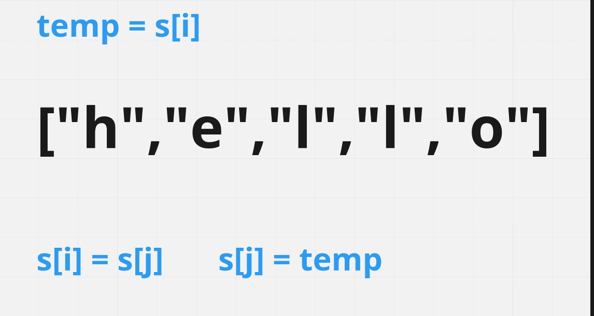
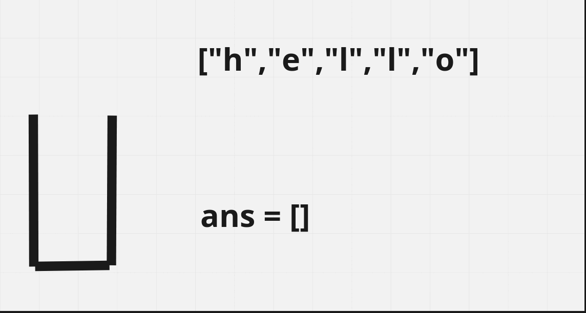

# [Java/C++] 3-Way's Visual Solution

**Author:** hi-malik
**Votes:** 198
**Link:** [https://leetcode.com/problems/reverse-string/solutions/1901756/](https://leetcode.com/problems/reverse-string/solutions/1901756/)

---

How's going Ladies - n - Gentlemen today we are going to solve another coolest problem i.e. **Reverse String**

```
This is A way easy Problem, if you encounter this in your Technical Interview, belive me you are way more lucky <^^> 
```

So, to solve this problem there are couple of ways to do that.
```
We gonna solve this problem in 3 simple & effective way's 
```
**1. Two Pointer's**

**`Visuall EXPLANATION :-`**




**Java**
```
class Solution {
    public void reverseString(char[] s) {
        int i = 0;
        int j = s.length - 1;
        
        while(i <= j){
            char temp = s[i];
            s[i] = s[j];
            s[j] = temp;
            i++;
            j--;
        }
    }
}
```
**C++**
```
class Solution {
public:
    void reverseString(vector<char>& s) {
        int i = 0;
        int j = s.size() - 1;
        
        while(i <= j){
            char temp = s[i];
            s[i] = s[j];
            s[j] = temp;
            i++;
            j--;
        }
    }
};
```

ANALYSIS :-
* **Time Complexity :-** BigO(N)

* **Space Complexity :-** BigO(1)

**2. Recursive Call**

Explanation is same as Two Pointer's what only different happening is, we are solve this using our fucntion call every time. We are just doing the work to reverse only **1 time** first & last element, rest one we are not worrying about!! Because recursion will do that for us :)

**Java**
```
class Solution {
    public void reverseString(char[] s) {
        int i = 0;
        int j = s.length - 1;
        solve(s, i, j);
    }
    public void solve(char[] s, int i, int j){
        if(i >= j) return;
        char temp = s[i];
        s[i] = s[j];
        s[j] = temp;
        solve(s, ++i, --j);
    }
}
```
**C++**
```
class Solution {
public:
    void reverseString(vector<char>& s) {
        int i = 0;
        int j = s.size() - 1;
        solve(s, i, j);
    }
    void solve(vector<char>& s, int i, int j){
        if(i >= j) return;
        char temp = s[i];
        s[i] = s[j];
        s[j] = temp;
        solve(s, ++i, --j);
    }
};
```

ANALYSIS :-
* **Time Complexity :-** BigO(N)

* **Space Complexity :-** BigO(N)

**3. Stack**

**`Visuall EXPLANATION :-`**




**Java**
```
class Solution {
    public void reverseString(char[] s) {
        Stack<Character> st = new Stack<>();
        String str = new String(s);
        for(int i = 0; i < str.length(); i++){
            st.push(s[i]);
        }
        char ans[] = new char[s.length];
        int i = 0;
        while(st.size() > 0){
            s[i++] = st.pop();
        }
        for(int j = 0; j < str.length(); j++){
            ans[j] = str.charAt(j);
        }
    }
}
```
**C++**
```
class Solution {
public:
    void reverseString(vector<char>& s) {
        //create a stack
        stack<char> st;
        //loop through the string, to add all the string elements in stack
        for(int i=0;i<s.size();i++){
            //create a variable to add the values
            char ch = s[i];
            st.push(ch);
        }
        //empty the original string
        s.clear();
        //add the stack elements to the string
        while(!st.empty()){
            char ch = st.top();
            //reversed
            s.push_back(ch);
            st.pop();
        }
    }
};
```

ANALYSIS :-
* **Time Complexity :-** BigO(N)

* **Space Complexity :-** BigO(N)