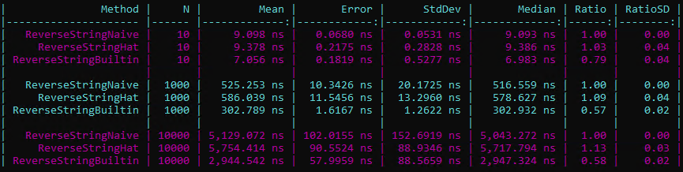

# Naive approach vs Hat vs Array.Reverse with benchmark results

**Author:** anikit
**Votes:** 12
**Link:** [https://leetcode.com/problems/reverse-string/solutions/1902861/](https://leetcode.com/problems/reverse-string/solutions/1902861/)

---

The easiest way is to use the built-in method `Reverse`:
```csharp
public class Solution
{
    public void ReverseString(char[] s)
    {
        Array.Reverse(s);
    }
}
```
The naive approach would to use one or two pointers and a `for` or a `while` loop. Please note that there is no need to introduce a temp variable for swapping values - use tuples instead. Here is an example:
```csharp
public class Solution
{
    public void ReverseString(char[] s)
    {
        int len = s.Length;
        for (int i = 0; i < len / 2; i++)
        {
            (s[i], s[len - 1 - i]) = (s[len - 1 - i], s[i]);
        }
    }
}
```
Readability can be somewhat improved by using the hat operator `^`:
```csharp
public class Solution
{
    public void ReverseString(char[] s)
    {
        for (int i = 1; i <= s.Length / 2; i++)
        {
            (s[i - 1], s[^i]) = (s[^i], s[i - 1]);
        }
    }
}
```
`^1` refers to the last element of an array, `^2` is the one before that, etc. More about the hat operator and ranges here: https://docs.microsoft.com/en-us/dotnet/csharp/language-reference/proposals/csharp-8.0/ranges

Benchmark results on arrays of three different sizes. The built-in method is the fastest:

