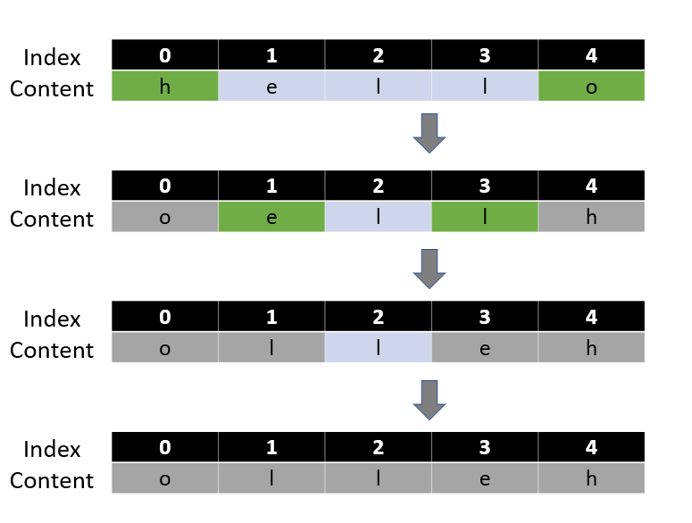

# Python/JS/Java/Go/C++ sol sharing [w/ Visualization]

**Author:** brianchiang_tw
**Votes:** 78
**Link:** [https://leetcode.com/problems/reverse-string/solutions/669726/](https://leetcode.com/problems/reverse-string/solutions/669726/)

---

Several solution sharing

---

**Illustartion**&**Visualization**:



---

**Implementation** by mirror image:

Python
```
class Solution:
    def reverseString(self, s: List[str]) -> None:
       
        size = len(s)
		
		# reverse string by mirror image
        for i in range(size//2):
            s[i], s[-i-1] = s[-i-1], s[i]
```


---


C++
<details>
	<summary> Click to show source code
	</summary>
	
```
class Solution {
public:
    void reverseString(vector<char>& s) {
        
        size_t n = s.size();
        
		// reverse string by mirror image
        for( size_t i = 0; i < n/2 ; i ++){
		
            swap(s[i], s[n-1-i]);            
        }
        
        return;
    }
};
```	
	
</details>

---

Golang:

<details>
	<summary> Click to show source code
	</summary>
	
```
func reverseString(s []byte)  {
    
    size := len(s)
    
    // reverse string by mirror image
    for i := 0 ; i < size/2 ; i++{
        s[i], s[size-1-i] = s[size-1-i], s[i]
    }
    
    return
    
}
```	
	
</details>


---

Java:

<details>
	<summary> Click to show source code
	</summary>

```
class Solution {
    public void reverseString(char[] s) {
        
        int n = s.length;
        
		// reverse string by mirror image
        for( int i = 0; i < n/2 ; i ++){
		
            char temp = s[i];
            s[i] = s[n-1-i];
            s[n-1-i] = temp;
        }
        
        return;
    }
}
```
</details>

---

Javascript:

<details>
	<summary> Click to show source code
	</summary>
	
```
var reverseString = function(s) {
    
    let size = s.length;
    
    // reverse string by mirror image
    for(let i = 0 ; i < Math.floor(size/2) ; i++ ){
        [ s[i], s[size-1-i] ] = [ s[size-1-i], s[i] ] ;
    }
    
    return;
};
```	
	
</details>


---

**Implementation** by two pointers:

Python
```
class Solution:
    def reverseString(self, s: List[str]) -> None:            
        
		# one points to head position, the other points to tail position
        left, right = 0, len(s)-1
        
		# reverse string by two pointers
        while left < right:
            
            s[left], s[right] = s[right], s[left]
            
            left,right = left+1, right-1
```

---

C++

<details>
	<summary>Click to show source code
	</summary>

```
class Solution {
public:
    void reverseString(vector<char>& s) {
        
        // one points to head position, the other points to tail position
        size_t left = 0, right = s.size()-1;
        
        // reverse string by two pointers
        while( left < right ){
            
            swap(s[left], s[right]);            
            
            left += 1;
            right -= 1;
        }
        
        return;
    }
};
```

</details>

---

Go:

<details>
	<summary>Click to show source code
	</summary>

```
func reverseString(s []byte)  {
    
    // one points to head position, the other points to tail position
    left, right := 0, len(s)-1
    
    // reverse string by two pointers
    for left < right{
        
        s[left], s[right] = s[right], s[left]

        left,right = left+1, right-1
    }
    
    return
    
}
```

</details>

---

Java:


<details>
	<summary>Click to show source code
	</summary>
	
```

class Solution {
    public void reverseString(char[] s) {
        
        // one points to head position, the other points to tail position
        int left = 0, right = s.length-1;
        
        // reverse string by two pointers
        while( left < right ){
            
            char temp = s[left];
            s[left] = s[right];            
            s[right] = temp;
            
            left += 1;
            right -= 1;
        }
        
        return;
    }
}
```	
	
	
</details>

---

Javascript:


<details>
	<summary>Click to show source code
	</summary>

```
var reverseString = function(s) {
    
    // one points to head position, the other points to tail position
    let [left, right] = [0, s.length-1];
    
    // reverse string by two pointers
    while( left < right ){
        [ s[left], s[right] ] = [ s[right], s[left] ];
        
        left += 1;
        right -= 1;
    }
     
    return;
};
```

</details>


---

**Implementation** by recursion:

Python

```
class Solution:
    def reverseString(self, s: List[str]) -> None:            

        def helper( left:int, right:int, string: List[str]):     
            
            if left >= right:
                # base case
                return
            
            # general case
            s[left], s[right] = s[right], s[left]
            
            helper( left+1, right-1, s)
        # ------------------------------------------------
        
        helper( left = 0, right = len(s)-1, string = s)
```

---

C++
<details>
	<summary> Click to show source code
	</summary>
	
```
class Solution {
public:
    void reverseString(vector<char>& s) {
        
        
        helper(0, s.size()-1, s);
        
        return;
    }
    
private:
    void helper(int left, int right, vector<char>& s){
        
        if( left > right ){
            // base case aka stop condition
            return ;
        }
        
        // general cases
        swap( s[left], s[right] );
        helper(left+1, right-1, s);
        
        return;
    }
    
};
```	
	
</details>

---

Go:

<details>
	<summary> Click to show source code
	</summary>
	
```

func reverseString(s []byte)  {

    
    var helper func( int, int)
    
    helper = func( left int, right int){
    
        if left >= right{
            // base case aka stop condition
            return
        }
        
        // general case
        // swap character 
        s[left], s[right] = s[right], s[left]
        
        helper(left+1, right-1)
        return
    }
    
    
    helper(0, len(s)-1)
    
    return
    
}
```	
	
</details>

---

Javascript:

<details>
	<summary> Click to show source code
	</summary>
	
```

var reverseString = function(s) {
    
    function helper(left, right){
        
        // base case aka stop condition
        if( left >= right){      
            return;
        }
        
        // general cases
        [ s[left], s[right] ] = [ s[right], s[left] ];
        
        helper(left+1, right-1);
        return;
    };
     
    helper( left=0, right=s.length-1 );
    return;
};
```	
	
</details>


---