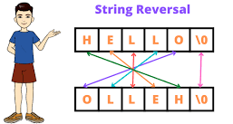

# 2 Easy Interview Approaches ✅ || Brute Force🔥|| Optimised using two Pointers💯 ||  Beat 💯

**Author:** naman_malik
**Votes:** 5
**Link:** [https://leetcode.com/problems/reverse-string/solutions/5242912/](https://leetcode.com/problems/reverse-string/solutions/5242912/)

---


# Approach 
<!-- Describe your approach to solving the problem. -->
Brute Force Approach 
# Complexity
- Time complexity: O(N)
<!-- Add your time complexity here, e.g. $$O(n)$$ -->

- Space complexity: O(N)
<!-- Add your space complexity here, e.g. $$O(n)$$ -->

# Code
```C++ []
class Solution {
public:
    void reverseString(vector<char>& s) {

        int n = s.size()-1;
        vector<char> v;

        for(int i=n; i>=0; i--)
        {
            v.push_back(s[i]);
        }
        for(int i=0; i<=n; i++)
        {
            s[i]=v[i];
        }
    }
}; 
```
```java []
class Solution {
    public void reverseString(char[] s) {
        int n = s.length - 1;
        char[] v = new char[s.length];

        for (int i = n; i >= 0; i--) {
            v[n - i] = s[i];
        }
        for (int i = 0; i <= n; i++) {
            s[i] = v[i];
        }
    }
}

```
```python []
class Solution(object):
    def reverseString(self, s):
        n = len(s) - 1
        v = []

        for i in range(n, -1, -1):
            v.append(s[i])
        for i in range(n + 1):
            s[i] = v[i]

```
# Intuition 2


# Approach 2
<!-- Describe your approach to solving the problem. -->
Optimised Approach - using two pointers
# Complexity
- Time complexity: O(logN)
<!-- Add your time complexity here, e.g. $$O(n)$$ -->

- Space complexity: O(1)
<!-- Add your space complexity here, e.g. $$O(n)$$ -->

# Code
```C++ []
class Solution {
public:
    void reverseString(vector<char>& s) {

        int n = s.size()-1;

        for(int i=0; i<n/2; i++)
        {
            swap(s[i],s[n-i]);
        }
    }
}; 
```
```java []
class Solution {
    public void reverseString(char[] s) {
        int n = s.length - 1;

        for (int i = 0; i < n / 2; i++) {
            char temp = s[i];
            s[i] = s[n - i];
            s[n - i] = temp;
        }
    }
}


```
```python []
class Solution(object):
    def reverseString(self, s):

        n = len(s) - 1

        for i in range(n // 2 + 1):
            s[i], s[n - i] = s[n - i], s[i]


```


