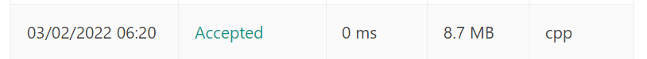
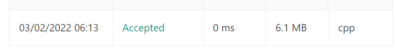

# [C++] || Recursion and Two pointer

**Author:** 4byx
**Votes:** 330
**Link:** [https://leetcode.com/problems/is-subsequence/solutions/1811177/](https://leetcode.com/problems/is-subsequence/solutions/1811177/)

---

```
1. Both Approaches are 100% faster
2. Approach
The idea is simple, we traverse both strings from one side to another side 
(say from rightmost character to leftmost). If we find a matching character
, we move ahead in both strings. Otherwise, we move ahead only in t. 
```

* **Code 1**
```
class Solution {
public:
    bool isSubsequence(string s, string t) {
        int n = s.length(),m=t.length();
        int j = 0; 
    // For index of s (or subsequence
 
    // Traverse s and t, and
    // compare current character
    // of s with first unmatched char
    // of t, if matched
    // then move ahead in s
    for (int i = 0; i < m and j < n; i++)
        if (s[j] == t[i])
            j++;
 
    // If all characters of s were found in t
    return (j == n);
    }
};

```



* **Code 2**
```
class Solution {
    int isSubSequence(string& s1, string& s2, int i, int j)
{
    if (i == 0 || j == 0) {
        return 0;
    }
    if (s1[i - 1] == s2[j - 1]) {
        return  1 + isSubSequence(s1, s2, i - 1, j - 1);
    }
    else {
        return  isSubSequence(s1, s2, i, j - 1);
    }
}
 
public:
    bool isSubsequence(string s, string t) {
         int m = s.size();
    int n = t.size();
    if (m > n) {
        return false;
    }
    if (isSubSequence(s, t, m, n) == m) {
        return true;
    }
    else {
        return false;
    }
    }
};

```



