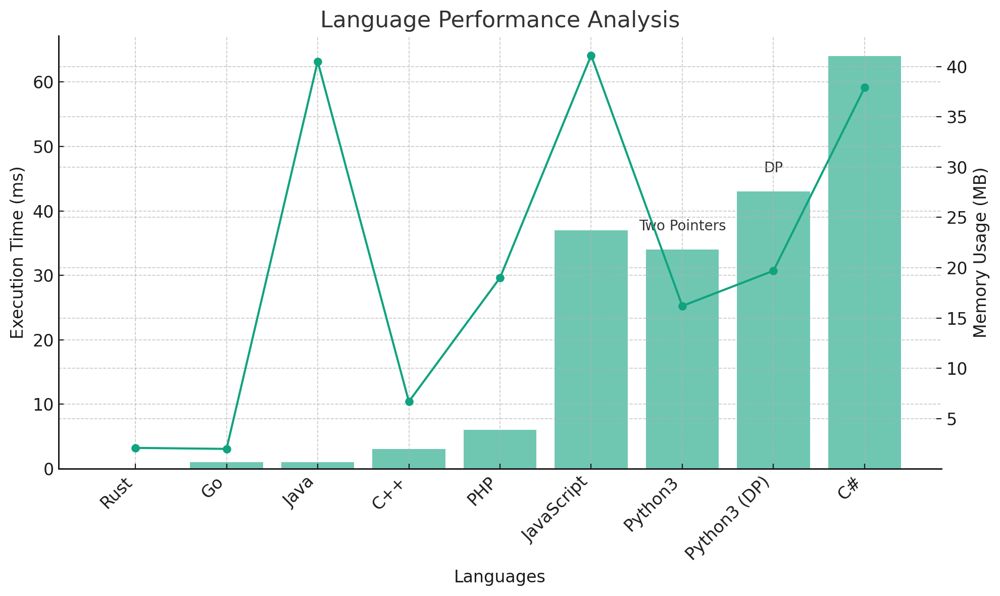

# ✅ 93.76% Two Pointers & DP

**Author:** vanAmsen
**Votes:** 149
**Link:** [https://leetcode.com/problems/is-subsequence/solutions/4074367/](https://leetcode.com/problems/is-subsequence/solutions/4074367/)

---

# Explanation of the "Is Subsequence" Problem and Solutions

## Introduction & Problem Statement

Given two strings, `s` and `t`, the challenge is to determine if `s` is a subsequence of `t`. A subsequence of a string is a new string generated from the original string with some characters (can be none) deleted without changing the relative order of the remaining characters.

## Key Concepts:

### What Makes This Problem Unique?

1. **String Constraints**:  
    - The length of `s` can range from 0 to 100.
    - The length of `t` can vary between 0 and 10,000.
    - Both `s` and `t` consist only of lowercase English letters.

2. **Solution Techniques**:  
    This problem can be approached using various techniques, including iterative (two-pointers) methods and dynamic programming.

---

# Strategy to Solve the Problem:

## Live Coding Two Pointers
https://youtu.be/gg7hnmSmhkw?si=Bqtwz-8skqwiP8YJ

### Two Pointers Approach:

The two-pointers technique is an iterative approach that uses two indices, one for each string. The idea is to traverse the longer string `t` and whenever a character matches the current character of string `s`, the index for `s` is moved to the right.

#### Key Data Structures:

- `i` and `j`: Two pointers initialized to 0. `i` is used for string `s` and `j` for string `t`.

#### Enhanced Breakdown:

1. **Traverse and Match**:
   - Traverse string `t` using pointer `j`.
   - If the current character of `t` matches the current character of `s`, increment `i`.
   - Continue until the end of string `t` or until all characters of `s` are found in `t`.

2. **Check Subsequence**:
   - At the end of traversal, if `i` is equal to the length of `s`, then `s` is a subsequence of `t`.

#### Complexity Analysis:

**Time Complexity**: 
- The algorithm traverses the string `t` once, resulting in a time complexity of $$ O(\	ext{len}(t)) $$.

**Space Complexity**: 
- Constant space is used, leading to a space complexity of $$ O(1) $$.

# Code Two Pointers
``` Python []
class Solution:
    def isSubsequence(self, s: str, t: str) -> bool:
        i, j = 0, 0
        while i < len(s) and j < len(t):
            if s[i] == t[j]:
                i += 1
            j += 1
        return i == len(s)
```
``` Go []
func isSubsequence(s string, t string) bool {
    i, j := 0, 0
    for i < len(s) && j < len(t) {
        if s[i] == t[j] {
            i++
        }
        j++
    }
    return i == len(s)
}
```
``` Rust []
impl Solution {
    pub fn is_subsequence(s: String, t: String) -> bool {
        let mut i = 0;
        let mut j = 0;
        let s_chars: Vec<char> = s.chars().collect();
        let t_chars: Vec<char> = t.chars().collect();
        
        while i < s.len() && j < t.len() {
            if s_chars[i] == t_chars[j] {
                i += 1;
            }
            j += 1;
        }
        i == s.len()
    }
}
```
``` C++ []
class Solution {
public:
    bool isSubsequence(std::string s, std::string t) {
        int i = 0, j = 0;
        while (i < s.size() && j < t.size()) {
            if (s[i] == t[j]) {
                i++;
            }
            j++;
        }
        return i == s.size();
    }
};
```
``` Java []
public class Solution {
    public boolean isSubsequence(String s, String t) {
        int i = 0, j = 0;
        while (i < s.length() && j < t.length()) {
            if (s.charAt(i) == t.charAt(j)) {
                i++;
            }
            j++;
        }
        return i == s.length();
    }
}
```
``` JavaScript []
/**
 * @param {string} s
 * @param {string} t
 * @return {boolean}
 */
var isSubsequence = function(s, t) {
        let i = 0, j = 0;
        while (i < s.length && j < t.length) {
            if (s[i] === t[j]) {
                i++;
            }
            j++;
        }
        return i === s.length;
    }
```
``` PHP []
class Solution {
    public function isSubsequence($s, $t) {
        $i = 0;
        $j = 0;
        while ($i < strlen($s) && $j < strlen($t)) {
            if ($s[$i] == $t[$j]) {
                $i++;
            }
            $j++;
        }
        return $i == strlen($s);
    }
}
```
``` C# []
public class Solution {
    public bool IsSubsequence(string s, string t) {
        int i = 0, j = 0;
        while (i < s.Length && j < t.Length) {
            if (s[i] == t[j]) {
                i++;
            }
            j++;
        }
        return i == s.Length;
    }
}
```

---

### Dynamic Programming Approach:

For the dynamic programming solution, the idea is to preprocess string `t` to understand the next occurrence of every character after each position. This approach is particularly useful when there are numerous subsequences to be checked against `t`, as it can check each subsequence in linear time.

#### Key Data Structures:

- `nxt`: A list of dictionaries to store the next occurrence of every character after each position in `t`.

#### Enhanced Breakdown:

1. **Preprocess string `t`**:
   - Create a list of dictionaries `nxt` to store the next occurrence of every character after each position in `t`.
   - Traverse string `t` in reverse. For each position, copy the next position's dictionary and update the current character's next occurrence.

2. **Check Subsequence**:
   - Traverse string `s` and for each character, check its next occurrence in `t` using the `nxt` list.
   - If any character of `s` doesn't have a next occurrence in `t`, return False. Otherwise, continue.

#### Complexity Analysis:

**Time Complexity** (for checking one subsequence `s`): 
- The algorithm traverses the string `s` once, resulting in a time complexity of $$ O(\	ext{len}(s)) $$.

**Space Complexity**: 
- The algorithm creates a list of dictionaries `nxt` of size $$ \	ext{len}(t) $$, leading to a space complexity of $$ O(\	ext{len}(t)) $$.


# Code Dynamic Programming
``` Python []
class Solution:
    def isSubsequence(self, s: str, t: str) -> bool:
        nxt = [{} for _ in range(len(t) + 1)]
        for i in range(len(t) - 1, -1, -1):
            nxt[i] = nxt[i + 1].copy()
            nxt[i][t[i]] = i + 1
        
        i = 0
        for c in s:
            if c in nxt[i]:
                i = nxt[i][c]
            else:
                return False
        return True
```

## Performance

| Language   | Execution Time (ms) | Memory Usage | Technique |
|------------|---------------------|--------------|-----------|
| Rust       | 0                   | 2.1 MB       | Two Pointers |
| Go         | 1                   | 2 MB         | Two Pointers |
| Java       | 1                   | 40.5 MB      | Two Pointers |
| C++        | 3                   | 6.7 MB       | Two Pointers |
| PHP        | 6                   | 19 MB        | Two Pointers |
| JavaScript | 37                  | 41.1 MB      | Two Pointers |
| Python3    | 34                  | 16.2 MB      | Two Pointers |
| Python3 (DP) | 43               | 19.7 MB      | DP |
| C#         | 64                  | 37.9 MB      | Two Pointers |




## Conclusion

Both strategies provided here tackle the problem effectively. The two-pointers approach is straightforward and intuitive, making it easy to implement and understand. The dynamic programming approach, on the other hand, is more sophisticated but offers the advantage of efficiently checking multiple subsequences against a single string `t`. Depending on the scenario, one can choose the appropriate strategy to solve the problem.