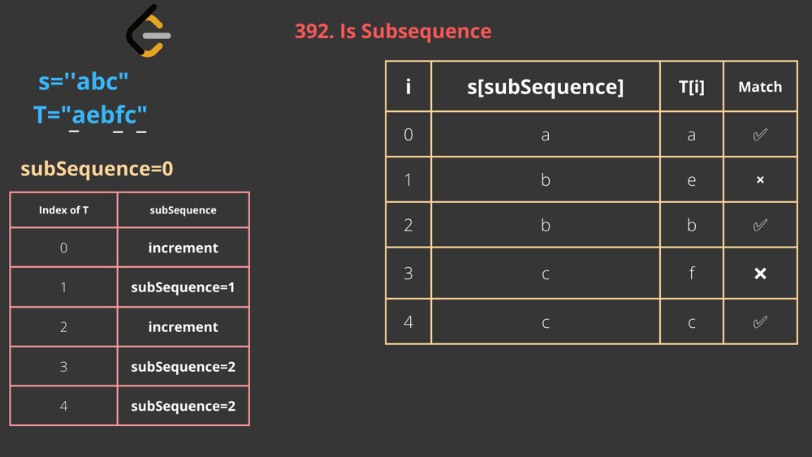

# [Python , Javascript]  Easy solution with very clear Explanation

**Author:** mageshyt
**Votes:** 662
**Link:** [https://leetcode.com/problems/is-subsequence/solutions/1811508/](https://leetcode.com/problems/is-subsequence/solutions/1811508/)

---


**Please dont downvote guys if cannot support,We are putting lot of effort in it\uD83D\uDE42**

```
Question asking us to return true if s is a subsequence of t, or false otherwise.

Example:
    s='code'
    t='leetcode'
    here s is subsequence of t ,we can get code from leetcode.


What is subsequence and subString?
    Subsequence: a sequence that appears in the same relative order, but not necessarily contiguous.
    SubString: a contiguous sequence of symbols that appears in the same relative order as the original string.
  
  
  Big O:
    Time: O(n) # n is the length of t
    Space: O(1)
```





`JavaScript`

```
const isSubsequence = (s, t) => {
  //! Edge case
  if (s.length > t.length) return false; //! if len of s is greater than len of t, return false because s cant be a subsequence of t
  `
  Example:
    s='Leetcode'
    t='Code'
    here we are trying to find if 'Leetcode' is a subsequence of 'Code' which is not possible because 'Leetcode' is longer than 'Code'

  `;
  const t_length = t.length;
  let subsequence = 0;
  for (let i = 0; i < t_length; i++) {
    if (s[subsequence] === t[i]) {
      // ! if it is matching, increment subsequence
      subsequence++;
    }
  }
  return subsequence === s.length
};
```

`Python`

```
class Solution:
    def isSubsequence(self, s: str, t: str) -> bool:
        if len(s) > len(t):return False
        if len(s) == 0:return True
        subsequence=0
        for i in range(0,len(t)):
            if subsequence <= len(s) -1:
                print(s[subsequence])
                if s[subsequence]==t[i]:

                    subsequence+=1
        return  subsequence == len(s) 
```


`UPVOTE if you like \uD83D\uDE03 , If you have any question, feel free to ask.
`