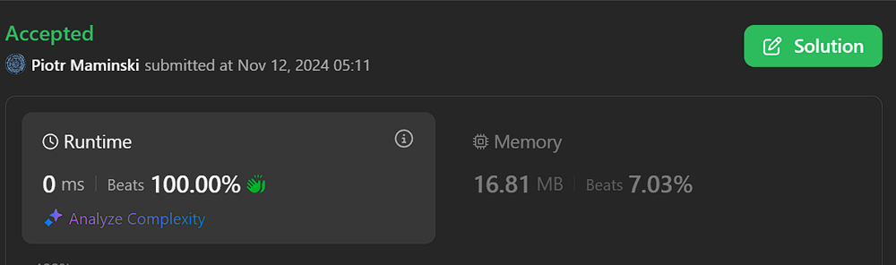

# ✅Beats 100% | Video | Short and Simple✅

**Author:** Piotr_Maminski
**Votes:** 0
**Link:** [https://leetcode.com/problems/valid-word-abbreviation/solutions/6041533/](https://leetcode.com/problems/valid-word-abbreviation/solutions/6041533/)

---

# Upvote if I should write premium solutions and if anyone reads them. That way I will know.



https://youtu.be/Sut-F029biM?si=jfemOFVPupQwVPsf


# Short Version, Same Logic (Beats 100%)


```python3 []
class Solution(object):
    def validWordAbbreviation(self, word, abbr):
        i = j = 0
        while i < len(word) and j < len(abbr):
            if abbr[j].isdigit():
                if abbr[j] == '0': return False
                num = 0
                while j < len(abbr) and abbr[j].isdigit():
                    num = num * 10 + int(abbr[j])
                    j += 1
                i += num
            else:
                if word[i] != abbr[j]: return False
                i += 1
                j += 1
        return i == len(word) and j == len(abbr)


```
```cpp []
class Solution {
public:
    bool validWordAbbreviation(string word, string abbr) {
        int i = 0, j = 0;
        while (i < word.length() && j < abbr.length()) {
            if (isdigit(abbr[j])) {
                if (abbr[j] == '0') return false;
                int num = 0;
                while (j < abbr.length() && isdigit(abbr[j])) {
                    num = num * 10 + (abbr[j] - '0');
                    j++;
                }
                i += num;
            } else {
                if (word[i] != abbr[j]) return false;
                i++;
                j++;
            }
        }
        return i == word.length() && j == abbr.length();
    }
};
```
```java []
class Solution {
    public boolean validWordAbbreviation(String word, String abbr) {
        int i = 0, j = 0;
        while (i < word.length() && j < abbr.length()) {
            if (Character.isDigit(abbr.charAt(j))) {
                if (abbr.charAt(j) == '0') return false;
                int num = 0;
                while (j < abbr.length() && Character.isDigit(abbr.charAt(j))) {
                    num = num * 10 + (abbr.charAt(j) - '0');
                    j++;
                }
                i += num;
            } else {
                if (word.charAt(i) != abbr.charAt(j)) return false;
                i++;
                j++;
            }
        }
        return i == word.length() && j == abbr.length();
    }
}
```
```csharp []
public class Solution {
    public bool ValidWordAbbreviation(string word, string abbr) {
        int i = 0, j = 0;
        while (i < word.Length && j < abbr.Length) {
            if (char.IsDigit(abbr[j])) {
                if (abbr[j] == '0') return false;
                int num = 0;
                while (j < abbr.Length && char.IsDigit(abbr[j])) {
                    num = num * 10 + (abbr[j] - '0');
                    j++;
                }
                i += num;
            } else {
                if (word[i] != abbr[j]) return false;
                i++;
                j++;
            }
        }
        return i == word.Length && j == abbr.Length;
    }
}
```
```golang []
func validWordAbbreviation(word string, abbr string) bool {
    i, j := 0, 0
    for i < len(word) && j < len(abbr) {
        if abbr[j] >= '0' && abbr[j] <= '9' {
            if abbr[j] == '0' {
                return false
            }
            num := 0
            for j < len(abbr) && abbr[j] >= '0' && abbr[j] <= '9' {
                num = num * 10 + int(abbr[j] - '0')
                j++
            }
            i += num
        } else {
            if word[i] != abbr[j] {
                return false
            }
            i++
            j++
        }
    }
    return i == len(word) && j == len(abbr)
}
```
```swift []
class Solution {
    func validWordAbbreviation(_ word: String, _ abbr: String) -> Bool {
        let word = Array(word)
        let abbr = Array(abbr)
        var i = 0, j = 0
       
        while i < word.count && j < abbr.count {
            if abbr[j].isNumber {
                if abbr[j] == "0" { return false }
                var num = 0
                while j < abbr.count && abbr[j].isNumber {
                    num = num * 10 + Int(String(abbr[j]))!
                    j += 1
                }
                i += num
            } else {
                if word[i] != abbr[j] { return false }
                i += 1
                j += 1
            }
        }
        return i == word.count && j == abbr.count
    }
}
```
```javascript [JS]
// JavaScript


var validWordAbbreviation = function(word, abbr) {
    let i = 0, j = 0;
   
    while (i < word.length && j < abbr.length) {
        if (/\\d/.test(abbr[j])) {
            if (abbr[j] === '0') return false;
            let num = 0;
            while (j < abbr.length && /\\d/.test(abbr[j])) {
                num = num * 10 + Number(abbr[j]);
                j++;
            }
            i += num;
        } else {
            if (word[i] !== abbr[j]) return false;
            i++;
            j++;
        }
    }
    return i === word.length && j === abbr.length;
};
```
```typescript [TS]
// TypeScript


function validWordAbbreviation(word: string, abbr: string): boolean {
    let i = 0, j = 0;
    while (i < word.length && j < abbr.length) {
        if (/\\d/.test(abbr[j])) {
            if (abbr[j] === '0') return false;
            let num = 0;
            while (j < abbr.length && /\\d/.test(abbr[j])) {
                num = num * 10 + parseInt(abbr[j]);
                j++;
            }
            i += num;
        } else {
            if (word[i] !== abbr[j]) return false;
            i++;
            j++;
        }
    }
    return i === word.length && j === abbr.length;
}
```
```rust []
impl Solution {
    pub fn valid_word_abbreviation(word: String, abbr: String) -> bool {
        let word = word.as_bytes();
        let abbr = abbr.as_bytes();
        let mut i = 0;
        let mut j = 0;
       
        while i < word.len() && j < abbr.len() {
            if abbr[j].is_ascii_digit() {
                if abbr[j] == b'0' { return false; }
                let mut num = 0;
                while j < abbr.len() && abbr[j].is_ascii_digit() {
                    num = num * 10 + (abbr[j] - b'0') as usize;
                    j += 1;
                }
                i += num;
            } else {
                if word[i] != abbr[j] { return false; }
                i += 1;
                j += 1;
            }
        }
        i == word.len() && j == abbr.len()
    }
}
```
```ruby []
def valid_word_abbreviation(word, abbr)
    i = j = 0
   
    while i < word.length && j < abbr.length
        if abbr[j] =~ /\\d/
            return false if abbr[j] == '0'
            num = 0
            while j < abbr.length && abbr[j] =~ /\\d/
                num = num * 10 + abbr[j].to_i
                j += 1
            end
            i += num
        else
            return false if word[i] != abbr[j]
            i += 1
            j += 1
        end
    end
   
    i == word.length && j == abbr.length
end


```


# Clean Code (Beats 100%)
```python3 []
class Solution:
    def validWordAbbreviation(self, word: str, abbreviation: str) -> bool:
        word_pos = abbr_pos = 0
       
        while abbr_pos < len(abbreviation) and word_pos < len(word):
            if abbreviation[abbr_pos].isalpha():
                if abbreviation[abbr_pos] != word[word_pos]:
                    return False
                word_pos += 1
                abbr_pos += 1
            else:
                # Handle numeric abbreviation
                if abbreviation[abbr_pos] == '0':
                    return False
                   
                skip_count = self._parse_number(abbreviation, abbr_pos)
                abbr_pos += len(str(skip_count))
                word_pos += skip_count
               
        return abbr_pos == len(abbreviation) and word_pos == len(word)
   
    def _parse_number(self, abbreviation: str, start_pos: int) -> int:
        """Extract number from abbreviation starting at given position."""
        number = 0
        while (start_pos < len(abbreviation) and
               abbreviation[start_pos].isdigit()):
            number = number * 10 + int(abbreviation[start_pos])
            start_pos += 1
        return number
```
```cpp []
class Solution {
private:
    int parseNumber(const string& abbreviation, int startPos) {
        int number = 0;
        while (startPos < abbreviation.length() && isdigit(abbreviation[startPos])) {
            number = number * 10 + (abbreviation[startPos] - '0');
            startPos++;
        }
        return number;
    }
    
public:
    bool validWordAbbreviation(string word, string abbreviation) {
        int wordPos = 0, abbrPos = 0;
        
        while (abbrPos < abbreviation.length() && wordPos < word.length()) {
            if (isalpha(abbreviation[abbrPos])) {
                if (abbreviation[abbrPos] != word[wordPos]) {
                    return false;
                }
                wordPos++;
                abbrPos++;
            } else {
                if (abbreviation[abbrPos] == '0') {
                    return false;
                }
                
                int skipCount = parseNumber(abbreviation, abbrPos);
                abbrPos += to_string(skipCount).length();
                wordPos += skipCount;
            }
        }
        
        return abbrPos == abbreviation.length() && wordPos == word.length();
    }
};
```
```java []
class Solution {
    private int parseNumber(String abbreviation, int startPos) {
        int number = 0;
        while (startPos < abbreviation.length() && 
               Character.isDigit(abbreviation.charAt(startPos))) {
            number = number * 10 + (abbreviation.charAt(startPos) - '0');
            startPos++;
        }
        return number;
    }
    
    public boolean validWordAbbreviation(String word, String abbreviation) {
        int wordPos = 0, abbrPos = 0;
        
        while (abbrPos < abbreviation.length() && wordPos < word.length()) {
            if (Character.isLetter(abbreviation.charAt(abbrPos))) {
                if (abbreviation.charAt(abbrPos) != word.charAt(wordPos)) {
                    return false;
                }
                wordPos++;
                abbrPos++;
            } else {
                if (abbreviation.charAt(abbrPos) == '0') {
                    return false;
                }
                
                int skipCount = parseNumber(abbreviation, abbrPos);
                abbrPos += String.valueOf(skipCount).length();
                wordPos += skipCount;
            }
        }
        
        return abbrPos == abbreviation.length() && wordPos == word.length();
    }
}
```
```csharp []
public class Solution {
    private int ParseNumber(string abbreviation, int startPos) {
        int number = 0;
        while (startPos < abbreviation.Length && char.IsDigit(abbreviation[startPos])) {
            number = number * 10 + (abbreviation[startPos] - '0');
            startPos++;
        }
        return number;
    }
    
    public bool ValidWordAbbreviation(string word, string abbreviation) {
        int wordPos = 0, abbrPos = 0;
        
        while (abbrPos < abbreviation.Length && wordPos < word.Length) {
            if (char.IsLetter(abbreviation[abbrPos])) {
                if (abbreviation[abbrPos] != word[wordPos]) {
                    return false;
                }
                wordPos++;
                abbrPos++;
            } else {
                if (abbreviation[abbrPos] == '0') {
                    return false;
                }
                
                int skipCount = ParseNumber(abbreviation, abbrPos);
                abbrPos += skipCount.ToString().Length;
                wordPos += skipCount;
            }
        }
        
        return abbrPos == abbreviation.Length && wordPos == word.Length;
    }
}
```
```golang []
func parseNumber(abbreviation string, startPos int) int {
    number := 0
    for startPos < len(abbreviation) && unicode.IsDigit(rune(abbreviation[startPos])) {
        number = number * 10 + int(abbreviation[startPos] - '0')
        startPos++
    }
    return number
}

func validWordAbbreviation(word string, abbreviation string) bool {
    wordPos, abbrPos := 0, 0
    
    for abbrPos < len(abbreviation) && wordPos < len(word) {
        if unicode.IsLetter(rune(abbreviation[abbrPos])) {
            if abbreviation[abbrPos] != word[wordPos] {
                return false
            }
            wordPos++
            abbrPos++
        } else {
            if abbreviation[abbrPos] == '0' {
                return false
            }
            
            skipCount := parseNumber(abbreviation, abbrPos)
            abbrPos += len(strconv.Itoa(skipCount))
            wordPos += skipCount
        }
    }
    
    return abbrPos == len(abbreviation) && wordPos == len(word)
}
```
```swift []
class Solution {
    private func parseNumber(_ abbreviation: String, _ startPos: Int) -> Int {
        var number = 0
        var pos = startPos
        let chars = Array(abbreviation)
        while pos < chars.count && chars[pos].isNumber {
            number = number * 10 + Int(String(chars[pos]))!
            pos += 1
        }
        return number
    }
    
    func validWordAbbreviation(_ word: String, _ abbreviation: String) -> Bool {
        var wordPos = 0
        var abbrPos = 0
        let wordChars = Array(word)
        let abbrChars = Array(abbreviation)
        
        while abbrPos < abbrChars.count && wordPos < wordChars.count {
            if abbrChars[abbrPos].isLetter {
                if abbrChars[abbrPos] != wordChars[wordPos] {
                    return false
                }
                wordPos += 1
                abbrPos += 1
            } else {
                if abbrChars[abbrPos] == "0" {
                    return false
                }
                
                let skipCount = parseNumber(abbreviation, abbrPos)
                abbrPos += String(skipCount).count
                wordPos += skipCount
            }
        }
        
        return abbrPos == abbrChars.count && wordPos == wordChars.count
    }
}
```
```javascript [JS]
// JavaScript

var validWordAbbreviation = function(word, abbreviation) {
    function parseNumber(abbreviation, startPos) {
        let number = 0;
        while (startPos < abbreviation.length && /\\d/.test(abbreviation[startPos])) {
            number = number * 10 + parseInt(abbreviation[startPos]);
            startPos++;
        }
        return number;
    }
    
    let wordPos = 0, abbrPos = 0;
    
    while (abbrPos < abbreviation.length && wordPos < word.length) {
        if (/[a-zA-Z]/.test(abbreviation[abbrPos])) {
            if (abbreviation[abbrPos] !== word[wordPos]) {
                return false;
            }
            wordPos++;
            abbrPos++;
        } else {
            if (abbreviation[abbrPos] === '0') {
                return false;
            }
            
            const skipCount = parseNumber(abbreviation, abbrPos);
            abbrPos += String(skipCount).length;
            wordPos += skipCount;
        }
    }
    
    return abbrPos === abbreviation.length && wordPos === word.length;
};


```
```typescript [TS]
// TypeScript

function parseNumber(abbreviation: string, startPos: number): number {
    let number = 0;
    while (startPos < abbreviation.length && /\\d/.test(abbreviation[startPos])) {
        number = number * 10 + parseInt(abbreviation[startPos]);
        startPos++;
    }
    return number;
}

function validWordAbbreviation(word: string, abbreviation: string): boolean {
    let wordPos = 0, abbrPos = 0;
    
    while (abbrPos < abbreviation.length && wordPos < word.length) {
        if (/[a-zA-Z]/.test(abbreviation[abbrPos])) {
            if (abbreviation[abbrPos] !== word[wordPos]) {
                return false;
            }
            wordPos++;
            abbrPos++;
        } else {
            if (abbreviation[abbrPos] === '0') {
                return false;
            }
            
            const skipCount = parseNumber(abbreviation, abbrPos);
            abbrPos += skipCount.toString().length;
            wordPos += skipCount;
        }
    }
    
    return abbrPos === abbreviation.length && wordPos === word.length;
}
```
```rust []
impl Solution {
    fn parse_number(abbreviation: &str, start_pos: usize) -> u32 {
        let mut number = 0;
        let chars: Vec<char> = abbreviation.chars().collect();
        let mut pos = start_pos;
        while pos < chars.len() && chars[pos].is_digit(10) {
            number = number * 10 + chars[pos].to_digit(10).unwrap();
            pos += 1;
        }
        number
    }
    
    pub fn valid_word_abbreviation(word: String, abbreviation: String) -> bool {
        let word_chars: Vec<char> = word.chars().collect();
        let abbr_chars: Vec<char> = abbreviation.chars().collect();
        let mut word_pos = 0;
        let mut abbr_pos = 0;
        
        while abbr_pos < abbr_chars.len() && word_pos < word_chars.len() {
            if abbr_chars[abbr_pos].is_alphabetic() {
                if abbr_chars[abbr_pos] != word_chars[word_pos] {
                    return false;
                }
                word_pos += 1;
                abbr_pos += 1;
            } else {
                if abbr_chars[abbr_pos] == '0' {
                    return false;
                }
                
                let skip_count = Self::parse_number(&abbreviation, abbr_pos) as usize;
                abbr_pos += skip_count.to_string().len();
                word_pos += skip_count;
            }
        }
        
        abbr_pos == abbr_chars.len() && word_pos == word_chars.len()
    }
}
```
```ruby []
def parse_number(abbreviation, start_pos)
    number = 0
    while start_pos < abbreviation.length && abbreviation[start_pos].match?(/\\d/)
        number = number * 10 + abbreviation[start_pos].to_i
        start_pos += 1
    end
    number
end

def valid_word_abbreviation(word, abbreviation)
    word_pos = abbr_pos = 0
    
    while abbr_pos < abbreviation.length && word_pos < word.length
        if abbreviation[abbr_pos].match?(/[a-zA-Z]/)
            return false if abbreviation[abbr_pos] != word[word_pos]
            word_pos += 1
            abbr_pos += 1
        else
            return false if abbreviation[abbr_pos] == '0'
            
            skip_count = parse_number(abbreviation, abbr_pos)
            abbr_pos += skip_count.to_s.length
            word_pos += skip_count
        end
    end
    
    abbr_pos == abbreviation.length && word_pos == word.length
end
```


### Complexity
- Time complexity: O(n)


- Space complexity: O(1)

# I'll expand if someone even reads it.
# Have a nice day! <3


